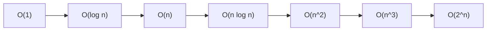

# 01 - Time Complexity

Learn how to measure how the cost of an algorithm grows as its input grows, using Big O notation. All ten programs count "steps" so you can see the growth with your own eyes.

## Table of Contents
- [A. Topic Introduction](#a-topic-introduction)
- [B. Core Concepts](#b-core-concepts)
- [C. How It Works](#c-how-it-works)
- [D. Time and Space Complexity](#d-time-and-space-complexity)
- [E. Problems for Practice](#e-problems-for-practice)
- [F. Installation Requirements](#f-installation-requirements)
- [G. How to Run the Files](#g-how-to-run-the-files)
- [H. Revision Notes](#h-revision-notes)

---

## A. Topic Introduction

**What it is.** Time complexity describes how the number of basic steps an algorithm performs grows when the input size `n` grows. Space complexity does the same for extra memory. We write it with Big O notation, for example `O(n)` or `O(n^2)`.

**Why it matters in DSA.** Two programs can give the same answer, yet one finishes in a blink and the other takes hours on big data. Complexity is the common language used to compare solutions, and every interviewer asks "what is the time and space complexity?".

**Where it is used.** Choosing between a database index lookup and a full table scan, deciding whether a loop over a million Eloquent records is safe, designing search features, sorting large reports, and avoiding timeouts in APIs.

**Everyday analogy.** Finding a name in a phone book:
- Reading every page from the start is linear, `O(n)`.
- Opening the middle and discarding half each time is logarithmic, `O(log n)`.
- Comparing every person with every other person to find twins is quadratic, `O(n^2)`.

If you know Laravel: `$collection->first()` is `O(1)`, `$collection->contains()` is `O(n)`, and a `foreach` inside a `foreach` over the same collection is `O(n^2)`.

---

## B. Core Concepts

| Term | Meaning |
|------|---------|
| Input size `n` | The quantity that grows (items in a list, digits of a number, ...). |
| Step / basic operation | One comparison, assignment or arithmetic action. |
| Big O `O(...)` | Upper bound on growth (usually the worst case). |
| Omega `Omega(...)` | Lower bound (usually the best case). |
| Theta `Theta(...)` | Tight bound (growth is the same from above and below). |
| Best / average / worst case | Cheapest, typical and most expensive input of the same size. |
| Space complexity | Extra memory used, not counting the input itself. |

**Rules for simplifying Big O**
1. Drop constants: `3n` and `n + 50` are both `O(n)`.
2. Keep only the fastest-growing term: `n^2 + n` is `O(n^2)`.
3. Sequential blocks add: `O(n) + O(n)` is `O(n)`.
4. Nested blocks multiply: a loop of `n` inside a loop of `n` is `O(n * n)`.
5. Halving the problem each step gives `log n`.

**Growth picture (steps for n = 16)**

```text
O(1)        |#                                  1
O(log n)    |####                               4
O(n)        |################                   16
O(n log n)  |################################################################  64
O(n^2)      |(256 steps - off the chart)
O(2^n)      |(65,536 steps - off the chart)
```

**Common classes from fast to slow**



---

## C. How It Works

**Dry run 1: counting a nested loop**

```text
for i in range(n):          # runs n times
    for j in range(n):      # runs n times for every i
        count += 1
```

| n | steps (n * n) |
|---|---------------|
| 4 | 16 |
| 8 | 64 |
| 16 | 256 |

Doubling `n` makes the work four times bigger, so it is `O(n^2)`.

**Dry run 2: a triangle loop (inner loop starts at `i`)**

For `n = 4` the inner loop runs 4 + 3 + 2 + 1 = 10 times, which is `n(n+1)/2`. Dropping the constant 1/2 gives `O(n^2)`.

**Dry run 3: halving**

`n = 16 -> 8 -> 4 -> 2 -> 1` takes 4 halvings, which is `log2(16)`. A loop whose variable doubles (`i = 1, 2, 4, 8, ...`) also runs `log n` times.

**Dry run 4: why naive Fibonacci explodes**

```text
fib(4)
 |-- fib(3)
 |    |-- fib(2)
 |    |    |-- fib(1)
 |    |    `-- fib(0)
 |    `-- fib(1)
 `-- fib(2)            <- fib(2) is computed AGAIN
      |-- fib(1)
      `-- fib(0)
```

Every call spawns two more, giving roughly `2^n` calls. Remembering answers (memoization) means each value is computed once, so the cost drops to `O(n)`.

---

## D. Time and Space Complexity

| Class | Name | Typical example | n = 1,000 means about |
|-------|------|-----------------|-----------------------|
| O(1) | Constant | Index into a list | 1 step |
| O(log n) | Logarithmic | Binary search | 10 steps |
| O(n) | Linear | Scan a list once | 1,000 steps |
| O(n log n) | Linearithmic | Merge sort | 10,000 steps |
| O(n^2) | Quadratic | Compare every pair | 1,000,000 steps |
| O(n^3) | Cubic | Three nested loops | 1,000,000,000 steps |
| O(2^n) | Exponential | Naive Fibonacci | more than atoms in the universe |

**Space complexity examples**

| Technique | Extra space |
|-----------|-------------|
| Swap two ends of a list in place | O(1) |
| Build a reversed copy | O(n) |
| Recursion of depth n | O(n) stack |
| Set of seen values | O(n) |

---

## E. Problems for Practice

| No | Title | Difficulty | Concept | Python File |
|----|-------|------------|---------|-------------|
| 1 | Constant Time Operations | Easy | O(1) operations and step counting | `01_constant_time.py` |
| 2 | Linear Time Operations | Easy | O(n) single loop | `02_linear_time.py` |
| 3 | Quadratic Time Operations | Easy | O(n^2) nested loops, pair counting | `03_quadratic_time.py` |
| 4 | Logarithmic Time with Binary Search | Easy | O(log n), halving | `04_logarithmic_time.py` |
| 5 | Linearithmic Time with Merge Sort | Medium | O(n log n), divide and merge | `05_linearithmic_time.py` |
| 6 | Analysing Nested Loops | Medium | Reading loops and deriving Big O | `06_nested_loops_analysis.py` |
| 7 | Best, Average and Worst Case | Medium | Case analysis of linear search | `07_best_average_worst_case.py` |
| 8 | Exponential Time: Naive Fibonacci vs Memoization | Medium | O(2^n) versus O(n), caching | `08_exponential_time_fibonacci.py` |
| 9 | Space Complexity | Medium | O(1) versus O(n) extra memory | `09_space_complexity.py` |
| 10 | Comparing Complexities | Medium | Growth table, three duplicate detectors | `10_comparing_complexities.py` |

### Problem 1 - Constant Time Operations (`01_constant_time.py`)
**Statement.** Write functions that take a fixed number of steps no matter how long the list is: read the first element, check if a number is even, swap the first and last elements, and compute `1 + 2 + ... + n` with a formula. Each function should also return the number of steps it used. Add a loop version of the sum to contrast.

**Example.**
```text
n = 10: first element = 0, steps = 1
        formula sum = 55, steps = 3
        loop sum    = 55, steps = 10
get_first_element([]) -> (None, 1)
```
**Constraints / edge cases.** Empty list must not crash; one-element list; `n = 0`.

**Hints.**
- Indexing a list is a direct jump, not a search.
- The sum `1..n` has a closed form involving `n * (n + 1)`; division by 2 must stay an integer.
- Count steps yourself with a variable; compare the formula version with the loop version for growing `n`.

### Problem 2 - Linear Time Operations (`02_linear_time.py`)
**Statement.** Write `sum_of_list`, `count_evens` and `linear_search`, each returning its answer plus the number of loop iterations. Show that a list twice as long needs twice the steps.

**Example.**
```text
numbers = [4, 7, 1, 9, 2, 8, 6]
sum_of_list -> (37, 7)    count_evens -> (4, 7)
linear_search(9) -> (3, 4)    linear_search(100) -> (-1, 7)
```
**Constraints / edge cases.** Empty list (sum 0, search -1), target missing, target at index 0.

**Hints.**
- One `for` loop and one counter are enough.
- Search may stop early; the sum and count may not.
- Return a pair (answer, steps).

### Problem 3 - Quadratic Time Operations (`03_quadratic_time.py`)
**Statement.** Given a list, (a) count all ordered pairs `(i, j)`, (b) count unordered pairs whose sum equals a target, (c) detect a duplicate by comparing every pair. Report comparisons.

**Example.**
```text
numbers = [3, 8, 2, 5, 7, 1], target = 9
ordered pairs steps: 36
pairs with sum 9: (2, 15)       # 2 pairs found in 15 comparisons
duplicates in [4, 1, 4]: (True, 2)
```
**Constraints / edge cases.** Lists of size 0 or 1 have no pairs; a pair must use two different positions.

**Hints.**
- For unordered pairs let the inner loop start just after the outer index.
- The number of unordered pairs is `n * (n - 1) / 2`.
- Return as soon as a duplicate is seen, but count what you did.

### Problem 4 - Logarithmic Time with Binary Search (`04_logarithmic_time.py`)
**Statement.** Search a target in a sorted list with binary search and count the steps. Also count how many times `n` can be halved before reaching 1, and compare for `n = 8, 1024, 1000000`.

**Example.**
```text
list = [2, 5, 8, 12, 16, 23, 38, 56, 72, 91]
search 23 -> (5, 3)    search 50 -> (-1, 4)
n = 1000000: halvings = 19, binary search steps = 20
```
**Constraints / edge cases.** Empty list; target smaller than first or larger than last; unsorted input gives meaningless output.

**Hints.**
- Keep two bounds and inspect the middle index.
- If the middle is too small, move the lower bound past it; otherwise move the upper bound before it.
- Stop when the bounds cross.

### Problem 5 - Linearithmic Time with Merge Sort (`05_linearithmic_time.py`)
**Statement.** Sort a list with a hand-written merge sort and count comparisons. Compare the count with `n * log2(n)` for several sizes.

**Example.**
```text
input : [38, 27, 43, 3, 9, 82, 10]
sorted: [3, 9, 10, 27, 38, 43, 82]
comparisons: 13
```
**Constraints / edge cases.** Empty and one-element lists; already sorted and reversed lists; duplicates (take from the left half first to stay stable). Do not use `sorted()` for the actual work.

**Hints.**
- Split in the middle, sort both halves recursively, then merge.
- Merging uses one pointer per half and always takes the smaller front item.
- Count a comparison each time you compare two front items.

### Problem 6 - Analysing Nested Loops (`06_nested_loops_analysis.py`)
**Statement.** Implement five loop patterns (two sequential loops, nested, triangle, doubling inner variable, triple nested) as functions that return how many times the innermost statement ran. Match each count to a formula.

**Example.**
```text
  n   seq  nested  triangle  doubling  triple
  8    16      64        36        24     512
n = 0 -> 0 0
```
**Constraints / edge cases.** `n = 0` gives 0 everywhere; a doubling variable must start at 1 or the loop never ends; keep `n` small for the cubic pattern.

**Hints.**
- Sequential loops add; nested loops multiply.
- The triangle pattern sums `n + (n-1) + ... + 1`.
- The doubling pattern costs `log n` per outer iteration.

### Problem 7 - Best, Average and Worst Case (`07_best_average_worst_case.py`)
**Statement.** For linear search over a list of distinct numbers, measure comparisons when the target is first, in the middle, last and missing. Then compute the true average over all positions and compare with `(n + 1) / 2`.

**Example.**
```text
numbers = [14, 3, 27, 8, 19, 42, 5, 31, 6, 11]
best 1, middle 5, worst 10, missing 10, average 5.5
```
**Constraints / edge cases.** Empty list gives 0 comparisons; duplicates stop at the first match.

**Hints.**
- A target at index `k` costs `k + 1` comparisons.
- Search every element once and divide the total by `n` for the average.
- Interviews usually want the worst case.

### Problem 8 - Exponential Time: Naive Fibonacci vs Memoization (`08_exponential_time_fibonacci.py`)
**Statement.** Compute Fibonacci numbers three ways (plain recursion, recursion with a dictionary cache, a loop) and count function calls for `n = 10, 20, 25`.

**Example.**
```text
n = 10: value = 55, naive calls = 177, memo calls = 19, iterative = 55
n = 25: value = 75025, naive calls = 242785, memo calls = 49
```
**Constraints / edge cases.** `fib(0) = 0`, `fib(1) = 1`; reject negative `n` with `ValueError`; keep the naive version to small `n`.

**Hints.**
- Naive: sum of the two previous calls.
- Memo: look in the dictionary first, store the answer before returning.
- Loop: keep only the last two values.

### Problem 9 - Space Complexity (`09_space_complexity.py`)
**Statement.** Reverse a list in place and by building a copy; compute a running total and a prefix-sum list; compute a recursive sum. Report extra slots used by each.

**Example.**
```text
copy reversed: ([6, 5, 4, 3, 2, 1], 6)
in-place reversed: ([6, 5, 4, 3, 2, 1], 0)
running total: (21, 0)    prefix sums: ([1, 3, 6, 10, 15, 21], 6)
```
**Constraints / edge cases.** Empty and one-element lists; in-place reversal changes the original; deep recursion hits Python's limit near 1000.

**Hints.**
- Two pointers moving inward need only one temporary variable.
- A copy needs a slot per element.
- Each recursive call costs one stack frame.

### Problem 10 - Comparing Complexities (`10_comparing_complexities.py`)
**Statement.** (a) Print a table of `log n`, `n`, `n log n`, `n^2`, `2^n` for several sizes. (b) Detect duplicates three ways (pairwise, sort then scan with a hand-written sort, set) and compare step counts.

**Example.**
```text
   n  log n    n  n log n    n^2          2^n
  16      4   16       64    256        65536
    n  pairwise  sort+scan   set
  100      4950        615   100
```
**Constraints / edge cases.** Empty and one-element lists; worst case is no duplicates; only print `2^n` for small `n`.

**Hints.**
- After sorting, equal values are neighbours.
- A set answers "seen before?" in about one step on average.
- Count a step for each comparison or set lookup.

---

## F. Installation Requirements

| Item | Requirement |
|------|-------------|
| Python version | Python 3.8 or newer |
| Packages | None. Standard library only (`math` where needed) |
| Extra installation | Nothing to install beyond Python itself |

Check your installation with `python --version` (see section G).

---

## G. How to Run the Files

1. Open a terminal: **Windows** - press `Win + R`, type `cmd` (or open PowerShell / VS Code terminal). **Linux/macOS** - open Terminal.
2. Verify Python:
   ```bash
   python --version      # Windows (or: py --version)
   python3 --version     # Linux / macOS
   ```
3. Move into the topic folder and run a file.

**Windows**
```bash
cd Python-DSA-Practice\01-Time-Complexity
python 01_constant_time.py
```
If `python` is not recognised, use the Python launcher: `py 01_constant_time.py`.

**Linux / macOS**
```bash
cd Python-DSA-Practice/01-Time-Complexity
python3 01_constant_time.py
```

Every file is a standalone program: it needs no other file and no internet.

---

## H. Revision Notes

**Key concepts**
- Big O describes growth, not exact seconds. Drop constants and lower-order terms.
- Sequential code adds, nested code multiplies, halving gives `log n`.
- `O(1) < O(log n) < O(n) < O(n log n) < O(n^2) < O(2^n)`.
- Best, average and worst cases can differ for the same algorithm.
- Space complexity counts extra memory (recursion stack included).

**Common mistakes**
- Forgetting that a hidden loop (such as `in` on a list, `sum()`, slicing) costs `O(n)`.
- Treating `O(2n)` as different from `O(n)`.
- Using binary search on unsorted data.
- Starting a doubling loop at 0 (infinite loop).
- Ignoring recursion stack space.

**Interview tips**
- State the worst case first, then mention best and average if different.
- Always give both time and space.
- Say which variable `n` stands for when there are two inputs (`O(n + m)` versus `O(n * m)`).
- Mention the trade-off: a set cuts time from `O(n^2)` to `O(n)` but costs `O(n)` space.
- Be ready to re-derive the count of a triangle loop: `n(n+1)/2`.
