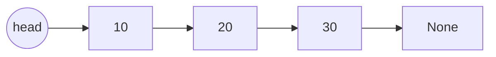

# 03 - Singly Linked List

Learn to store data as a chain of nodes and manipulate it by rewiring pointers. Ten programs cover creation, insertion, deletion, search, reversal, middle, cycles, duplicates, nth from end and merging.

## Table of Contents
- [A. Topic Introduction](#a-topic-introduction)
- [B. Core Concepts](#b-core-concepts)
- [C. How It Works](#c-how-it-works)
- [D. Time and Space Complexity](#d-time-and-space-complexity)
- [E. Problems for Practice](#e-problems-for-practice)
- [F. Installation Requirements](#f-installation-requirements)
- [G. How to Run the Files](#g-how-to-run-the-files)
- [H. Revision Notes](#h-revision-notes)

---

## A. Topic Introduction

**What it is.** A singly linked list is a chain of small objects called nodes. Each node stores a value and a reference (`next`) to the following node. The last node points to `None`. You only hold the first node, called the `head`.

**Why it matters in DSA.** Linked lists teach you pointer thinking: how to rewire references without losing the rest of the chain. Almost every tree, graph and cache (LRU) problem builds on this skill, and interviewers love list questions (reverse, cycle, merge).

**Where it is used.** Undo history, music playlists, memory allocators, hash-table buckets (chaining), and the building blocks of stacks and queues.

**Everyday analogy.** A treasure hunt: each clue tells you where the next clue is hidden. You cannot jump to clue 5; you must follow clues 1, 2, 3, 4 first. A Python list is more like a row of numbered lockers where you can open locker 5 directly.

If you know Laravel: a Collection (backed by an array) gives you `$items[5]` instantly, whereas a linked list is like a chain of Eloquent models where each model only knows its `next_id` - to reach item 5 you must hop four times.

---

## B. Core Concepts

| Term | Meaning |
|------|---------|
| Node | Object with `data` and `next`. |
| Head | Reference to the first node; the only entry point. |
| Tail | The last node (its `next` is `None`). |
| Traversal | Walking with a moving `current` pointer until it is `None`. |
| Dummy (sentinel) node | A fake node placed before the head to simplify edge cases such as deleting the head. |
| Slow / fast pointers | Two pointers moving at different speeds (1 step and 2 steps). |

**Picture of a list**

```text
head
 |
 v
[10|*]--->[20|*]--->[30|*]--->[40|/]    (/ means None)
```

**Array versus linked list**

| Operation | Python list | Singly linked list |
|-----------|-------------|--------------------|
| Access by index | O(1) | O(n) |
| Insert at front | O(n) | O(1) |
| Insert at end | O(1) amortised | O(1) with tail pointer, else O(n) |
| Delete after a known node | O(n) | O(1) |
| Search | O(n) | O(n) |



---

## C. How It Works

**Dry run 1: insert 25 at index 2 of `10 -> 20 -> 30`**

```text
Step 1: walk to the node BEFORE index 2 (the node holding 20)
        10 -> [20] -> 30
Step 2: new.next = 20.next          (new -> 30 first, so 30 is not lost)
        25 -> 30
Step 3: 20.next = new
        10 -> 20 -> 25 -> 30
```
Order matters: if you set `20.next = new` first, you lose the reference to 30.

**Dry run 2: reverse `1 -> 2 -> 3`** (three pointers: `prev`, `current`, `next_node`)

| Step | prev | current | Action | List state |
|------|------|---------|--------|------------|
| start | None | 1 | - | 1 -> 2 -> 3 |
| 1 | 1 | 2 | save next, point 1 back to None | 1 -> None, 2 -> 3 |
| 2 | 2 | 3 | point 2 back to 1 | 2 -> 1 -> None, 3 |
| 3 | 3 | None | point 3 back to 2 | 3 -> 2 -> 1 -> None |

`prev` is the new head.

**Dry run 3: slow and fast pointers find the middle of `1 -> 2 -> 3 -> 4 -> 5`**

```text
start : slow=1 fast=1
step 1: slow=2 fast=3
step 2: slow=3 fast=5   fast.next is None -> stop
middle = 3
```
Fast moves twice as quickly, so when it reaches the end, slow is halfway.

**Dry run 4: Floyd cycle detection**

If a cycle exists, the fast pointer eventually laps the slow pointer inside the loop and they meet. If there is no cycle, fast reaches `None`.

---

## D. Time and Space Complexity

| Operation | Time | Space |
|-----------|------|-------|
| Access / search by position or value | O(n) | O(1) |
| Insert / delete at head | O(1) | O(1) |
| Insert at tail (with tail pointer) | O(1) | O(1) |
| Insert / delete at a position | O(n) | O(1) |
| Reverse (iterative) | O(n) | O(1) |
| Reverse (recursive) | O(n) | O(n) stack |
| Find middle, detect cycle (two pointers) | O(n) | O(1) |
| Remove duplicates (unsorted, with set) | O(n) | O(n) |
| Merge two sorted lists | O(n + m) | O(1) iterative |

---

## E. Problems for Practice

| No | Title | Difficulty | Concept | Python File |
|----|-------|------------|---------|-------------|
| 1 | Node Creation and Traversal | Easy | Node class, head, traversal | `01_node_creation_and_traversal.py` |
| 2 | Insertion at Head, Tail and Any Position | Easy | Pointer rewiring, bounds checking | `02_insertion_operations.py` |
| 3 | Delete a Node by Value and by Position | Easy | Unlinking nodes, previous pointer | `03_deletion_operations.py` |
| 4 | Search an Element and Count Occurrences | Easy | Linear scan, first index, counting | `04_search_and_count.py` |
| 5 | Reverse a Singly Linked List | Medium | Three-pointer reversal, recursion | `05_reverse_linked_list.py` |
| 6 | Find the Middle Node (Slow and Fast Pointers) | Medium | Two-pointer technique | `06_find_middle_node.py` |
| 7 | Detect a Cycle (Floyd's Algorithm) and Find Where It Starts | Medium | Floyd tortoise and hare, cycle entry | `07_detect_cycle.py` |
| 8 | Remove Duplicates from a Linked List | Medium | Sorted and unsorted de-duplication, set | `08_remove_duplicates.py` |
| 9 | Nth Node from the End (and Remove It) | Medium | Gap of n between two pointers, dummy node | `09_nth_node_from_end.py` |
| 10 | Merge Two Sorted Linked Lists | Medium | Splicing nodes, dummy head, recursion | `10_merge_two_sorted_lists.py` |

### Problem 1 - Node Creation and Traversal (`01_node_creation_and_traversal.py`)
**Statement.** Build a singly linked list from a Python list of values, traverse it from head to tail printing every value, and report its length.

**Example.**
```text
values = [10, 20, 30, 40]
Linked list: 10 -> 20 -> 30 -> 40 -> None
Length: 4
Empty list: None, length 0
```
**Constraints / edge cases.** Empty input leaves `head` as `None`; a single value makes head and tail the same node.

**Hints.**
- A node needs only two fields: the value and the next reference.
- Keep a `tail` pointer while building so each append is O(1).
- Traverse with `current = head` and stop when `current` becomes `None`.

### Problem 2 - Insertion at Head, Tail and Any Position (`02_insertion_operations.py`)
**Statement.** Implement `insert_at_head(value)`, `insert_at_tail(value)` and `insert_at_position(index, value)`. Invalid positions must be rejected.

**Example.**
```text
tail 20, tail 30, head 10  -> [10, 20, 30]
insert_at_position(2, 25)  -> True  [10, 20, 25, 30]
insert_at_position(9, 99)  -> False [10, 20, 25, 30]
```
**Constraints / edge cases.** Insert into an empty list; index 0 (new head); index equal to length (new tail); negative or too large index returns `False` and changes nothing.

**Hints.**
- Index 0 is a special case: there is no previous node.
- For other positions walk to the node just before the index.
- Connect the new node to the rest first, then connect the previous node to the new node.

### Problem 3 - Delete a Node by Value and by Position (`03_deletion_operations.py`)
**Statement.** Implement `delete_value(value)`, removing the first node holding that value, and `delete_at(index)`. Both return `True` if something was deleted, else `False`.

**Example.**
```text
list = 5 -> 10 -> 15 -> 20 -> 25
delete_value(5)  -> True [10, 15, 20, 25]
delete_at(1)     -> True
delete_value(99) -> False
```
**Constraints / edge cases.** Empty list; deleting the head, the tail or the only node; value absent; negative or out-of-range index; duplicates (only the first match goes).

**Hints.**
- Track a `previous` pointer while searching.
- Deleting the head just moves `head` forward.
- Unlink by setting `previous.next = current.next`.

### Problem 4 - Search an Element and Count Occurrences (`04_search_and_count.py`)
**Statement.** Given a list and a target, return the zero-based index of the first occurrence (or -1) and also count how many times the target appears.

**Example.**
```text
list = 7 -> 3 -> 9 -> 3 -> 5
target 3 -> index 1, count 2
target 8 -> index -1, count 0
```
**Constraints / edge cases.** Empty list; target missing; target at head or tail; duplicates (index reports only the first).

**Hints.**
- One traversal with an index counter is enough.
- The index function may stop early, the count function must scan everything.
- Return -1 only after the whole list was checked.

### Problem 5 - Reverse a Singly Linked List (`05_reverse_linked_list.py`)
**Statement.** Reverse the direction of every link so the last node becomes the head. Provide an iterative and a recursive solution.

**Example.**
```text
1 -> 2 -> 3 -> 4 -> 5
Reversed: [5, 4, 3, 2, 1]
Empty: [], single: [42]
```
**Constraints / edge cases.** Empty list returns `None`; a single node returns itself; the recursive version can hit Python's recursion limit (about 1000 frames) on long lists.

**Hints.**
- Keep `prev`, `current` and a saved `next_node`.
- Save the next node before you overwrite `current.next`.
- Recursive idea: reverse the rest, then make the second node point back to the first.

### Problem 6 - Find the Middle Node (Slow and Fast Pointers) (`06_find_middle_node.py`)
**Statement.** Return the middle node in one pass. For an even length return the second of the two middle nodes.

**Example.**
```text
[1, 2, 3, 4, 5]    -> 3
[1, 2, 3, 4, 5, 6] -> 4
[4, 8] -> 8, [] -> None
```
**Constraints / edge cases.** Empty list returns `None`; one node returns itself; two nodes return the second.

**Hints.**
- Move slow one step and fast two steps.
- Loop while fast and fast.next both exist.
- When fast stops, slow is at the middle.

### Problem 7 - Detect a Cycle (Floyd's Algorithm) and Find Where It Starts (`07_detect_cycle.py`)
**Statement.** Decide whether a list has a cycle (some `next` points back to an earlier node). If it does, return the node where the cycle begins.

**Example.**
```text
1-2-3-4-5, tail -> 3 : cycle starts at 3
1-2-3 (no cycle)     : none
```
**Constraints / edge cases.** Empty list or single node without a self-loop; self-loop; whole list is a cycle (tail points to head).

**Hints.**
- A set of visited nodes works but costs O(n) memory.
- Fast and slow pointers meet inside the cycle if one exists.
- After they meet, restart one pointer at the head and move both one step at a time; they meet at the cycle start.

### Problem 8 - Remove Duplicates from a Linked List (`08_remove_duplicates.py`)
**Statement.** Remove repeated values. Part A: the list is sorted. Part B: the list is unsorted; keep the first occurrence of each value.

**Example.**
```text
sorted   1,1,2,3,3,3,4 -> [1, 2, 3, 4]
unsorted 4,2,4,1,2,5   -> [4, 2, 1, 5]
```
**Constraints / edge cases.** Empty list or single node; all values equal; duplicates at the tail. Without a set, a nested-loop approach gives O(1) space but O(n^2) time.

**Hints.**
- Sorted: duplicates are neighbours, compare `current` with `current.next`.
- Unsorted: remember seen values in a set.
- Only advance after you decide not to delete the next node.

### Problem 9 - Nth Node from the End (and Remove It) (`09_nth_node_from_end.py`)
**Statement.** Return the value of the nth node counting from the end (n = 1 is the last node) in one pass, then remove that node.

**Example.**
```text
1 -> 2 -> 3 -> 4 -> 5, n = 2 -> value 4
remove n = 2 -> [1, 2, 3, 5]
n = 6 -> None
```
**Constraints / edge cases.** n larger than the length or n <= 0 is invalid; n equal to the length removes the head; single-node list.

**Hints.**
- Move a lead pointer n steps ahead first.
- Then move both pointers together until the lead reaches the end.
- A dummy node before the head makes removing the head the same as any other node.

### Problem 10 - Merge Two Sorted Linked Lists (`10_merge_two_sorted_lists.py`)
**Statement.** Given two ascending sorted lists, splice their nodes into one sorted list and return its head. Reuse existing nodes.

**Example.**
```text
list1 = 1 -> 3 -> 5 -> 7
list2 = 2 -> 3 -> 6
Merged: [1, 2, 3, 3, 5, 6, 7]
```
**Constraints / edge cases.** One or both lists empty; very different lengths; equal values (take list1 first to stay stable).

**Hints.**
- Use a dummy node and a `tail` pointer to build the result.
- Always attach the smaller front node and advance that list.
- When one list ends, attach the remainder of the other.

---

## F. Installation Requirements

| Item | Requirement |
|------|-------------|
| Python version | Python 3.8 or newer |
| Packages | None. Standard library only |
| Extra installation | Nothing to install beyond Python itself |

Check your installation with `python --version` (see section G).

---

## G. How to Run the Files

1. Open a terminal: **Windows** - press `Win + R`, type `cmd` (or open PowerShell / VS Code terminal). **Linux/macOS** - open Terminal.
2. Verify Python:
   ```bash
   python --version      # Windows (or: py --version)
   python3 --version     # Linux / macOS
   ```
3. Move into the topic folder and run a file.

**Windows**
```bash
cd Python-DSA-Practice\03-Singly-Linked-List
python 01_node_creation_and_traversal.py
```
If `python` is not recognised, use the Python launcher: `py 01_node_creation_and_traversal.py`.

**Linux / macOS**
```bash
cd Python-DSA-Practice/03-Singly-Linked-List
python3 01_node_creation_and_traversal.py
```

Every file is a standalone program: it needs no other file and no internet.

---

## H. Revision Notes

**Key concepts**
- A node holds data and `next`; the head is your only handle on the list.
- Insert and delete are O(1) once you stand at the right node; getting there is O(n).
- Rewire pointers in the safe order: connect the new node forward before connecting backward.
- Slow/fast pointers solve middle, cycle and nth-from-end in one pass.
- A dummy node removes special cases for the head.

**Common mistakes**
- Losing the rest of the list by overwriting `next` before saving it.
- Forgetting the empty list and one-node list.
- Not updating `tail` after deleting the last node (when a tail is kept).
- Accessing `current.next.next` without checking `current.next`.
- Infinite loops on lists that contain a cycle.

**Interview tips**
- Draw boxes and arrows and update them step by step before coding.
- Mention the dummy-node trick and the two-pointer trick by name.
- State both time and space: reversing is O(n) time, O(1) space iteratively.
- Offer the set-based solution first for cycle detection, then improve to Floyd.
- Ask whether the list is sorted and whether duplicates are allowed.
