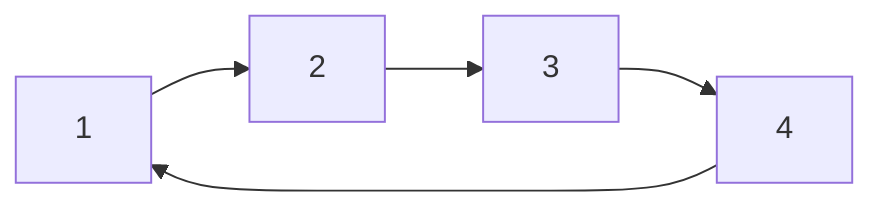

# 04 - Doubly and Circular Linked List

Extend the linked list with two-way links and with a circle. Ten programs cover creation, insertion, deletion, reversal, bidirectional search, palindromes, circular traversal, the Josephus problem and splitting a circle.

## Table of Contents
- [A. Topic Introduction](#a-topic-introduction)
- [B. Core Concepts](#b-core-concepts)
- [C. How It Works](#c-how-it-works)
- [D. Time and Space Complexity](#d-time-and-space-complexity)
- [E. Problems for Practice](#e-problems-for-practice)
- [F. Installation Requirements](#f-installation-requirements)
- [G. How to Run the Files](#g-how-to-run-the-files)
- [H. Revision Notes](#h-revision-notes)

---

## A. Topic Introduction

**What it is.** A doubly linked list node stores `prev` and `next`, so you can walk in both directions. A circular list has no `None` at the end: the last node points back to the first.

**Why it matters in DSA.** Two-way links make deleting a known node and walking backwards cheap. Circular lists model anything that repeats in a loop. Both are common interview follow-ups to the singly linked list.

**Where it is used.** Browser back/forward history, text-editor cursors, LRU caches, music players on repeat, round-robin schedulers and multiplayer turn order.

**Everyday analogy.** A doubly linked list is a train: each carriage has a coupling in front and behind. A circular list is a roundabout: keep driving and you return to where you started.

If you know Laravel: pagination with "previous" and "next" links is a doubly linked idea; a queue worker that cycles through a fixed set of servers is a circular idea.

---

## B. Core Concepts

| Term | Meaning |
|------|---------|
| `prev` / `next` | The two references stored in a doubly linked node. |
| Head / tail | First and last node. In a DLL `head.prev` and `tail.next` are `None`. |
| Circular list | The tail's `next` points to the head (and in a circular DLL `head.prev` points to the tail). |
| Tail pointer | Keeping only the tail of a circular list gives the head as `tail.next`. |
| Josephus problem | Eliminate every k-th person in a circle until one survives. |

**Doubly linked list**

```text
None <- [10] <-> [20] <-> [30] <-> [40] -> None
         ^head                       ^tail
```

**Circular singly linked list**

```text
      +-----------------------------+
      v                             |
    [1] --> [2] --> [3] --> [4] ----+
     ^head                    ^tail
```



**Key difference.** In a DLL you stop when the pointer is `None`. In a circular list you stop when you come back to the start - using `while current is not None` loops forever.

---

## C. How It Works

**Dry run 1: delete 30 from `10 <-> 20 <-> 30 <-> 40`**

```text
node = the node holding 30
node.prev.next = node.next     # 20 -> 40
node.next.prev = node.prev     # 40 <- 20
result: 10 <-> 20 <-> 40
```
No search for a "previous" node is needed - the node already knows it.

**Dry run 2: reverse a DLL (swap `prev` and `next` in every node)**

| Node | prev before | next before | prev after | next after |
|------|-------------|-------------|------------|------------|
| 1 | None | 2 | 2 | None |
| 2 | 1 | 3 | 3 | 1 |
| 3 | 2 | None | None | 2 |

Finally swap `head` and `tail`.

**Dry run 3: search from both ends of `[4, 8, 15, 16, 23, 42]`**

```text
iteration 1: front=4  back=42
iteration 2: front=8  back=23
iteration 3: front=15 back=16   target 16 found from the back
```
At most n/2 iterations.

**Dry run 4: Josephus with n = 5, k = 2**

```text
circle: 1 2 3 4 5   eliminate 2 -> 1 3 4 5
        continue from 3: eliminate 4 -> 1 3 5
        continue from 5: eliminate 1 -> 3 5
        continue from 3: eliminate 5 -> 3 survives
```

---

## D. Time and Space Complexity

| Operation | Doubly linked | Circular singly (tail pointer) |
|-----------|---------------|--------------------------------|
| Insert at head | O(1) | O(1) |
| Insert at tail | O(1) | O(1) |
| Delete head / tail | O(1) | head O(1), tail O(n) |
| Delete a known node | O(1) | O(n) (need previous) |
| Search | O(n) | O(n) |
| Reverse | O(n) time, O(1) space | - |
| Josephus (simulation) | - | O(n * k) |

Extra memory: a DLL stores one more pointer per node than a singly linked list (O(n) total either way).

---

## E. Problems for Practice

| No | Title | Difficulty | Concept | Python File |
|----|-------|------------|---------|-------------|
| 1 | Create a Doubly Linked List and Traverse It Both Ways | Easy | prev/next links, forward and backward walk | `01_dll_creation_and_traversal.py` |
| 2 | Insert at Head, Tail and Any Position | Easy | Four-pointer updates | `02_dll_insert_operations.py` |
| 3 | Delete from Head, Tail and by Value | Easy | Unlinking with prev/next, edge nodes | `03_dll_delete_operations.py` |
| 4 | Reverse a Doubly Linked List | Medium | In-place reversal by swapping links | `04_dll_reverse.py` |
| 5 | Search a Doubly Linked List from Both Ends | Medium | Two pointers meeting in the middle | `05_dll_search_from_both_ends.py` |
| 6 | Check if a Doubly Linked List is a Palindrome | Medium | Compare ends moving inward | `06_dll_palindrome_check.py` |
| 7 | Create and Traverse a Circular Linked List | Easy | Circular structure, stopping condition | `07_circular_list_traversal.py` |
| 8 | Insert and Delete in a Circular Linked List | Medium | Tail pointer, keeping the circle intact | `08_circular_insert_delete.py` |
| 9 | Josephus Problem with a Circular Linked List | Medium | Simulation on a circle, modular thinking | `09_circular_josephus_problem.py` |
| 10 | Detect a Circular List and Split It into Two Halves | Medium | Circle detection, slow/fast, splitting | `10_circular_detect_and_split.py` |

### Problem 1 - Create a Doubly Linked List and Traverse It Both Ways (`01_dll_creation_and_traversal.py`)
**Statement.** Build a doubly linked list from a Python list, print it head to tail and tail to head, and return the length.

**Example.**
```text
values = [10, 20, 30, 40]
Forward : 10 <-> 20 <-> 30 <-> 40
Backward: 40 <-> 30 <-> 20 <-> 10
Length  : 4
```
**Constraints / edge cases.** Empty list (both walks print nothing); single node (head is tail); duplicate values.

**Hints.**
- Every append must set both `new.prev` and `tail.next`.
- Walk backwards by starting at `tail` and following `prev`.
- Keep both `head` and `tail`.

### Problem 2 - Insert at Head, Tail and Any Position (`02_dll_insert_operations.py`)
**Statement.** Implement `insert_at_head`, `insert_at_tail` and `insert_at_position(index, value)`. Invalid positions must be rejected.

**Example.**
```text
tail 20, head 10, tail 40 -> [10, 20, 40]
insert 30 at 2 -> True [10, 20, 30, 40]
insert 99 at 9 -> False
```
**Constraints / edge cases.** Empty list; index 0; index equal to size; negative index; index larger than size.

**Hints.**
- Inserting in the middle changes four references.
- Link the new node's own `prev` and `next` first.
- Update `head` or `tail` when inserting at the ends.

### Problem 3 - Delete from Head, Tail and by Value (`03_dll_delete_operations.py`)
**Statement.** Implement `delete_head`, `delete_tail` and `delete_value(value)` (first occurrence) and report what was removed.

**Example.**
```text
10 <-> 20 <-> 30 <-> 40 <-> 50
delete_head -> 10, delete_tail -> 50, delete 30 -> True, delete 99 -> False
```
**Constraints / edge cases.** Delete from an empty list; delete the only node (both `head` and `tail` become `None`); value absent; value repeated.

**Hints.**
- Neighbours are reached through the node's own `prev` and `next`.
- Handle head and tail separately because one neighbour is missing.
- When the last node goes, reset both ends.

### Problem 4 - Reverse a Doubly Linked List (`04_dll_reverse.py`)
**Statement.** Reverse the list in place so the old tail becomes the head. Do not create new nodes.

**Example.**
```text
1 <-> 2 <-> 3 <-> 4 <-> 5
Forward after reverse : [5, 4, 3, 2, 1]
Backward after reverse: [1, 2, 3, 4, 5]
```
**Constraints / edge cases.** Empty list; single node; two nodes.

**Hints.**
- Swap `prev` and `next` of each node while walking.
- Remember to move to the old `prev` (the former next) after swapping.
- Swap `head` and `tail` at the end.

### Problem 5 - Search a Doubly Linked List from Both Ends (`05_dll_search_from_both_ends.py`)
**Statement.** Return the index of a target by moving one pointer from the head and one from the tail at the same time. Return -1 if absent.

**Example.**
```text
[4, 8, 15, 16, 23, 42]
42 -> index 5 after 1 iteration
16 -> index 3 after 3 iterations
99 -> -1
```
**Constraints / edge cases.** Empty list; one node; target in the middle; duplicates (the nearer end wins); even and odd lengths.

**Hints.**
- Track both indices: front increases, back decreases.
- Stop when the pointers cross.
- Check both pointers every iteration, including when they meet on the same node.

### Problem 6 - Check if a Doubly Linked List is a Palindrome (`06_dll_palindrome_check.py`)
**Statement.** Return `True` if the list reads the same forwards and backwards.

**Example.**
```text
['r','a','c','e','c','a','r'] -> True
['a','b','c'] -> False
[1, 2, 2, 1] -> True
```
**Constraints / edge cases.** Empty list and one node are palindromes; even and odd length; case sensitivity.

**Hints.**
- Use a front pointer and a back pointer.
- Compare, then move them toward each other.
- Stop when they meet or pass each other.

### Problem 7 - Create and Traverse a Circular Linked List (`07_circular_list_traversal.py`)
**Statement.** Build a circular singly linked list, traverse it exactly once, count its nodes and show that following `next` keeps cycling.

**Example.**
```text
values = [1, 2, 3, 4]
One traversal: [1, 2, 3, 4]
Walk 7 steps: [1, 2, 3, 4, 1, 2, 3]
```
**Constraints / edge cases.** Empty list (tail is `None`); single node pointing to itself; `while current is not None` loops forever.

**Hints.**
- Point the last node's `next` at the head.
- Use a do-while style loop: visit, move, stop when back at the head.
- A single node's `next` is itself.

### Problem 8 - Insert and Delete in a Circular Linked List (`08_circular_insert_delete.py`)
**Statement.** Implement `insert_at_front`, `insert_at_end` and `delete_value` for a circular singly linked list that keeps only a tail pointer.

**Example.**
```text
insert end 2, end 3, front 1 -> [1, 2, 3]
delete 3 -> [1, 2]; delete 5 -> False
```
**Constraints / edge cases.** Empty list; single node; deleting the head; deleting the tail; value absent; duplicates (only the first removed).

**Hints.**
- The head is always `tail.next`.
- Front and end inserts differ only in whether `tail` moves.
- Deleting the only node must set `tail` to `None`.

### Problem 9 - Josephus Problem with a Circular Linked List (`09_circular_josephus_problem.py`)
**Statement.** n people stand in a circle numbered 1..n. Starting at 1, every k-th person is eliminated until one remains. Return the elimination order and the survivor.

**Example.**
```text
n = 7, k = 3
eliminated = [3, 6, 2, 7, 5, 1], survivor = 4
```
**Constraints / edge cases.** n = 1; k = 1 (eliminates in order); k larger than n (wraps naturally); n or k not positive.

**Hints.**
- Build a circle, then move k - 1 steps and remove the next node.
- Keep a pointer to the node before the one being removed.
- A closed-form recurrence exists and is useful as a check.

### Problem 10 - Detect a Circular List and Split It into Two Halves (`10_circular_detect_and_split.py`)
**Statement.** Decide whether a list is circular (last node links back to the head). If it is, split it into two circular lists of sizes ceil(n/2) and floor(n/2).

**Example.**
```text
1 -> 2 -> 3 -> 4 -> 5 -> back to 1
Split: [1, 2, 3] and [4, 5]
```
**Constraints / edge cases.** Empty list; single node (cannot split into two non-empty halves); two nodes; odd and even sizes; a list that loops back to a middle node instead of the head.

**Hints.**
- Distinguish 'has a cycle' from 'is a pure circle through the head'.
- Slow/fast pointers locate the middle.
- Close both halves by pointing each new tail at its own head.

---

## F. Installation Requirements

| Item | Requirement |
|------|-------------|
| Python version | Python 3.8 or newer |
| Packages | None. Standard library only |
| Extra installation | Nothing to install beyond Python itself |

Check your installation with `python --version` (see section G).

---

## G. How to Run the Files

1. Open a terminal: **Windows** - press `Win + R`, type `cmd` (or open PowerShell / VS Code terminal). **Linux/macOS** - open Terminal.
2. Verify Python:
   ```bash
   python --version      # Windows (or: py --version)
   python3 --version     # Linux / macOS
   ```
3. Move into the topic folder and run a file.

**Windows**
```bash
cd Python-DSA-Practice\04-Doubly-and-Circular-Linked-List
python 01_dll_creation_and_traversal.py
```
If `python` is not recognised, use the Python launcher: `py 01_dll_creation_and_traversal.py`.

**Linux / macOS**
```bash
cd Python-DSA-Practice/04-Doubly-and-Circular-Linked-List
python3 01_dll_creation_and_traversal.py
```

Every file is a standalone program: it needs no other file and no internet.

---

## H. Revision Notes

**Key concepts**
- A DLL node knows both neighbours, so deleting a known node is O(1).
- Every DLL insert or delete changes up to four references; keep `head` and `tail` consistent.
- In a circular list the end is detected by returning to the start, not by `None`.
- Holding only the tail of a circular list gives O(1) access to both ends.
- Josephus can be simulated on a circle or solved with a recurrence.

**Common mistakes**
- Updating `next` but forgetting `prev` (list breaks when walked backwards).
- Forgetting to reset `head` and `tail` when the last node is removed.
- Looping with `while current is not None` on a circular list.
- Forgetting to close the circle after splitting.
- Off-by-one errors when counting k steps.

**Interview tips**
- Say why a DLL costs more memory but gives O(1) delete of a given node (LRU cache).
- Draw the four pointer changes before coding an insert.
- For circular lists, test with 0, 1 and 2 nodes first.
- Mention the Josephus recurrence `J(n) = (J(n-1) + k) mod n` as the optimised approach.
- Ask whether the list may contain a cycle that does not pass through the head.
