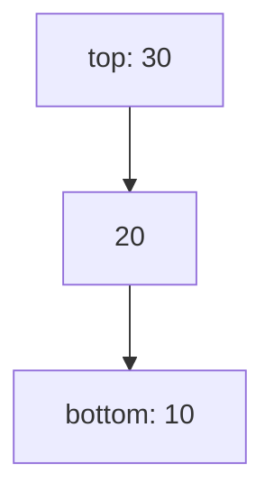

# 05 - Stack

Learn Last-In-First-Out storage and the problems it solves: matching, undo, expression handling and monotonic-stack tricks.

## Table of Contents
- [A. Topic Introduction](#a-topic-introduction)
- [B. Core Concepts](#b-core-concepts)
- [C. How It Works](#c-how-it-works)
- [D. Time and Space Complexity](#d-time-and-space-complexity)
- [E. Problems for Practice](#e-problems-for-practice)
- [F. Installation Requirements](#f-installation-requirements)
- [G. How to Run the Files](#g-how-to-run-the-files)
- [H. Revision Notes](#h-revision-notes)

---

## A. Topic Introduction

**What it is.** A stack is a collection where you add and remove only at one end, called the top. The last item pushed is the first item popped: Last-In-First-Out (LIFO).

**Why it matters in DSA.** Any problem that needs "remember the most recent unfinished thing" is a stack problem: matching brackets, undo, expression evaluation, and the monotonic-stack family (next greater element, histogram).

**Where it is used.** The function call stack, undo/redo in editors, the browser back button, parsing expressions and syntax checking in compilers.

**Everyday analogy.** A pile of plates: you put a plate on top and take a plate from the top. You never pull from the bottom.

If you know PHP: `array_push($arr, $x)` and `array_pop($arr)` already behave as a stack. In Python a `list` with `append()` and `pop()` is the same thing.

---

## B. Core Concepts

| Term | Meaning |
|------|---------|
| Push | Add an item on top. |
| Pop | Remove and return the top item. |
| Peek / top | Look at the top item without removing it. |
| LIFO | Last in, first out. |
| Underflow | Popping or peeking an empty stack. |
| Monotonic stack | A stack kept in increasing or decreasing order to answer "next greater/smaller" questions. |
| Postfix (RPN) | Operators come after operands: `2 3 +`. |

**Picture**

```text
push(10) push(20) push(30)         pop() -> 30

 |    |     |    |     |  30 |      |    |
 |    |     | 20 |     |  20 |      | 20 |
 | 10 |     | 10 |     |  10 |      | 10 |
 +----+     +----+     +-----+      +----+
```



**Python choice.** Use a list with `append` and `pop` (both O(1) at the end). Avoid `insert(0, x)` because it is O(n).

---

## C. How It Works

**Dry run 1: balanced brackets for `{[()]}`**

| Char | Action | Stack |
|------|--------|-------|
| `{` | push | `{` |
| `[` | push | `{ [` |
| `(` | push | `{ [ (` |
| `)` | top is `(`, pop | `{ [` |
| `]` | top is `[`, pop | `{` |
| `}` | top is `{`, pop | empty |

Empty at the end means balanced. `([)]` fails: when `)` arrives, the top is `[`.

**Dry run 2: postfix `2 3 4 * +`**

```text
2 -> [2]
3 -> [2, 3]
4 -> [2, 3, 4]
*  -> pop 4, pop 3, push 12   -> [2, 12]
+  -> pop 12, pop 2, push 14  -> [14]
```
Careful: the first popped value is the RIGHT operand (matters for `-` and `/`).

**Dry run 3: next greater element for `[4, 5, 2, 25]`** (stack holds indices still waiting for an answer)

| i | value | Stack before | Action | Answers so far |
|---|-------|--------------|--------|----------------|
| 0 | 4 | [] | push 0 | - |
| 1 | 5 | [0] | 5 > 4: answer[0]=5, push 1 | [5,-,-,-] |
| 2 | 2 | [1] | push 2 | |
| 3 | 25 | [1,2] | answer[2]=25, answer[1]=25, push 3 | [5,25,25,-] |

Whatever remains gets -1. Each index is pushed and popped once: O(n).

**Dry run 4: min stack.** Keep a second stack of minimums; push to it when the new value is `<=` the current minimum, pop from it when the popped value equals the minimum.

---

## D. Time and Space Complexity

| Operation | Time | Notes |
|-----------|------|-------|
| push / pop / peek / is_empty / size | O(1) | list end operations |
| Reverse a string with a stack | O(n) time, O(n) space | |
| Balanced brackets | O(n) time, O(n) space | worst case all openers |
| Next greater / daily temperatures | O(n) | each element pushed and popped once |
| Min stack `get_min` | O(1) | extra O(n) space |
| Postfix evaluation / infix to postfix | O(n) | |
| Largest rectangle in histogram | O(n) | brute force is O(n^2) |

---

## E. Problems for Practice

| No | Title | Difficulty | Concept | Python File |
|----|-------|------------|---------|-------------|
| 1 | Stack Implementation | Easy | LIFO class, push/pop/peek | `01_stack_implementation.py` |
| 2 | Reverse a String Using a Stack | Easy | Push all, pop all | `02_reverse_string_using_stack.py` |
| 3 | Balanced Parentheses | Easy | Matching pairs with a stack | `03_balanced_parentheses.py` |
| 4 | Undo and Redo Operations | Medium | Two stacks, history management | `04_undo_operations.py` |
| 5 | Next Greater Element | Medium | Monotonic stack | `05_next_greater_element.py` |
| 6 | Min Stack | Medium | Auxiliary stack, O(1) minimum | `06_min_stack.py` |
| 7 | Postfix Expression Evaluation | Medium | Operand stack, RPN | `07_postfix_evaluation.py` |
| 8 | Infix to Postfix Conversion | Medium | Operator precedence stack (shunting yard) | `08_infix_to_postfix.py` |
| 9 | Daily Temperatures | Medium | Monotonic stack, distance to next warmer day | `09_daily_temperatures.py` |
| 10 | Largest Rectangle in a Histogram | Medium | Monotonic stack, area calculation | `10_largest_rectangle_histogram.py` |

### Problem 1 - Stack Implementation (`01_stack_implementation.py`)
**Statement.** Build a stack class with `push`, `pop`, `peek`, `is_empty` and `size`. Popping or peeking an empty stack must report an error.

**Example.**
```text
push 10, 20, 30 -> [10, 20, 30]
peek() -> 30, pop() -> 30, pop() -> 20, size() -> 1
pop() on empty -> Stack is empty
```
**Constraints / edge cases.** Pop or peek on an empty stack; pushing `None` or duplicates; push again after emptying.

**Hints.**
- Store items in a Python list and use only its end.
- Check `is_empty()` before pop and peek.
- Raise a clear error rather than failing silently.

### Problem 2 - Reverse a String Using a Stack (`02_reverse_string_using_stack.py`)
**Statement.** Reverse a whole string with a stack, then reverse only the letters of each word while keeping the word order.

**Example.**
```text
"Data Structures"
Reversed      : serutcurtS ataD
Words reversed: ataD serutcurtS
```
**Constraints / edge cases.** Empty string; single character; multiple, leading or trailing spaces; palindromes.

**Hints.**
- Push every character, then pop them to build the result.
- For words, flush the stack each time you meet a space.
- Flush once more at the end of the string.

### Problem 3 - Balanced Parentheses (`03_balanced_parentheses.py`)
**Statement.** Given a string with `()`, `[]` and `{}` (and other characters), decide whether every opening bracket is closed by the correct type in the correct order.

**Example.**
```text
"{[()]}" -> balanced
"([)]" -> NOT balanced
"((" -> NOT balanced
```
**Constraints / edge cases.** Empty string (balanced); only closers; only openers; wrong order like `([)]`; non-bracket characters.

**Hints.**
- Push openers; on a closer compare with the top.
- A closer with an empty stack is an immediate failure.
- At the end the stack must be empty.

### Problem 4 - Undo and Redo Operations (`04_undo_operations.py`)
**Statement.** Simulate a small text editor with `type`, `undo` and `redo`. Undo reverses the latest change; redo re-applies it unless a new edit happened after the undo.

**Example.**
```text
type 'Hello', type ' World', undo, undo, redo
-> 'Hello World', 'Hello', '', 'Hello'
```
**Constraints / edge cases.** Undo with no history; redo with nothing undone; redo cleared after a new edit; undo repeatedly until empty.

**Hints.**
- Use an undo stack and a redo stack.
- Undo moves an action from the undo stack to the redo stack.
- Any new edit clears the redo stack.

### Problem 5 - Next Greater Element (`05_next_greater_element.py`)
**Statement.** For every element find the first element to its right that is strictly greater, or -1 if none exists.

**Example.**
```text
[4, 5, 2, 25] -> [5, 25, 25, -1]
[3, 3, 3] -> [-1, -1, -1]
```
**Constraints / edge cases.** Empty array; equal values (strictly greater required); strictly decreasing array (all -1); single element.

**Hints.**
- Keep a stack of indices that are still waiting for an answer.
- While the current value beats the stack top, resolve the top.
- Indices left at the end have no greater element.

### Problem 6 - Min Stack (`06_min_stack.py`)
**Statement.** Design a stack with `push`, `pop`, `top` and `get_min`, where `get_min` returns the smallest current element in constant time.

**Example.**
```text
push 5, 3, 7, 3
get_min after each push: 5, 3, 3, 3
pop x4: min 3, 3, 5, empty
```
**Constraints / edge cases.** Duplicate minimums (why `<=` matters); pop/top/get_min on an empty stack; increasing and decreasing pushes.

**Hints.**
- Keep a second stack that records minimums.
- Push onto it when the new value is less than or equal to its top.
- Pop from it only when the popped value equals the current minimum.

### Problem 7 - Postfix Expression Evaluation (`07_postfix_evaluation.py`)
**Statement.** Evaluate a postfix expression such as `2 3 4 * +`. Support `+ - * /` and report invalid expressions.

**Example.**
```text
"2 3 4 * +" = 14
"10 2 /" = 5.0
"1 +" -> error: not enough operands
"4 0 /" -> error: division by zero
```
**Constraints / edge cases.** Too few operands; leftover operands; division by zero; unknown token; empty expression; operand order for `-` and `/`.

**Hints.**
- Push numbers; on an operator pop two operands.
- The first value popped is the right-hand operand.
- At the end exactly one value must remain.

### Problem 8 - Infix to Postfix Conversion (`08_infix_to_postfix.py`)
**Statement.** Convert an infix expression like `a+b*c` into postfix. Support `+ - * / ^` and parentheses; `^` is right-associative.

**Example.**
```text
a+b*c -> abc*+
(a+b)*c -> ab+c*
a^b^c -> abc^^
a+(b -> error: mismatched parentheses
```
**Constraints / edge cases.** Mismatched parentheses; nested parentheses; chained `^`; equal-precedence operators (left to right); single operand.

**Hints.**
- Operands go straight to the output.
- Pop operators of higher (or equal, for left-associative) precedence before pushing a new one.
- A closing bracket pops until its opening bracket.

### Problem 9 - Daily Temperatures (`09_daily_temperatures.py`)
**Statement.** Given daily temperatures, return for each day how many days you must wait for a warmer one, or 0 if none.

**Example.**
```text
[73, 74, 75, 71, 69, 72, 76, 73] -> [1, 1, 4, 2, 1, 1, 0, 0]
```
**Constraints / edge cases.** Empty input; equal temperatures (not warmer); strictly decreasing list; single day.

**Hints.**
- Same idea as next greater element, but store the distance.
- Keep indices on the stack, not temperatures.
- Answer for a popped index is the current index minus that index.

### Problem 10 - Largest Rectangle in a Histogram (`10_largest_rectangle_histogram.py`)
**Statement.** Given bar heights (each of width 1), find the area of the largest rectangle that fits inside the bars.

**Example.**
```text
[2, 1, 5, 6, 2, 3] -> 10
[2, 4] -> 4
[] -> 0
```
**Constraints / edge cases.** Empty list; single bar; all equal heights; strictly increasing or decreasing; zero-height bars.

**Hints.**
- Keep a stack of indices with increasing heights.
- When a lower bar arrives, pop and compute the area using the popped height.
- Width runs from the new stack top (exclusive) to the current index (exclusive); flush the stack at the end.

---

## F. Installation Requirements

| Item | Requirement |
|------|-------------|
| Python version | Python 3.8 or newer |
| Packages | None. Standard library only |
| Extra installation | Nothing to install beyond Python itself |

Check your installation with `python --version` (see section G).

---

## G. How to Run the Files

1. Open a terminal: **Windows** - press `Win + R`, type `cmd` (or open PowerShell / VS Code terminal). **Linux/macOS** - open Terminal.
2. Verify Python:
   ```bash
   python --version      # Windows (or: py --version)
   python3 --version     # Linux / macOS
   ```
3. Move into the topic folder and run a file.

**Windows**
```bash
cd Python-DSA-Practice\05-Stack
python 01_stack_implementation.py
```
If `python` is not recognised, use the Python launcher: `py 01_stack_implementation.py`.

**Linux / macOS**
```bash
cd Python-DSA-Practice/05-Stack
python3 01_stack_implementation.py
```

Every file is a standalone program: it needs no other file and no internet.

---

## H. Revision Notes

**Key concepts**
- LIFO: the most recent item is handled first.
- Use a list: `append` to push, `pop` to pop, `[-1]` to peek.
- Stack = remember unfinished work (brackets, undo, recursion).
- Monotonic stack answers next-greater/smaller style questions in O(n).
- Postfix needs only a stack; infix needs a stack for operators.

**Common mistakes**
- Popping from an empty stack.
- Forgetting to check that the stack is empty at the end (brackets).
- Swapping operand order for `-` and `/`.
- Using `<` instead of `<=` in the min stack and breaking with duplicates.
- Storing values instead of indices when distances are needed.

**Interview tips**
- Say "I will use a stack because the latest unmatched item matters."
- For "next greater" problems, mention the monotonic stack and its O(n) amortised cost.
- State the space cost: usually O(n) in the worst case.
- Relate recursion to the call stack and mention the recursion limit.
- Test with empty input and a single element.
