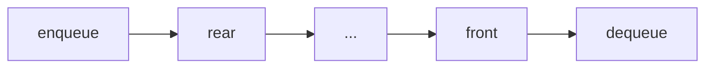

# 06 - Queue and Deque

Learn First-In-First-Out processing and the double-ended queue. Ten programs cover queues, deques, simulation with stacks and queues, sliding windows, scheduling and BFS in a grid.

## Table of Contents
- [A. Topic Introduction](#a-topic-introduction)
- [B. Core Concepts](#b-core-concepts)
- [C. How It Works](#c-how-it-works)
- [D. Time and Space Complexity](#d-time-and-space-complexity)
- [E. Problems for Practice](#e-problems-for-practice)
- [F. Installation Requirements](#f-installation-requirements)
- [G. How to Run the Files](#g-how-to-run-the-files)
- [H. Revision Notes](#h-revision-notes)

---

## A. Topic Introduction

**What it is.** A queue is First-In-First-Out (FIFO): items join at the back and leave from the front. A deque (double-ended queue, pronounced "deck") allows adding and removing at both ends.

**Why it matters in DSA.** Queues drive breadth-first search, scheduling and streaming problems. The deque is the tool for sliding-window problems and for O(1) work at both ends.

**Where it is used.** Print queues, job queues (Laravel queue workers), CPU scheduling, message brokers, level-order tree walks and shortest path in a grid.

**Everyday analogy.** People waiting at a ticket counter: the first to arrive is served first. A deque is a bus aisle where people can enter or leave at either door.

If you know Laravel: `dispatch(new Job)` pushes to the back of a queue and a worker takes from the front - exactly FIFO.

---

## B. Core Concepts

| Term | Meaning |
|------|---------|
| Enqueue | Add at the rear. |
| Dequeue | Remove from the front. |
| Front / rear | The next item to leave / the most recently added item. |
| FIFO | First in, first out. |
| `collections.deque` | Python's O(1) double-ended queue (`append`, `appendleft`, `pop`, `popleft`). |
| Monotonic deque | A deque kept in decreasing order to track window maximums. |
| BFS | Breadth-first search; explores level by level using a queue. |

**Queue picture**

```text
enqueue ->  [ rear ] 40 30 20 10 [ front ]  -> dequeue
```

**Deque picture**

```text
appendleft <->  [ 1 | 2 | 3 | 4 ]  <-> append
popleft    <->                     <-> pop
```



**Warning.** `list.pop(0)` is O(n) because every element shifts. Use `deque.popleft()` (O(1)) for queues.

---

## C. How It Works

**Dry run 1: queue with a linked list (head = front, tail = rear)**

```text
enqueue(10): head=tail=[10]
enqueue(20): [10] -> [20]          tail moves
dequeue()  : returns 10, head=[20]
dequeue()  : returns 20, head=None -> also set tail=None
```
Forgetting to reset the tail when the queue empties is a classic bug.

**Dry run 2: queue from two stacks**

```text
enqueue 1,2,3 -> in=[1,2,3] out=[]
dequeue       -> out is empty, so move everything: in=[] out=[3,2,1]
                 pop from out -> returns 1, out=[3,2]
```
Only refill `out` when it is empty; then the order stays correct. Each element moves at most twice, so dequeue is O(1) amortised.

**Dry run 3: binary numbers 1..5 with a queue**

| Step | Dequeue | Output | Enqueue (add 0, add 1) | Queue after |
|------|---------|--------|------------------------|-------------|
| 1 | "1" | 1 | "10", "11" | 10, 11 |
| 2 | "10" | 10 | "100", "101" | 11, 100, 101 |
| 3 | "11" | 11 | "110", "111" | 100, 101, 110, 111 |

**Dry run 4: sliding window maximum for `[1, 3, -1, -3, 5]`, k = 3**

```text
deque holds indices whose values are in decreasing order
i=0: [0]          i=1: 3 removes 1 -> [1]
i=2: [1,2] -> window full, max = a[1] = 3
i=3: [1,2,3] -> max 3
i=4: 5 removes all smaller, index 1 leaves the window -> [4], max 5
```

**Dry run 5: BFS on a grid.** Put the start in the queue; repeatedly take a cell, add its unvisited open neighbours with distance + 1. The first time you reach the goal is the shortest path.

---

## D. Time and Space Complexity

| Operation | Time | Notes |
|-----------|------|-------|
| enqueue / dequeue (linked list or deque) | O(1) | |
| `list.pop(0)` | O(n) | avoid for queues |
| Queue from two stacks, dequeue | O(1) amortised | worst single call O(n) |
| Stack from queues | push O(n) or pop O(n) | one of the two is costly |
| Sliding window maximum | O(n) | each index enters and leaves once; O(k) space |
| First non-repeating in a stream | O(1) amortised per char | O(alphabet) space |
| Round robin | O(total burst time / quantum) steps | |
| BFS in grid R x C | O(R * C) | O(R * C) space |

---

## E. Problems for Practice

| No | Title | Difficulty | Concept | Python File |
|----|-------|------------|---------|-------------|
| 1 | Queue Implementation | Easy | FIFO class, front/rear | `01_queue_implementation.py` |
| 2 | Deque Basics | Easy | collections.deque, rotate, maxlen | `02_deque_basics.py` |
| 3 | Palindrome Check with a Deque | Easy | Take from both ends | `03_palindrome_check_with_deque.py` |
| 4 | Queue Using Two Stacks | Medium | Amortised transfer between stacks | `04_queue_using_two_stacks.py` |
| 5 | Generate Binary Numbers 1 to N | Medium | Queue as a generator | `05_generate_binary_numbers.py` |
| 6 | Sliding Window Maximum | Medium | Monotonic deque | `06_sliding_window_maximum.py` |
| 7 | First Non-Repeating Character in a Stream | Medium | Queue plus frequency table | `07_first_non_repeating_in_stream.py` |
| 8 | Stack Using Queues | Medium | Rotating a queue to get LIFO | `08_stack_using_queues.py` |
| 9 | Round Robin CPU Scheduler | Medium | Queue simulation, time slices | `09_round_robin_scheduler.py` |
| 10 | BFS Shortest Path in a Grid | Medium | BFS, visited set, path reconstruction | `10_bfs_shortest_path_in_grid.py` |

### Problem 1 - Queue Implementation (`01_queue_implementation.py`)
**Statement.** Build a queue with `enqueue`, `dequeue`, `front`, `rear`, `is_empty` and `size`. Enqueue and dequeue must both be O(1).

**Example.**
```text
enqueue 10, 20, 30 -> front=10 rear=30 size=3
dequeue -> 10, dequeue -> 20
dequeue on empty -> Queue is empty
```
**Constraints / edge cases.** Dequeue or front on an empty queue; dequeuing the last item (reset the tail); enqueue after the queue became empty.

**Hints.**
- A linked list with head and tail pointers gives O(1) at both ends.
- Enqueue at the tail, dequeue at the head.
- When head becomes `None`, tail must become `None` too.

### Problem 2 - Deque Basics (`02_deque_basics.py`)
**Statement.** Demonstrate `collections.deque`: use it as a queue, add and remove at both ends, rotate it, use `maxlen`, and compare removing from the front of a deque and of a list.

**Example.**
```text
deque([1, 2, 3]) popleft -> 1
appendleft(0) -> deque([0, 2, 3])
rotate(1) -> deque([8, 0, 2, 7])
maxlen=3 after 1..5 -> deque([3, 4, 5])
```
**Constraints / edge cases.** `popleft` or `pop` on an empty deque raises `IndexError`; `maxlen=0`; rotating by more than the length wraps around.

**Hints.**
- Know the four end operations and which side each uses.
- Positive `rotate` moves items to the right.
- A `maxlen` deque silently drops items from the opposite end.

### Problem 3 - Palindrome Check with a Deque (`03_palindrome_check_with_deque.py`)
**Statement.** Decide whether a string is a palindrome, ignoring case, spaces and punctuation, by comparing characters taken from both ends of a deque.

**Example.**
```text
"A man, a plan, a canal: Panama" -> palindrome
"hello" -> not a palindrome
"" -> palindrome
```
**Constraints / edge cases.** Empty string; single character; odd and even length; mixed case; only punctuation.

**Hints.**
- Load only letters and digits, lower-cased, into the deque.
- Compare `popleft` with `pop` while at least two items remain.
- Zero or one remaining item means success.

### Problem 4 - Queue Using Two Stacks (`04_queue_using_two_stacks.py`)
**Statement.** Build a FIFO queue using only two LIFO stacks (lists with `append` and `pop`). Support `enqueue`, `dequeue` and `peek`.

**Example.**
```text
enqueue 1,2,3; dequeue -> 1; enqueue 4; dequeue -> 2, 3, 4
dequeue on empty -> Queue is empty
```
**Constraints / edge cases.** Dequeue on empty; interleaved enqueue and dequeue (do not transfer while the output stack still has items); single element.

**Hints.**
- Use an input stack for enqueue and an output stack for dequeue.
- Transfer only when the output stack is empty.
- Transferring reverses the order, which is exactly what FIFO needs.

### Problem 5 - Generate Binary Numbers 1 to N (`05_generate_binary_numbers.py`)
**Statement.** Print the binary form of every number from 1 to N using a queue and no number-to-binary conversion function.

**Example.**
```text
n = 10 -> ['1', '10', '11', '100', '101', '110', '111', '1000', '1001', '1010']
n = 0 -> []
```
**Constraints / edge cases.** n = 0; n = 1; powers of two; large n (the queue holds about n/2 entries).

**Hints.**
- Start with "1" in the queue.
- Dequeue a string, output it, enqueue it with "0" appended then with "1" appended.
- Stop after N outputs.

### Problem 6 - Sliding Window Maximum (`06_sliding_window_maximum.py`)
**Statement.** Given an array and a window size k, report the maximum of every window of k consecutive elements as it slides left to right.

**Example.**
```text
[1, 3, -1, -3, 5, 3, 6, 7], k = 3 -> [3, 3, 5, 5, 6, 7]
```
**Constraints / edge cases.** k = 1; k equal to the length; k larger than the length; empty array; duplicates; monotonic arrays.

**Hints.**
- Store indices in a deque with decreasing values.
- Remove smaller values from the back when a new one arrives.
- Remove the front index when it leaves the window; the front is the maximum.

### Problem 7 - First Non-Repeating Character in a Stream (`07_first_non_repeating_in_stream.py`)
**Statement.** Characters arrive one at a time. After each arrival report the first character seen so far that appeared exactly once, or `#` if none.

**Example.**
```text
stream 'aabcbd' -> a # b b c c
stream 'aabb' -> a # b #
```
**Constraints / edge cases.** Empty stream; all characters repeated; a unique character that repeats later; three or more repeats.

**Hints.**
- Keep counts in a dictionary.
- Keep candidates in a queue in arrival order.
- Pop from the front while the front's count is greater than 1.

### Problem 8 - Stack Using Queues (`08_stack_using_queues.py`)
**Statement.** Build a LIFO stack using only queue operations (enqueue at back, dequeue from front, size, is-empty). Support `push`, `pop` and `top`.

**Example.**
```text
push 1, 2, 3 -> top=3
pop -> 3, push 4, pop -> 4, 2, 1
pop on empty -> Stack is empty
```
**Constraints / edge cases.** Pop or top on an empty stack; single element (no rotation needed); push after the stack became empty.

**Hints.**
- After adding a new item, rotate the older items behind it.
- Rotate by dequeuing and re-enqueuing `size - 1` times.
- Then the front of the queue is always the stack top.

### Problem 9 - Round Robin CPU Scheduler (`09_round_robin_scheduler.py`)
**Statement.** Processes have burst times and arrive together. The scheduler gives each at most `quantum` units in turn; unfinished processes go to the back. Report finish, turnaround and waiting times.

**Example.**
```text
P1=5, P2=3, P3=1, quantum = 2
Finish times: P1=9, P2=8, P3=5
Average waiting time: 4.33
```
**Constraints / edge cases.** Quantum larger than all bursts (becomes first-come-first-served); quantum 1; single process; bursts that are exact multiples of the quantum; empty process list.

**Hints.**
- Queue holds (name, remaining time) pairs.
- Run for `min(quantum, remaining)`, advance the clock.
- If time remains, re-enqueue; otherwise record finish time. Waiting = turnaround - burst.

### Problem 10 - BFS Shortest Path in a Grid (`10_bfs_shortest_path_in_grid.py`)
**Statement.** A grid has open cells (0) and walls (1). Find the length of the shortest path from the top-left to the bottom-right moving up, down, left or right, and print one such path. Return -1 if none exists.

**Example.**
```text
0 0 0 / 1 1 0 / 0 0 0
shortest path has 4 moves
path: (0,0) (0,1) (0,2) (1,2) (2,2)
```
**Constraints / edge cases.** Start equals goal (1x1 grid); blocked start or goal; no route; empty grid; long winding corridors.

**Hints.**
- Queue stores cells (and their distance).
- Mark cells visited when you enqueue them, not when you dequeue them.
- Remember each cell's parent to rebuild the path.

---

## F. Installation Requirements

| Item | Requirement |
|------|-------------|
| Python version | Python 3.8 or newer |
| Packages | None. Standard library only |
| Extra installation | Nothing to install beyond Python itself |

Check your installation with `python --version` (see section G).

---

## G. How to Run the Files

1. Open a terminal: **Windows** - press `Win + R`, type `cmd` (or open PowerShell / VS Code terminal). **Linux/macOS** - open Terminal.
2. Verify Python:
   ```bash
   python --version      # Windows (or: py --version)
   python3 --version     # Linux / macOS
   ```
3. Move into the topic folder and run a file.

**Windows**
```bash
cd Python-DSA-Practice\06-Queue-and-Deque
python 01_queue_implementation.py
```
If `python` is not recognised, use the Python launcher: `py 01_queue_implementation.py`.

**Linux / macOS**
```bash
cd Python-DSA-Practice/06-Queue-and-Deque
python3 01_queue_implementation.py
```

Every file is a standalone program: it needs no other file and no internet.

---

## H. Revision Notes

**Key concepts**
- FIFO: the oldest item leaves first.
- `collections.deque` gives O(1) at both ends; `list.pop(0)` is O(n).
- A monotonic deque tracks window extremes in O(n).
- BFS uses a queue and finds the shortest path in an unweighted graph or grid.
- Stacks and queues can imitate each other using two structures or rotation.

**Common mistakes**
- Using `list.pop(0)` for a large queue.
- Forgetting to reset `tail` when the queue empties.
- Marking cells visited on dequeue in BFS (causes duplicates and slowness).
- Moving items between the two stacks while the output stack is not empty.
- Not removing out-of-window indices in the sliding window.

**Interview tips**
- Say "BFS, because every edge has the same cost."
- Know the amortised argument for the two-stack queue.
- Mention that `deque` is implemented as blocks, hence O(1) ends but O(n) middle access.
- Clarify tie-breaking and arrival times in scheduling questions.
- Test with k = 1 and k = n in window problems.
