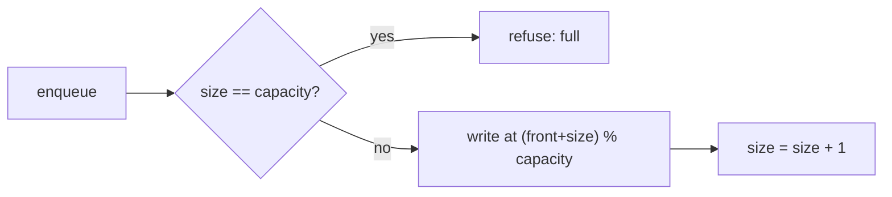

# 07 - Circular Queue

Learn how a fixed-size queue reuses its array by treating it as a ring, and how that idea powers schedulers, buffers and sliding windows.

## Table of Contents
- [A. Topic Introduction](#a-topic-introduction)
- [B. Core Concepts](#b-core-concepts)
- [C. How It Works](#c-how-it-works)
- [D. Time and Space Complexity](#d-time-and-space-complexity)
- [E. Problems for Practice](#e-problems-for-practice)
- [F. Installation Requirements](#f-installation-requirements)
- [G. How to Run the Files](#g-how-to-run-the-files)
- [H. Revision Notes](#h-revision-notes)

---

## A. Topic Introduction

**What it is.** A circular queue is a First-In-First-Out (FIFO) queue stored in a fixed-size array whose last slot is considered to be followed by the first slot. When an index walks off the end, it wraps back to 0.

**Why it matters in DSA.** A plain array queue wastes space: after many dequeues the front slots are empty but can never be used again. A circular queue reuses them, so a small fixed block of memory serves an endless stream of items with O(1) work per operation. It is also the cleanest way to learn the modulo (`%`) trick for cyclic indexing.

**Where it is used.** Ring buffers for logs and sensor data, keyboard and network buffers, CPU round-robin scheduling, turn order in games, music playlists on repeat, and sliding-window statistics.

**Everyday analogy.** A sushi conveyor belt or a round dinner table with a fixed number of seats: people sit, eat and leave, and the next arrival takes whichever seat comes up next, wrapping around the table.

If you know PHP/Laravel: think of a fixed-size array where you keep an integer pointer and write `$i = ($i + 1) % $n` instead of letting `$i` grow forever. A "keep only the last N log lines" buffer is the same idea.

---

## B. Core Concepts

| Term | Meaning |
|------|---------|
| Capacity | Number of slots in the array. It never changes. |
| Front | Index of the oldest item (the next one to leave). |
| Rear | Index of the newest item (or, in some designs, the next free slot). |
| Size | How many items are currently stored. |
| Enqueue | Add an item at the rear. |
| Dequeue | Remove the item at the front. |
| Wrap-around | Moving from the last index back to index 0 using `%`. |
| Full / Empty | The two boundary states that must be told apart. |
| Ring buffer | A circular queue that overwrites the oldest item when full. |
| Deque | Double-ended queue: insert and delete at both ends. |

### The ring picture

The array is linear in memory, but we think of it as a circle:

```text
 index:   0    1    2    3
        +----+----+----+----+
        | 10 | 20 | 30 |    |
        +----+----+----+----+
          ^              ^
        front           next free slot (wraps to 0 after 3)

 As a ring:
            [0]
        [3]     [1]
            [2]
```

### The key formulas

```text
next index          = (index + 1) % capacity
previous index      = (index - 1) % capacity       (Python keeps this non-negative)
rear slot (size ctr)= (front + size) % capacity    (next free slot)
last item index     = (front + size - 1) % capacity
is_full             = size == capacity
is_empty            = size == 0
```

### Why full and empty are confusing

If you track only `front` and `rear`, then `front == rear` can mean "empty" or "completely full". Two standard fixes:

1. Keep a `size` counter (use every slot).
2. Waste one slot: the queue is full when `(rear + 1) % n == front`, so a queue of n slots holds at most n - 1 items.



---

## C. How It Works

Dry run with capacity 3 (using front + size):

| Step | Operation | Slots | front | size | Note |
|------|-----------|-------|-------|------|------|
| 0 | start | `[_, _, _]` | 0 | 0 | empty |
| 1 | enqueue 10 | `[10, _, _]` | 0 | 1 | write at (0+0)%3 = 0 |
| 2 | enqueue 20 | `[10, 20, _]` | 0 | 2 | write at 1 |
| 3 | enqueue 30 | `[10, 20, 30]` | 0 | 3 | write at 2, now full |
| 4 | enqueue 40 | `[10, 20, 30]` | 0 | 3 | refused, full |
| 5 | dequeue | `[_, 20, 30]` | 1 | 2 | returns 10, front = (0+1)%3 |
| 6 | enqueue 40 | `[40, 20, 30]` | 1 | 3 | write at (1+2)%3 = 0 (wrapped) |

After step 6 the raw array reads `[40, 20, 30]`, but the logical queue order (front to rear) is 20, 30, 40. Always read from `front` for exactly `size` steps to get the real order.

Overwrite mode (ring buffer): when full, write at the slot where the oldest item lives and advance `front` by one, so the oldest item silently disappears.

---

## D. Time and Space Complexity

| Operation | Time | Space | Note |
|-----------|------|-------|------|
| enqueue | O(1) | O(1) extra | One write, one modulo |
| dequeue | O(1) | O(1) extra | One read, one modulo |
| peek front / rear | O(1) | O(1) extra | Direct index |
| is_empty / is_full | O(1) | O(1) extra | Compare size or indexes |
| display (logical view) | O(size) | O(size) | Visit each item once |
| whole structure | - | O(capacity) | Fixed array |
| Plain list `pop(0)` queue (for contrast) | O(n) per dequeue | O(n) | Every item shifts left |

---

## E. Problems for Practice

| No | Title | Difficulty | Concept | Filename |
|----|-------|------------|---------|----------|
| 1 | Basic Fixed-Size Circular Queue | Easy | enqueue/dequeue, modulo wrap, size counter | `01_basic_circular_queue.py` |
| 2 | Trace Wrap-Around Indexes | Easy | front/rear tracing, `(i + 1) % n` | `02_wraparound_index_trace.py` |
| 3 | Full vs Empty Without a Size Counter | Medium | one wasted slot, `(rear + 1) % n == front` | `03_full_empty_one_slot_wasted.py` |
| 4 | Peek Front/Rear and Error Handling | Easy | peek, custom exceptions, rear from front+size | `04_peek_front_rear_and_errors.py` |
| 5 | Display a Circular Queue | Easy | logical vs physical view | `05_display_queue_contents.py` |
| 6 | Ring Buffer That Overwrites the Oldest Item | Medium | overwrite on full, dropped counter | `06_ring_buffer_overwrite_oldest.py` |
| 7 | Josephus Problem Using a Circular Queue | Medium | rotate by dequeue + enqueue | `07_josephus_problem.py` |
| 8 | Round-Robin CPU Scheduler | Medium | time quantum, re-enqueue unfinished work | `08_round_robin_scheduler.py` |
| 9 | Moving Average from a Data Stream | Medium | circular buffer as sliding window, running total | `09_moving_average_data_stream.py` |
| 10 | Circular Deque | Medium | backward wrap `(i - 1) % n`, both ends O(1) | `10_circular_deque.py` |

Try each problem yourself first, then compare with the solution file.

### Problem 1: Basic Fixed-Size Circular Queue (`01_basic_circular_queue.py`)

**Statement.** Implement a queue with a fixed capacity using a Python list as a ring. Support `enqueue(value)`, `dequeue()`, `is_empty()` and `is_full()`. Enqueue on a full queue and dequeue on an empty queue must be refused safely (no crash).

**Example.**
```text
Input : capacity = 3; enqueue 10, 20, 30, 40; dequeue; enqueue 40; dequeue all
Output: enqueue 40 (first time) -> REFUSED (full)
        dequeue -> 10
        raw slots: [40, 20, 30] front = 1
        dequeues then give 20, 30, 40; one more dequeue -> None
```

**Constraints and edge cases.** Enqueue when full, dequeue when empty, capacity 1, reusing a slot after wrap-around.

**Hints.**
- Store `front` (oldest item) and `size`. You do not need a separate `rear` variable.
- Where does the next item go? Think "front plus size, wrapped by the capacity".
- After a dequeue, move `front` forward by one with wrapping, and clear the old slot.
- A size counter answers full and empty without any guessing.

### Problem 2: Trace Wrap-Around Indexes (`02_wraparound_index_trace.py`)

**Statement.** Given a capacity and operations (`E x` to enqueue x, `D` to dequeue), simulate a circular queue and print the front index, rear index and raw array after every step. Highlight the moment the rear wraps back to 0.

**Example.**
```text
Input : capacity = 4; ops = E 1, E 2, E 3, E 4, E 9, D, D, E 5, E 6, D
Output: E 4  front=0 rear=3 [1, 2, 3, 4]  ok
        E 9  front=0 rear=3 [1, 2, 3, 4]  full
        D    front=1 rear=3 [None, 2, 3, 4]  removed 1
        E 5  front=2 rear=0 [5, None, 3, 4]  ok, rear WRAPPED to 0
```

**Constraints and edge cases.** Full or empty operations are reported, not crashed; rear wrapping to 0 while front is still above 0.

**Hints.**
- Here `rear` means the index of the last stored item; start it at -1 so the first enqueue lands on 0.
- Advance `rear` with the wrap formula before writing.
- Detect the wrap by checking whether the new rear is 0 after being non-zero.
- Print a row after every operation, including rejected ones.

### Problem 3: Full vs Empty Without a Size Counter (`03_full_empty_one_slot_wasted.py`)

**Statement.** Implement a circular queue that stores only `front` and `rear` (no size counter). Decide empty and full using index comparisons only. A queue with n slots holds at most n - 1 items.

**Example.**
```text
Input : n = 4 slots (usable capacity 3); enqueue 1, 2, 3, 4; dequeue; enqueue 4
Output: enq 3 -> ok      front=0 rear=3 slots=[1, 2, 3, None] ... full=True
        enq 4 -> refused front=0 rear=3 ...
        deq -> 1
        enq 4 -> True    front=1 rear=0 slots=[None, 2, 3, 4] ... full=True
```

**Constraints and edge cases.** A queue with 1 slot could store nothing, so reject slot counts below 2; both pointers wrap independently.

**Hints.**
- Here `front` is the oldest item and `rear` is the NEXT free slot.
- Empty: the two pointers are equal.
- Full: moving `rear` one step forward would land on `front`.
- Draw four slots on paper and fill them: you will see why one slot must stay unused.

### Problem 4: Peek Front/Rear and Error Handling (`04_peek_front_rear_and_errors.py`)

**Statement.** Extend a circular queue with `peek_front()` and `peek_rear()` that return values without removing them. Instead of returning None, raise `QueueFullError` on enqueue to a full queue and `QueueEmptyError` when dequeuing or peeking an empty queue.

**Example.**
```text
Input : capacity = 3; peek on empty; enqueue 5, 6, 7; enqueue 8; dequeue; enqueue 8
Output: peek_front on empty -> ERROR: no front item: queue is empty
        front: 5 | rear: 7
        enqueue 8 on full -> ERROR: queue is full (capacity 3)
        raw: [8, 6, 7] | front: 6 | rear: 8
```

**Constraints and edge cases.** Peeking when empty; peeking rear when items wrap past the array end; capacity 1 (front and rear are the same item).

**Hints.**
- Define two small exception classes inheriting from `Exception`.
- The rear item index is "front plus size minus one", wrapped.
- Why exceptions? A stored `None` would be indistinguishable from "nothing there".
- Wrap the demo calls in try/except and print the message.

### Problem 5: Display a Circular Queue (`05_display_queue_contents.py`)

**Statement.** Add `logical_view()` (items in queue order, front to rear) and `physical_view()` (raw array with `_` for empty slots and markers on the front and rear).

**Example.**
```text
Input : capacity = 5; enqueue 1..5; dequeue twice; enqueue 6, 7
Output: empty   logical: [] | physical: _ | _ | _ | _ | _
        full    logical: [1, 2, 3, 4, 5] | physical: 1F | 2 | 3 | 4 | 5R
        wrapped logical: [3, 4, 5, 6, 7] | physical: 6 | 7R | 3F | 4 | 5
```

**Constraints and edge cases.** Empty queue (no markers); full queue; wrapped contents.

**Hints.**
- Logical view: loop exactly `size` times, visiting `(front + i)` wrapped.
- Do not stop "when you return to front": on a full queue you start there.
- Physical view: loop over every index; mark index `front` and the last item's index only if the queue is not empty.
- Notice how logical and physical orders differ after wrap-around.

### Problem 6: Ring Buffer That Overwrites the Oldest Item (`06_ring_buffer_overwrite_oldest.py`)

**Statement.** Build a "last N events" log: a circular queue where a new item REPLACES the oldest one when full instead of being refused. Provide `add(value)` and `contents()` (oldest to newest), and count dropped items.

**Example.**
```text
Input : capacity = 3; add 1, 2, 3, 4, 5
Output: add 3 -> contents: [1, 2, 3] | raw: [1, 2, 3] | dropped: 0
        add 4 -> contents: [2, 3, 4] | raw: [4, 2, 3] | dropped: 1
        add 5 -> contents: [3, 4, 5] | raw: [4, 5, 3] | dropped: 2
```

**Constraints and edge cases.** Fewer items than capacity (nothing dropped); capacity 1 keeps only the latest; many more items than capacity.

**Hints.**
- When there is room, the write position is front plus size, wrapped.
- When full, that same position equals `front`: overwrite it.
- After overwriting, advance `front` so the new oldest item is correct; do not change `size`.
- Increase the dropped counter only in the full case.

### Problem 7: Josephus Problem Using a Circular Queue (`07_josephus_problem.py`)

**Statement.** n people stand in a circle numbered 1..n. Starting from person 1, every k-th person is eliminated and counting continues from the next person. Return the elimination order and the last survivor.

**Example.**
```text
Input : n = 7, k = 3
Output: eliminated [3, 6, 2, 7, 5, 1] | survivor 4
Also  : n=5 k=1 -> survivor 5 ; n=1 k=4 -> survivor 1 ; n=6 k=10 -> survivor 2
```

**Constraints and edge cases.** k = 1; n = 1; k larger than n (several laps).

**Hints.**
- Put the people in the queue in order.
- To "skip" a person, dequeue them and enqueue them again at the back.
- The k-th person is dequeued and NOT re-added; record who left.
- Stop when one person remains. The solution also checks against the known recurrence (survivor index for n built from n - 1 plus k, taken modulo n): try deriving it.

### Problem 8: Round-Robin CPU Scheduler (`08_round_robin_scheduler.py`)

**Statement.** Each process has a name and burst time. The CPU gives each process at most `quantum` time units per turn, in circular order; an unfinished process goes to the back of the queue. Print each process's finish time and waiting time (all arrive at time 0).

**Example.**
```text
Input : P1:5, P2:3, P3:1, quantum = 2
Output: t= 2: P1 ran 2 unit(s), 3 left
        ...
        P1: burst=5 finish=9 waiting=4
        P2: burst=3 finish=8 waiting=5
        P3: burst=1 finish=5 waiting=4
        With quantum 10 it behaves like first come, first served.
```

**Constraints and edge cases.** Quantum larger than every burst; burst of 0; a single process.

**Hints.**
- Queue items are (name, remaining time) pairs.
- Each turn: dequeue, run for the smaller of quantum and remaining, add that to the clock.
- If time remains, enqueue again; otherwise record the finish time.
- Waiting time = finish time minus burst time (because arrival is 0).

### Problem 9: Moving Average from a Data Stream (`09_moving_average_data_stream.py`)

**Statement.** Numbers arrive one by one. After each number, report the average of the last `window` numbers (or of all so far if fewer have arrived). Memory must stay O(window).

**Example.**
```text
Input : window = 3; stream = 1, 10, 3, 5, 8, 2
Output: value  1 -> average 1.0000
        value 10 -> average 5.5000
        value  3 -> average 4.6667
        value  5 -> average 6.0000
        window 1: [4.0, 9.0, -2.0]   (for a different small stream)
```

**Constraints and edge cases.** Fewer numbers than the window; window of 1; negative numbers and floats.

**Hints.**
- Keep a ring of `window` slots, a count of items seen (capped), and a running total.
- Do not re-add the whole window every time.
- When the ring is full, the slot you are about to overwrite holds the value leaving the window: subtract it from the total first.
- Divide by the number of values currently stored, not by the window size.

### Problem 10: Circular Deque (`10_circular_deque.py`)

**Statement.** Implement a fixed-capacity double-ended queue on a ring with `insert_front`, `insert_rear`, `delete_front`, `delete_rear`, `get_front`, `get_rear`, `is_empty`, `is_full`, all in O(1).

**Example.**
```text
Input : capacity = 4; insert_rear 1, 2; insert_front 3, 4; insert_rear 5; delete_rear; delete_front
Output: insert_front 4     raw=[1, 2, 4, 3] front_index=2 front=4 rear=2
        insert_rear 5 on full -> False
        delete_rear -> 2
        delete_front -> 4
```

**Constraints and edge cases.** Insert at front of an empty deque; delete from empty / insert into full; front moving below index 0; capacity 1.

**Hints.**
- Keep `front` and `size`, as in problem 1.
- Insert at front: step `front` BACKWARD with wrapping first, then write.
- Insert at rear: write at front plus size, wrapped.
- Delete at rear needs no pointer move except reducing `size`; its slot is front plus size minus one.
- Python's `%` returns a non-negative result for a negative left side, so `(0 - 1) % n` is `n - 1` (PHP would give a negative number, so be careful if you port this).

---

## F. Installation Requirements

| Item | Requirement |
|------|-------------|
| Python version | Python 3.8 or newer |
| Packages | None. Every file uses only the standard library |
| Third-party installs | Not needed (no NumPy in this topic) |

Check your version:

```bash
python --version
```

---

## G. How to Run the Files

1. Open a terminal: Windows - Command Prompt or PowerShell (or the terminal in VS Code); Linux/macOS - Terminal.
2. Go to the topic folder.
3. Run a file.

**Windows**
```bash
cd Python-DSA-Practice\07-Circular-Queue
python 01_basic_circular_queue.py
```
If `python` is not recognised, use the launcher: `py 01_basic_circular_queue.py` (and `py --version`).

**Linux / macOS**
```bash
cd Python-DSA-Practice/07-Circular-Queue
python3 01_basic_circular_queue.py
python3 --version
```

Each file is standalone: it needs no other file and no input from you.

---

## H. Revision Notes

**Key concepts**
- A circular queue is a fixed array plus wrap-around indexing with `%`.
- `front` + `size` is the simplest bookkeeping: rear slot is `(front + size) % capacity`.
- Without a size counter, `front == rear` is ambiguous; waste one slot to fix it.
- Ring buffer = overwrite the oldest when full. Circular deque = also step backward with `(i - 1) % n`.
- All core operations are O(1) with O(capacity) memory.

**Common mistakes**
- Forgetting the modulo so an index runs past the end.
- Treating `front == rear` as empty when the queue could be full.
- Displaying by looping "until you return to front" (fails on a full queue); loop `size` times.
- Not clearing or tracking size after a dequeue, so stale values look real.
- Reading raw array order as queue order after wrap-around.
- In overwrite mode, forgetting to advance `front`.

**Interview tips**
- State your full/empty strategy (size counter vs wasted slot) before coding.
- Walk through a wrap-around by hand with capacity 3 or 4.
- Mention that `collections.deque` exists, but be ready to build the ring yourself.
- Know the classics built on this idea: Design Circular Queue/Deque, Moving Average from Data Stream, Josephus, Round Robin.
