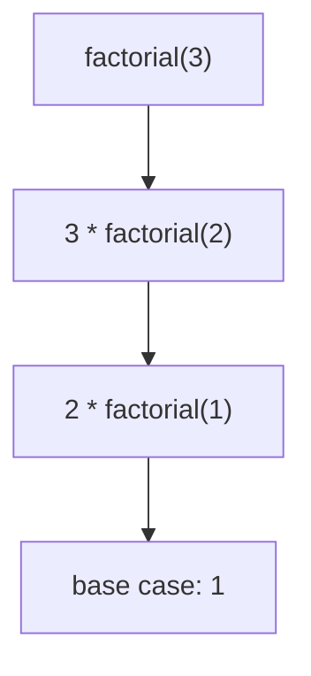

# 08 - Recursion

Learn to solve a problem by solving a smaller copy of it. Ten programs cover factorial, Fibonacci, digits, strings, searching, arrays, powers, Tower of Hanoi and backtracking.

## Table of Contents
- [A. Topic Introduction](#a-topic-introduction)
- [B. Core Concepts](#b-core-concepts)
- [C. How It Works](#c-how-it-works)
- [D. Time and Space Complexity](#d-time-and-space-complexity)
- [E. Problems for Practice](#e-problems-for-practice)
- [F. Installation Requirements](#f-installation-requirements)
- [G. How to Run the Files](#g-how-to-run-the-files)
- [H. Revision Notes](#h-revision-notes)

---

## A. Topic Introduction

**What it is.** Recursion means a function solves a problem by calling itself on a smaller version of the same problem, until it reaches a case so small that the answer is obvious (the base case).

**Why it matters in DSA.** Trees, graphs, divide-and-conquer, dynamic programming and backtracking are all recursive in nature. Learning to trust the recursive "leap of faith" is a core skill.

**Where it is used.** Directory walking, JSON/tree processing, parsing, sorting (merge sort, quick sort), searching (binary search), puzzles (Hanoi) and generating combinations.

**Everyday analogy.** Russian nesting dolls: to find the smallest doll, open the current doll and repeat on the one inside. When you can't open any more, you have reached the base case.

If you know PHP/Laravel: walking a nested menu or category tree (`children` inside `children`) with a function that calls itself on each child is recursion.

---

## B. Core Concepts

| Term | Meaning |
|------|---------|
| Base case | Input so small that the answer is returned directly. Stops the recursion. |
| Recursive case | The function calls itself with a smaller input. |
| Call stack | Memory that holds each pending call; depth = how many are waiting. |
| Stack overflow | Too many nested calls (Python's default limit is about 1000: `RecursionError`). |
| Memoization | Caching results so repeated sub-problems are solved once. |
| Backtracking | Try a choice, recurse, undo the choice, try the next. |

**Two questions to ask**
1. What is the simplest input and its answer? (base case)
2. If I magically had the answer for a smaller input, how do I build my answer? (recursive step)

**Template**

```text
def solve(problem):
    if problem is smallest:      # base case
        return known answer
    smaller = shrink(problem)
    return combine(solve(smaller))
```



---

## C. How It Works

**Dry run 1: `factorial(4)`**

```text
factorial(4) -> 4 * factorial(3)
                    factorial(3) -> 3 * factorial(2)
                                       factorial(2) -> 2 * factorial(1)
                                                          factorial(1) -> 1   (base)
unwinding: 2*1 = 2,  3*2 = 6,  4*6 = 24
```

**Dry run 2: sum of digits of 9875**

| Call | Last digit | Rest | Result |
|------|-----------|------|--------|
| f(9875) | 5 | 987 | 5 + f(987) |
| f(987) | 7 | 98 | 7 + f(98) |
| f(98) | 8 | 9 | 8 + f(9) |
| f(9) | 9 | 0 | 9 + f(0) = 9 + 0 |
| total | | | 9 + 8 + 7 + 5 = 29 |

**Dry run 3: fast power `2^10`**

```text
2^10 = (2^5)^2,  2^5 = 2 * (2^2)^2,  2^2 = (2^1)^2,  2^1 = 2 * (2^0)^2,  2^0 = 1
Only about log2(10) levels instead of 10 multiplications.
```

**Dry run 4: Tower of Hanoi for 3 disks (A to C using B)**

```text
move 2 disks A -> B   (using C)     = 3 moves
move disk 3   A -> C                = 1 move
move 2 disks B -> C   (using A)     = 3 moves
total 7 = 2^3 - 1
```

**Dry run 5: backtracking subsets of `[1, 2]`**

```text
choose 1? -> include -> choose 2? -> include -> [1, 2]
                                    -> exclude -> [1]
          -> exclude -> choose 2? -> include -> [2]
                                    -> exclude -> []
```

---

## D. Time and Space Complexity

| Problem | Time | Space (stack) |
|---------|------|---------------|
| Factorial, sum of digits, reverse, palindrome | O(n) | O(n) |
| Naive Fibonacci | O(2^n) | O(n) |
| Memoized Fibonacci | O(n) | O(n) |
| Recursive binary search | O(log n) | O(log n) |
| Simple power x^n | O(n) | O(n) |
| Fast power x^n | O(log n) | O(log n) |
| Tower of Hanoi | O(2^n) | O(n) |
| Subsets | O(n * 2^n) | O(n) depth |
| Permutations | O(n * n!) | O(n) depth |

Rule of thumb: time = (number of calls) x (work per call); space = maximum depth of the call stack (plus any stored results).

---

## E. Problems for Practice

| No | Title | Difficulty | Concept | Python File |
|----|-------|------------|---------|-------------|
| 1 | Factorial Using Recursion | Easy | Base case and recursive case | `01_factorial.py` |
| 2 | Fibonacci Numbers (Naive vs Memoized) | Easy | Overlapping sub-problems, caching | `02_fibonacci.py` |
| 3 | Sum of Digits and Digital Root | Easy | Shrinking by integer division | `03_sum_of_digits.py` |
| 4 | Reverse a String Recursively | Easy | Recursion on strings, two pointers | `04_reverse_string.py` |
| 5 | Palindrome Check Using Recursion | Easy | Comparing ends, cleaning input | `05_palindrome_check.py` |
| 6 | Recursive Binary Search | Medium | Divide and conquer, O(log n) | `06_binary_search_recursive.py` |
| 7 | Recursive Array Operations | Medium | Index-based recursion | `07_recursive_array_operations.py` |
| 8 | Power Function x^n (Linear vs Fast) | Medium | Halving the exponent | `08_power_function.py` |
| 9 | Tower of Hanoi | Medium | Recursive decomposition | `09_tower_of_hanoi.py` |
| 10 | Backtracking: Subsets and Permutations | Medium | Choose, explore, un-choose | `10_backtracking_subsets_permutations.py` |

### Problem 1 - Factorial Using Recursion (`01_factorial.py`)
**Statement.** Given a non-negative integer n, compute n! = n * (n-1) * ... * 1 using recursion. By definition 0! = 1. Include a call trace.

**Example.**
```text
n = 5 -> 120
0! = 1, 10! = 3628800
negative n -> error
```
**Constraints / edge cases.** n = 0 and n = 1 return 1; negative n is invalid (`ValueError`); very large n hits Python's recursion limit.

**Hints.**
- The base case is `n` of 0 or 1.
- `n! = n * (n - 1)!`.
- Validate input before recursing.

### Problem 2 - Fibonacci Numbers (Naive vs Memoized) (`02_fibonacci.py`)
**Statement.** Return the n-th Fibonacci number with F(0) = 0, F(1) = 1 and F(n) = F(n-1) + F(n-2). Compare naive recursion, memoized recursion and a loop by call counts.

**Example.**
```text
n = 10: value 55, naive 177 calls, memo 19 calls
n = 20: naive 21891 calls, memo 39 calls
fib(50) with memo = 12586269025
```
**Constraints / edge cases.** n = 0; n = 1; negative n (`ValueError`); the naive version is very slow for large n.

**Hints.**
- Naive: add the results of the two previous calls.
- Memo: check a dictionary first and store each answer before returning.
- Loop: keep only the last two values.

### Problem 3 - Sum of Digits and Digital Root (`03_sum_of_digits.py`)
**Statement.** Return the sum of the digits of a non-negative integer with recursion, then repeat until a single digit remains (digital root).

**Example.**
```text
9875 -> sum 29, root 2
123456789 -> sum 45, root 9
negative -> error
```
**Constraints / edge cases.** n = 0; single digit; numbers with zeros such as 1001; negative input.

**Hints.**
- The last digit is `n % 10`; the rest is `n // 10`.
- Base case: a number below 10 (or 0).
- Digital root: apply the digit sum again until the result is below 10.

### Problem 4 - Reverse a String Recursively (`04_reverse_string.py`)
**Statement.** Reverse a string without `text[::-1]` or `reversed()` using recursion, and also with an in-place two-pointer version on a list of characters.

**Example.**
```text
'recursion' -> 'noisrucer'
'hello world' -> 'dlrow olleh'
'' -> ''
```
**Constraints / edge cases.** Empty string; single character; spaces; even and odd lengths.

**Hints.**
- Reverse of a string = reverse of everything after the first character, followed by the first character.
- Base case: length 0 or 1.
- Two-pointer version: swap the ends and move inward until they meet.

### Problem 5 - Palindrome Check Using Recursion (`05_palindrome_check.py`)
**Statement.** Check whether a string reads the same forwards and backwards, ignoring case, spaces and punctuation (only letters and digits count).

**Example.**
```text
'A man, a plan, a canal: Panama' -> True
'hello' -> False
'' -> True
```
**Constraints / edge cases.** Empty string is a palindrome; single character; only punctuation; mixed case.

**Hints.**
- Clean the text first (keep letters and digits, lower-case).
- Compare the first and last characters, then recurse on the middle.
- Base case: length 0 or 1 is `True`.

### Problem 6 - Recursive Binary Search (`06_binary_search_recursive.py`)
**Statement.** Given a sorted list and a target, return the index of the target or -1 using recursion.

**Example.**
```text
[2, 5, 8, 12, 16, 23, 38, 56, 72, 91], target 23 -> index 5
target 50 -> -1
```
**Constraints / edge cases.** Empty list; one element; target smaller or larger than everything; duplicates (any matching index).

**Hints.**
- Pass `low` and `high` bounds instead of slicing the list.
- Base case: `low > high` means not found.
- Compare with the middle and recurse into one half.

### Problem 7 - Recursive Array Operations (`07_recursive_array_operations.py`)
**Statement.** Without loops write recursive functions that compute the sum, the maximum, a count of a value, and an in-place reversal of a list.

**Example.**
```text
[3, 8, 2, 8, 5] -> sum 26, max 8, count of 8 = 2, reversed [5, 8, 2, 8, 3]
max of empty list -> error
```
**Constraints / edge cases.** Empty list (sum 0, count 0, maximum is an error); single element; all equal; negative numbers.

**Hints.**
- Pass an index so you do not copy the list.
- Sum: element + sum of the rest; max: larger of element and max of the rest.
- Reverse: swap the two ends and recurse inward.

### Problem 8 - Power Function x^n (Linear vs Fast) (`08_power_function.py`)
**Statement.** Compute x to the integer power n using recursion, without `**` or `pow()`. Support negative n. Compare a simple and a fast version.

**Example.**
```text
2^10 simple: 11 calls, fast: 5 calls
2^-3 = 0.125
0 with negative power -> error
```
**Constraints / edge cases.** n = 0 gives 1; n = 1; negative n; x = 0 with negative n is an error; negative x.

**Hints.**
- Simple: `x * power(x, n - 1)`.
- Fast: compute half = power(x, n // 2) once and square it; multiply by x if n is odd.
- For negative n compute with the positive exponent and take the reciprocal.

### Problem 9 - Tower of Hanoi (`09_tower_of_hanoi.py`)
**Statement.** Move n disks from peg A to peg C using peg B, one disk at a time, never putting a larger disk on a smaller one. Print the moves and count them.

**Example.**
```text
n = 3 -> 7 moves, first move: disk 1 from A to C
n = 5 -> 31 moves
```
**Constraints / edge cases.** n = 0 means no moves; n = 1 is a single move; moves grow as 2^n - 1.

**Hints.**
- Move n-1 disks to the spare peg, move the biggest disk, move n-1 disks on top of it.
- The roles of source, helper and target change on every call.
- Total moves satisfy `T(n) = 2T(n-1) + 1`.

### Problem 10 - Backtracking: Subsets and Permutations (`10_backtracking_subsets_permutations.py`)
**Statement.** Given a list of distinct items, generate all subsets and all permutations using recursive backtracking.

**Example.**
```text
[1, 2, 3] -> 8 subsets, 6 permutations
empty input -> [[]] for both
4 items -> 16 subsets, 24 permutations
```
**Constraints / edge cases.** Empty input returns `[[]]`; single item; duplicate items would repeat results (distinct items are assumed).

**Hints.**
- Keep a current path list and add a copy of it to the results.
- Subsets: for each item decide to include or exclude it.
- Permutations: choose an unused item, recurse, then remove it again (undo).

---

## F. Installation Requirements

| Item | Requirement |
|------|-------------|
| Python version | Python 3.8 or newer |
| Packages | None. Standard library only |
| Extra installation | Nothing to install beyond Python itself |

Check your installation with `python --version` (see section G).

---

## G. How to Run the Files

1. Open a terminal: **Windows** - press `Win + R`, type `cmd` (or open PowerShell / VS Code terminal). **Linux/macOS** - open Terminal.
2. Verify Python:
   ```bash
   python --version      # Windows (or: py --version)
   python3 --version     # Linux / macOS
   ```
3. Move into the topic folder and run a file.

**Windows**
```bash
cd Python-DSA-Practice\08-Recursion
python 01_factorial.py
```
If `python` is not recognised, use the Python launcher: `py 01_factorial.py`.

**Linux / macOS**
```bash
cd Python-DSA-Practice/08-Recursion
python3 01_factorial.py
```

Every file is a standalone program: it needs no other file and no internet.

---

## H. Revision Notes

**Key concepts**
- Every recursion needs a base case and progress toward it.
- The call stack stores pending calls; depth costs O(depth) memory.
- Overlapping sub-problems (Fibonacci) call for memoization.
- Halving the problem gives `O(log n)` (binary search, fast power).
- Backtracking = choose, explore, undo.

**Common mistakes**
- Missing or wrong base case causing `RecursionError`.
- Not shrinking the input (infinite recursion).
- Slicing lists/strings in every call, which hides O(n) copying.
- Forgetting to undo a choice in backtracking, or storing the path without copying it.
- Using naive recursion where memoization is required.

**Interview tips**
- Say the base case first, then the recursive relation.
- State time and space, including the call stack.
- Mention Python's recursion limit and how to convert to a loop or explicit stack.
- Draw the call tree for 3-4 inputs to spot repeated work.
- Know that tail recursion is not optimised in Python.
