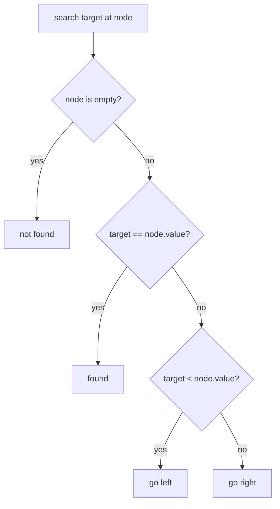

# 09 - Tree

Learn binary trees: how to build them, walk them in every order, measure them, and use the ordering rule of a Binary Search Tree (BST).

## Table of Contents
- [A. Topic Introduction](#a-topic-introduction)
- [B. Core Concepts](#b-core-concepts)
- [C. How It Works](#c-how-it-works)
- [D. Time and Space Complexity](#d-time-and-space-complexity)
- [E. Problems for Practice](#e-problems-for-practice)
- [F. Installation Requirements](#f-installation-requirements)
- [G. How to Run the Files](#g-how-to-run-the-files)
- [H. Revision Notes](#h-revision-notes)

---

## A. Topic Introduction

**What it is.** A tree is a set of nodes connected in a hierarchy: one root at the top, and every other node hangs below exactly one parent. In a binary tree each node has at most two children, called left and right.

**Why it matters in DSA.** Trees model hierarchical data and give fast search (BST), and almost every tree problem is solved with recursion, so they are the best practice ground for recursive thinking. They lead directly to heaps, tries, segment trees and graphs.

**Where it is used.** File systems, the HTML DOM, database indexes (B-trees), expression parsers in compilers, autocomplete, decision trees, routing tables, and organisation charts.

**Everyday analogy.** A family tree or a folder structure: one top folder, each folder holds sub-folders, and a folder with nothing inside is a leaf.

If you know PHP/Laravel: a tree node is like a linked-list node with two `next` pointers (`left` and `right`). Nested arrays or a category with `parent_id` (e.g. menu categories) describe the same hierarchy.

---

## B. Core Concepts

| Term | Meaning |
|------|---------|
| Node | One element holding a value, a left child and a right child. |
| Root | The top node (no parent). |
| Parent / child | A node directly above / below another. |
| Leaf | A node with no children. |
| Internal node | A node with at least one child. |
| Subtree | A node together with everything below it. |
| Depth of a node | Number of edges from the root to it (root = 0). |
| Height of a tree | Number of nodes on the longest root-to-leaf path in these files (empty tree = 0). |
| Level | All nodes at the same depth. |
| Balanced | Left and right heights differ by at most 1 at every node. |
| BST rule | For every node: all left-subtree values are smaller, all right-subtree values are larger. |

```text
            1            <- root, level 0
           / \
          2   3          <- level 1 (3 is a leaf)
         / \
        4   5            <- level 2 (leaves)

Node 2: parent=1, children=4 and 5, internal node.
```

### Depth-first versus breadth-first

```text
Preorder  (Root, Left, Right) : 1 2 4 5 3
Inorder   (Left, Root, Right) : 4 2 5 1 3
Postorder (Left, Right, Root) : 4 5 2 3 1
Level-order (top to bottom)   : 1 2 3 4 5
```

Depth-first uses recursion (or your own stack); breadth-first uses a queue.

### A BST

```text
          50
        /    \
      30      70
     /  \    /  \
    20  40  60  80

Inorder walk of a BST gives sorted order: 20 30 40 50 60 70 80
```



---

## C. How It Works

**Recursion pattern.** Most tree functions follow one template: handle the empty node (base case), solve the left subtree, solve the right subtree, combine.

```text
height(node):  if node is empty -> 0
               otherwise 1 + larger of (height(left), height(right))
```

Dry run of height on the first tree in section B (root 1, children 2 and 3, node 2 has children 4 and 5):

| Call | Returns |
|------|---------|
| height(4) | 1 + max(0, 0) = 1 |
| height(5) | 1 |
| height(2) | 1 + max(1, 1) = 2 |
| height(3) | 1 |
| height(1) | 1 + max(2, 1) = 3 |

**Level-order with a queue.** Start with the root in the queue. For each level, take exactly the current queue length of nodes, record them, and push their children. That count is what separates one level from the next.

**BST insert.** Compare with the current node: smaller goes left, larger goes right; attach the new node at the first empty spot. Inserting 50, 30, 70, 20 gives the tree shown earlier. Inserting 1, 2, 3, 4, 5 in order gives a chain of height 5, because insertion order decides the shape.

**BST delete, three cases.**

| Case | What to do |
|------|------------|
| Leaf | Remove it. |
| One child | Replace the node by that child. |
| Two children | Copy the inorder successor (smallest value in the right subtree) into the node, then delete that successor from the right subtree. |

**Validate a BST.** Checking only parent against child is wrong: a value deep in the right subtree must still be larger than the root. Pass down an allowed range (low, high) and tighten it as you go left or right.

---

## D. Time and Space Complexity

n = number of nodes, h = height of the tree (about log n if balanced, n if skewed).

| Operation | Time | Space | Note |
|-----------|------|-------|------|
| Build from a level-order list | O(n) | O(n) | Queue of waiting parents |
| Preorder / inorder / postorder (recursive) | O(n) | O(h) | Recursion stack |
| Iterative traversals | O(n) | O(h) | Explicit stack; O(n) when skewed |
| Level-order | O(n) | O(w) | w = widest level, up to O(n) |
| Height, count nodes/leaves | O(n) | O(h) | Every node visited once |
| BST search / insert / delete | O(h) | O(h) recursive, O(1) iterative | Balanced O(log n), skewed O(n) |
| BST min / max | O(h) | O(1) | Walk one side |
| Validate BST | O(n) | O(h) | Each node visited once |

---

## E. Problems for Practice

| No | Title | Difficulty | Concept | Filename |
|----|-------|------------|---------|----------|
| 1 | Creating a Binary Tree and Displaying Its Shape | Easy | Node class, building from list, sideways print | `01_tree_creation.py` |
| 2 | Inorder, Preorder and Postorder Traversals | Easy | recursive depth-first traversal | `02_depth_first_traversals.py` |
| 3 | Height (Maximum Depth) of a Binary Tree | Easy | post-order recursion, depth, balance | `03_tree_height.py` |
| 4 | Count Nodes, Leaves and Internal Nodes | Easy | recursive aggregation, leaf test | `04_count_nodes_leaves.py` |
| 5 | Level-Order (Breadth-First) Traversal | Medium | queue BFS, per-level processing, zigzag | `05_level_order_traversal.py` |
| 6 | Binary Search Tree - Insertion | Easy | BST rule, recursive and iterative insert | `06_bst_insert.py` |
| 7 | Binary Search Tree - Search, Minimum, Maximum | Easy | BST search path, min/max, successor | `07_bst_search.py` |
| 8 | Binary Search Tree - Deletion | Medium | three deletion cases, successor replacement | `08_bst_delete.py` |
| 9 | Validate a Binary Search Tree | Medium | range bounds, inorder check | `09_validate_bst.py` |
| 10 | Iterative Inorder, Preorder and Postorder Traversals | Medium | explicit stack instead of recursion | `10_iterative_traversals.py` |

Try each problem yourself first, then compare with the solution file.

### Problem 1: Creating a Binary Tree and Displaying Its Shape (`01_tree_creation.py`)

**Statement.** Build a binary tree from node objects (value, left, right) and print it sideways so the structure is visible. Also build a tree from a level-order list where `None` marks a missing child.

**Example.**
```text
Input : level-order list = [1, 2, 3, 4, 5, None, 6]
Output (root at the left, right subtree on top):
            6
        3
    1
            5
        2
            4
Also  : empty list -> None; node 4 is reported as a leaf
```

**Constraints and edge cases.** Empty list (no tree), only a root, `None` gaps, skewed trees.

**Hints.**
- A node is a tiny class with three fields; no methods needed.
- Sideways print: print right subtree first, then the node indented by its depth, then the left subtree.
- Building from a list: keep a queue of nodes that still need children; for each, take the next two list items as left and right (skipping `None`).
- Handle an empty list or a `None` first item before anything else.

### Problem 2: Inorder, Preorder and Postorder Traversals (`02_depth_first_traversals.py`)

**Statement.** Visit every node in inorder (Left, Root, Right), preorder (Root, Left, Right) and postorder (Left, Right, Root) using recursion, returning the values as lists.

**Example.**
```text
Input : tree 1 -> (2 -> (4, 5), 3)
Output: Preorder : [1, 2, 4, 5, 3]
        Inorder  : [4, 2, 5, 1, 3]
        Postorder: [4, 5, 2, 3, 1]
        Empty tree: []
```

**Constraints and edge cases.** Empty tree, single node, only left or only right children.

**Hints.**
- The three functions are nearly identical; only the position of the "visit" step changes.
- Base case: an empty node contributes nothing.
- Collect values in a list (a helper that appends to a shared list is fine).
- Mnemonic: the name tells where Root goes: PRE = before, IN = between, POST = after.

### Problem 3: Height (Maximum Depth) of a Binary Tree (`03_tree_height.py`)

**Statement.** Return the height (number of nodes on the longest root-to-leaf path; empty tree = 0). Also report the depth of a value (root = 0, missing = -1) and whether the tree is height-balanced.

**Example.**
```text
Input : 1 -> (2 -> (4 -> 5), 3)
Output: Height: 4
        Height of left subtree: 3
        Depth of 5: 3
        Depth of 99: -1
        Balanced? False
```

**Constraints and edge cases.** Empty tree (0), single node (1), skewed tree (height = n).

**Hints.**
- Height depends on the children's heights, so compute children first (post-order thinking).
- Empty node returns 0; otherwise add 1 to the larger child height.
- Depth: pass the current depth down as you recurse, return it when the value matches.
- Balanced: at every node, the two child heights must differ by at most 1 (and both subtrees must be balanced).

### Problem 4: Count Nodes, Leaves and Internal Nodes (`04_count_nodes_leaves.py`)

**Statement.** Compute the total nodes, leaf nodes (no children), internal nodes (at least one child) and the sum of all values.

**Example.**
```text
Input : 10 -> (5 -> (3, 7), 20 -> (None, 30))
Output: nodes=6, leaves=3, internal=3, sum=75
        Empty tree: nodes=0, leaves=0, internal=0, sum=0
        Single node (8): nodes=1, leaves=1, internal=0, sum=8
```

**Constraints and edge cases.** Empty tree, single node (it is a leaf), node with one child (internal, not a leaf).

**Hints.**
- Nodes: one for this node plus the counts of both subtrees.
- A leaf is a node whose left AND right are both missing.
- Internal = nodes minus leaves, or count directly; both agree.
- Same recursion shape for the sum: this node's value plus both subtree sums.

### Problem 5: Level-Order (Breadth-First) Traversal (`05_level_order_traversal.py`)

**Statement.** Return the values level by level, top to bottom and left to right, as a flat list and as a list of levels. Also return the zigzag order (reverse direction on alternate levels).

**Example.**
```text
Input : 3 -> (9, 20 -> (15, 7))
Output: By levels: [[3], [9, 20], [15, 7]]
        Flat: [3, 9, 20, 15, 7]
        Zigzag: [[3], [20, 9], [15, 7]]
        Empty tree: []
```

**Constraints and edge cases.** Empty tree gives an empty list; single node; skewed tree (every level has one node).

**Hints.**
- Use `collections.deque` as the queue (a Python list makes dequeuing slow).
- At the start of each round, note the queue length: that is exactly how many nodes belong to this level.
- Pop that many nodes, store their values, push their non-empty children.
- Zigzag: flip every other level's list after collecting it (do it by hand, no shortcuts needed beyond a simple reversal you write).
- The solution also shows a recursive version that passes the level number down.

### Problem 6: Binary Search Tree - Insertion (`06_bst_insert.py`)

**Statement.** Insert integers one by one into a BST (left subtree smaller, right subtree larger, duplicates ignored). Show that an inorder walk prints values in sorted order.

**Example.**
```text
Input : values = [50, 30, 70, 20, 40, 60, 80]
Output: Inorder (sorted): [20, 30, 40, 50, 60, 70, 80]
        Duplicates ignored: [3, 5, 8]
        Height of balanced-looking tree: 3
        Height after inserting sorted values 1..5: 5
```

**Constraints and edge cases.** Empty tree (new value becomes the root), duplicate values, sorted input (creates a chain).

**Hints.**
- Recursive version: if the spot is empty, return a new node; otherwise recurse left or right and reattach the returned subtree.
- Iterative version: walk down while remembering the parent, then attach to the parent's left or right.
- For equal values, do nothing.
- Compare heights for random-looking versus sorted input to see why balance matters.

### Problem 7: Binary Search Tree - Search, Minimum, Maximum (`07_bst_search.py`)

**Statement.** Search a BST for a target and report the path taken. Also find the smallest and largest values and the inorder successor of a value (the next larger value present).

**Example.**
```text
Input : BST from [50, 30, 70, 20, 40, 60, 80]
Output: Search 60: found=True, path=[50, 70, 60]
        Search 25: found=False, path=[50, 30, 20]
        Minimum: 20 Maximum: 80
        Successor of 20: 30   Successor of 50: 60   Successor of 80: None
        Empty tree: False None
```

**Constraints and edge cases.** Empty tree, single node, missing target, target is the maximum (no successor).

**Hints.**
- Each comparison throws away one whole subtree.
- Min: keep going left. Max: keep going right.
- Successor: if the node has a right subtree, it is that subtree's minimum. Otherwise it is the last ancestor where you turned left on the way down.
- Walk from the root while tracking the best candidate: no parent pointers are needed.

### Problem 8: Binary Search Tree - Deletion (`08_bst_delete.py`)

**Statement.** Delete a value from a BST so the result is still a valid BST, handling a leaf, a node with one child, and a node with two children.

**Example.**
```text
Input : BST from [50, 30, 70, 20, 40, 60, 80]; delete 20, then 30, then 50
Output: Start             : inorder=[20, 30, 40, 50, 60, 70, 80]
        Delete 20 (leaf)  : inorder=[30, 40, 50, 60, 70, 80]
        Delete 30 (1 child): inorder=[40, 50, 60, 70, 80]
        Delete 50 (2 kids): inorder=[40, 60, 70, 80] preorder=[60, 40, 70, 80]
        Delete 999 (none) : unchanged
```

**Constraints and edge cases.** Deleting the root, a missing value, an empty tree, a node with only one child, the last remaining node (result is `None`).

**Hints.**
- Search recursively; on the way back, reassign `node.left` or `node.right` to whatever the recursive call returns.
- Zero or one child: return the other child (or `None`).
- Two children: find the smallest value in the right subtree, copy it into this node, then delete that value from the right subtree.
- Why the successor? It is the only value that keeps everything on the left smaller and everything on the right larger.

### Problem 9: Validate a Binary Search Tree (`09_validate_bst.py`)

**Statement.** Given a binary tree, decide whether it is a valid BST: all values in each node's left subtree are smaller and all in its right subtree larger (no duplicates).

**Example.**
```text
Input : 5 -> (1, 6 -> (3, 7))   (3 sits in the right subtree of 5 but is smaller than 5)
Output: tricky tree: bounds=False, inorder=False, parent-child-only=True
        valid BST:   bounds=True, inorder=True
        duplicate value: bounds=False
        empty tree: True
```

**Constraints and edge cases.** Empty tree (valid), single node, duplicates (invalid here), values equal to a bound, a tree that looks fine locally but is not.

**Hints.**
- Method 1 (bounds): each node must lie strictly between a low and a high limit. Going left tightens the high limit to the node's value; going right tightens the low limit.
- Start with no limits (infinite or `None`).
- Method 2 (inorder): an inorder walk of a valid BST is strictly increasing; keep the previous value and compare.
- The "parent-child-only" check in the solution is the common wrong answer: try to see why it passes the tricky tree.

### Problem 10: Iterative Inorder, Preorder and Postorder Traversals (`10_iterative_traversals.py`)

**Statement.** Perform the three depth-first traversals WITHOUT recursion, using an explicit stack (a Python list).

**Example.**
```text
Input : 1 -> (2 -> (4, 5), 3)
Output: Inorder  : [4, 2, 5, 1, 3]
        Preorder : [1, 2, 4, 5, 3]
        Postorder: [4, 5, 2, 3, 1]
        Empty tree: [] [] []
        Deep chain of 3000 nodes works without a recursion error
```

**Constraints and edge cases.** Empty tree, single node, skewed trees (the stack grows to n).

**Hints.**
- Inorder: go as far left as possible, pushing nodes; pop one, visit it, then move to its right child and repeat.
- Preorder: pop, visit, push the right child first and then the left, so left is processed first.
- Postorder: one trick is to produce Root-Right-Left order and then reverse it; another uses two stacks.
- A deep chain would crash a recursive version (Python's default limit is about 1000 calls), which is the whole point of this problem.

---

## F. Installation Requirements

| Item | Requirement |
|------|-------------|
| Python version | Python 3.8 or newer |
| Packages | None beyond the standard library (`collections.deque` is used in the level-order file) |
| Third-party installs | Not needed (no NumPy in this topic) |

Check your version:

```bash
python --version
```

---

## G. How to Run the Files

1. Open a terminal: Windows - Command Prompt or PowerShell (or the terminal in VS Code); Linux/macOS - Terminal.
2. Go to the topic folder.
3. Run a file.

**Windows**
```bash
cd Python-DSA-Practice\09-Tree
python 01_tree_creation.py
```
If `python` is not recognised, use the launcher: `py 01_tree_creation.py` (and `py --version`).

**Linux / macOS**
```bash
cd Python-DSA-Practice/09-Tree
python3 01_tree_creation.py
python3 --version
```

Each file is standalone: it needs no other file and no input from you.

---

## H. Revision Notes

**Key concepts**
- A node has a value, a left and a right pointer; a leaf has both empty.
- Preorder = Root first, inorder = Root in the middle, postorder = Root last; level-order uses a queue.
- Inorder traversal of a BST is sorted.
- BST search/insert/delete cost O(h): O(log n) when balanced, O(n) when skewed.
- Height: empty = 0, otherwise 1 + larger child height (these files count nodes, not edges).
- BST delete with two children: replace with the inorder successor.

**Common mistakes**
- Forgetting the empty-node base case, leading to attribute errors on `None`.
- Mixing up height counted in nodes versus edges; always state your convention.
- Validating a BST by comparing only parent and child instead of the full range.
- In BST delete, forgetting to reassign the child links returned from the recursive call.
- Counting a node with a single child as a leaf.
- In level-order, not fixing the level size before the loop (the queue changes while you iterate).
- Allowing duplicates silently; decide and state the rule.

**Interview tips**
- Say the traversal order out loud and draw a 5-node tree before coding.
- Most tree problems are: base case, recurse left, recurse right, combine.
- Be ready to convert a recursive solution to an iterative one (problem 10).
- Know classics: Maximum Depth, Level Order, Validate BST, Lowest Common Ancestor, Kth Smallest in a BST.
- Mention the skewed-tree worst case and that self-balancing trees (AVL, Red-Black) fix it.
