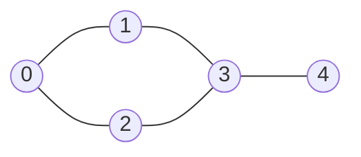

# 10 - Graph

## Table of Contents

- [A. Topic Introduction](#a-topic-introduction)
- [B. Core Concepts](#b-core-concepts)
- [C. How It Works](#c-how-it-works)
- [D. Time and Space Complexity](#d-time-and-space-complexity)
- [E. Problems for Practice](#e-problems-for-practice)
- [F. Installation Requirements](#f-installation-requirements)
- [G. How to Run the Files](#g-how-to-run-the-files)
- [H. Revision Notes](#h-revision-notes)

## A. Topic Introduction

A **graph** is a set of **vertices** (things) joined by **edges** (relationships). It is the most general data structure you will meet: a linked list is a graph where every vertex has one neighbour, and a tree is a graph with no cycles.

**Why it matters in DSA.** Many interview problems are graph problems in disguise: "can I get from A to B?", "what is the fewest number of steps?", "which tasks must run first?", "how many separate groups are there?".

**Real-world uses.** Social networks (friends), maps and route planning, web page links, package managers and build tools (dependencies), network routing, game boards and grids.

**Everyday analogy.** A city metro map. Stations are vertices, tracks are edges. Asking "how many stops from station A to station D?" is a shortest-path question. For a Laravel developer: think of database tables linked by foreign keys, or the dependency order of migrations. Each table is a vertex and each foreign key is an edge.

## B. Core Concepts

**Terminology**

| Term | Meaning |
|------|---------|
| Vertex (node) | One item in the graph |
| Edge | A connection between two vertices |
| Undirected | An edge works both ways (friendship) |
| Directed | An edge has a direction (A must come before B) |
| Neighbour | A vertex directly joined to another |
| Degree | Number of neighbours of a vertex |
| Path | A sequence of vertices joined by edges |
| Cycle | A path that returns to its starting vertex |
| Connected component | A group of vertices that can all reach each other |
| In-degree | Number of edges pointing into a vertex (directed graphs) |

**A small graph** (used in the examples below):

```text
    0 --- 1 --- 3 --- 4
    |           |
    2 ----------+
```

Edges: (0,1) (0,2) (1,3) (2,3) (3,4). The cycle is 0-1-3-2-0.

**Two ways to store it**

Adjacency list (a dictionary of lists; good for sparse graphs, the usual choice):

```text
0 -> [1, 2]
1 -> [0, 3]
2 -> [0, 3]
3 -> [1, 2, 4]
4 -> [3]
```

Adjacency matrix (a grid; O(1) edge check but O(V^2) memory):

```text
    0 1 2 3 4
0:  0 1 1 0 0
1:  1 0 0 1 0
2:  1 0 0 1 0
3:  0 1 1 0 1
4:  0 0 0 1 0
```

**Two ways to walk it**

- **BFS** (breadth-first) uses a **queue**: visit all vertices 1 step away, then 2 steps away, and so on.
- **DFS** (depth-first) uses a **stack** (or recursion): go as deep as possible, then backtrack.



## C. How It Works

**BFS dry run** on the graph above, starting from 0. Mark a vertex visited when it is put in the queue.

| Step | Take from queue | Queue after adding unseen neighbours | Result so far |
|------|-----------------|--------------------------------------|---------------|
| 0 | - | [0] | [] |
| 1 | 0 | [1, 2] | [0] |
| 2 | 1 | [2, 3] | [0, 1] |
| 3 | 2 | [3] (3 already seen) | [0, 1, 2] |
| 4 | 3 | [4] | [0, 1, 2, 3] |
| 5 | 4 | [] | [0, 1, 2, 3, 4] |

Because the queue is first-in-first-out, every vertex at distance d leaves the queue before any vertex at distance d+1. That is why BFS gives shortest paths in **unweighted** graphs.

**DFS dry run** from 0 (neighbours tried in list order): visit 0, go to 1, go to 3, go to 2 (0 already seen, back), go to 4. Order: 0, 1, 3, 2, 4. The recursion stack always holds the current path.

**The visited set** is the rule that makes every traversal safe. Without it a cycle would make the loop run forever.

**Kahn's topological sort** (directed graphs): count in-degrees, queue every vertex with in-degree 0, remove one at a time and lower the in-degree of its targets. If not every vertex gets removed, a cycle exists.

**Grid as a graph:** in a 2D grid every cell is a vertex and its up/down/left/right cells are its neighbours; no adjacency list is ever built.

## D. Time and Space Complexity

V = number of vertices, E = number of edges.

| Operation | Adjacency list | Adjacency matrix |
|-----------|----------------|------------------|
| Space | O(V + E) | O(V^2) |
| Is there an edge u-v? | O(degree of u) | O(1) |
| List neighbours of u | O(degree of u) | O(V) |
| Build from edge list | O(V + E) | O(V^2) |

| Algorithm | Time | Extra space |
|-----------|------|-------------|
| BFS / DFS | O(V + E) | O(V) |
| Path exists | O(V + E) | O(V) |
| Shortest path (unweighted, BFS) | O(V + E) | O(V) |
| Connected components | O(V + E) | O(V) |
| Cycle detection (undirected, DFS) | O(V + E) | O(V) |
| Topological sort (Kahn) | O(V + E) | O(V + E) |
| Number of islands (R x C grid) | O(R * C) | O(R * C) |

Rule of thumb: sparse graph (few edges) means use an adjacency list; dense graph or constant-time edge lookups mean a matrix.

## E. Problems for Practice

Try each problem on your own first. Open the `.py` file only after you have attempted it.

| No | Title | Difficulty | Concept | Python file |
|----|-------|------------|---------|-------------|
| 01 | Build a Graph with an Adjacency List | Easy | Graph representation, degree | `01_adjacency_list.py` |
| 02 | Build a Graph with an Adjacency Matrix | Easy | Matrix representation, symmetry | `02_adjacency_matrix.py` |
| 03 | Breadth-First Search (BFS) Traversal | Easy | Queue, visited set, level order | `03_bfs_traversal.py` |
| 04 | Depth-First Search (DFS) Traversal | Easy | Recursion vs explicit stack | `04_dfs_traversal.py` |
| 05 | Does a Path Exist? | Easy | Reachability, parent tracking | `05_path_exists.py` |
| 06 | Shortest Path in an Unweighted Graph | Medium | BFS distance and path | `06_shortest_path_unweighted.py` |
| 07 | Count and List Connected Components | Medium | Traversal from every unvisited vertex | `07_connected_components.py` |
| 08 | Detect a Cycle in an Undirected Graph | Medium | DFS with parent | `08_cycle_detection_undirected.py` |
| 09 | Topological Sort with Cycle Detection | Medium | Directed graphs, in-degree (Kahn) | `09_topological_sort.py` |
| 10 | Number of Islands | Medium | Grid as a graph, flood fill | `10_number_of_islands.py` |

### Problem 01: Build a Graph with an Adjacency List (Easy)

File: `01_adjacency_list.py`

**Problem statement.** Given n vertices labelled 0..n-1 and a list of undirected edges, build an adjacency list (dictionary of neighbour lists) and print each vertex with its neighbours and degree.

**Example.**

```text
n = 5
edges = [(0,1), (0,2), (1,3), (2,3), (3,4)]

0 -> [1, 2] (degree 2)
1 -> [0, 3] (degree 2)
2 -> [0, 3] (degree 2)
3 -> [1, 2, 4] (degree 3)
4 -> [3] (degree 1)
```

**Constraints and edge cases.**

- n = 0 gives an empty graph.
- Vertices with no edges must still appear with an empty list.
- An edge using a vertex outside 0..n-1 must be rejected with an error.
- An undirected edge is stored twice.

**Hints (no code).**

1. Start by creating an empty list for every vertex so isolated vertices are not forgotten.
2. For an undirected edge (u, v) you need to update two lists.
3. Degree is simply how many entries a vertex's list has.
4. Validate both endpoints before adding the edge.

### Problem 02: Build a Graph with an Adjacency Matrix (Easy)

File: `02_adjacency_matrix.py`

**Problem statement.** Build an n x n matrix where cell [u][v] is 1 when u and v are joined. Add helpers to test whether an edge exists and to list the neighbours of a vertex.

**Example.**

```text
n = 4
edges = [(0,1), (0,2), (2,3)]

   0 1 2 3
0: 0 1 1 0
1: 1 0 0 0
2: 1 0 0 1
3: 0 0 1 0
Edge 0-1? True
Edge 1-3? False
Neighbours of 2: [0, 3]
```

**Constraints and edge cases.**

- n = 0 gives an empty matrix.
- Invalid vertex numbers must raise an error.
- Duplicate edges change nothing.
- Rows must be separate lists, not copies of one shared list.

**Hints (no code).**

1. Be careful how you create the rows: building them with list multiplication of a list shares one row.
2. For an undirected graph the matrix is symmetric, so set two cells per edge.
3. Checking an edge is a single lookup.
4. Neighbours of u are the column numbers where row u holds 1.

### Problem 03: Breadth-First Search (BFS) Traversal (Easy)

File: `03_bfs_traversal.py`

**Problem statement.** Given an adjacency list and a start vertex, return the vertices in BFS order (nearest first).

**Example.**

```text
graph = {0:[1,2], 1:[0,3,4], 2:[0,5], 3:[1], 4:[1], 5:[2]}
start = 0

BFS from 0: [0, 1, 2, 3, 4, 5]
BFS from 3: [3, 1, 0, 4, 2, 5]
```

**Constraints and edge cases.**

- A start vertex with no neighbours returns just [start].
- Vertices in other components are never reached.
- Cycles must not cause an infinite loop.
- A start vertex not in the graph should raise an error.

**Hints (no code).**

1. Use a queue (deque) and a visited set.
2. Mark a vertex visited when you add it to the queue, not when you remove it; otherwise it can be queued twice.
3. Process the front vertex, then add its unseen neighbours.
4. Stop when the queue is empty.

### Problem 04: Depth-First Search (DFS) Traversal (Easy)

File: `04_dfs_traversal.py`

**Problem statement.** Return the DFS order from a start vertex, first with recursion and then with an explicit stack. Both should give the same order.

**Example.**

```text
graph = {0:[1,2], 1:[0,3,4], 2:[0,5], 3:[1], 4:[1], 5:[2]}
start = 0

Recursive DFS: [0, 1, 3, 4, 2, 5]
Iterative DFS: [0, 1, 3, 4, 2, 5]
```

**Constraints and edge cases.**

- A long chain of thousands of vertices can exceed Python's recursion limit.
- Cycles must be handled with a visited set.
- Unknown start vertex should raise an error.

**Hints (no code).**

1. Recursive: mark visited, record the vertex, then call yourself for each unseen neighbour.
2. Iterative: a list used as a stack; pop, skip if visited, record, push neighbours.
3. A stack reverses order, so think about the order in which you push neighbours if you want to match the recursive result.
4. Test with a path graph of 5000 vertices to see why iterative matters.

### Problem 05: Does a Path Exist? (Easy)

File: `05_path_exists.py`

**Problem statement.** Given an undirected graph, a source and a destination, return whether the destination is reachable and, if so, one path from source to destination.

**Example.**

```text
graph = {0:[1,2], 1:[0,3], 2:[0], 3:[1], 4:[5], 5:[4]}

0 -> 3: exists=True path=[0, 1, 3]
0 -> 5: exists=False path=None
```

**Constraints and edge cases.**

- source == destination is trivially reachable with path [source].
- Different components mean no path.
- Unknown vertices should raise an error.
- The path found need not be the shortest.

**Hints (no code).**

1. Traverse from the source and remember, for every vertex, which vertex you came from.
2. If the destination gets a recorded parent, it was reached.
3. Rebuild the path by following parents backwards, then reverse it.
4. Handle the source == destination case first.

### Problem 06: Shortest Path in an Unweighted Graph (Medium)

File: `06_shortest_path_unweighted.py`

**Problem statement.** Return the minimum number of edges between a source and destination and one shortest path. Return (-1, None) when unreachable.

**Example.**

```text
graph = {0:[1,2], 1:[0,3], 2:[0,3], 3:[1,2,4], 4:[3], 5:[]}

0 -> 4: distance=3 path=[0, 1, 3, 4]
0 -> 5: distance=-1 path=None
```

**Constraints and edge cases.**

- source == destination gives distance 0.
- Unreachable destination gives (-1, None).
- Several shortest paths may exist; any is fine.
- This does not work for weighted edges.

**Hints (no code).**

1. Why does BFS (and not DFS) give shortest paths? Think about the order vertices leave the queue.
2. Record distance[v] = distance[u] + 1 the first time you discover v.
3. Also record the parent so the path can be rebuilt.
4. You may stop as soon as the destination is discovered.

### Problem 07: Count and List Connected Components (Medium)

File: `07_connected_components.py`

**Problem statement.** Given n vertices and an edge list, return how many connected components there are and the vertices of each.

**Example.**

```text
n = 7, edges = [(0,1), (1,2), (3,4)]

Component count: 4
Component 1: [0, 1, 2]
Component 2: [3, 4]
Component 3: [5]
Component 4: [6]
```

**Constraints and edge cases.**

- n = 0 gives 0 components.
- No edges: every vertex is its own component.
- Fully connected graph: exactly 1.
- Invalid edge endpoints should raise an error.

**Hints (no code).**

1. Build the adjacency list first.
2. Loop over every vertex; when one is unvisited, a new component starts.
3. A traversal from it collects exactly that component.
4. The answer is the number of times you had to start a new traversal.

### Problem 08: Detect a Cycle in an Undirected Graph (Medium)

File: `08_cycle_detection_undirected.py`

**Problem statement.** Return True if an undirected graph (possibly disconnected) contains a cycle.

**Example.**

```text
tree  = {0:[1,2], 1:[0], 2:[0]}
cycle = {0:[1,2], 1:[0,2], 2:[0,1]}

Tree has cycle: False
Triangle has cycle: True
```

**Constraints and edge cases.**

- The cycle may be in only one component.
- A self-loop counts as a cycle.
- Empty graph has no cycle.
- Inputs are assumed to be simple graphs (no repeated edges).

**Hints (no code).**

1. In an undirected edge, the vertex you just came from always shows up as a visited neighbour. How can you ignore exactly that one?
2. Pass the parent along in the DFS.
3. A visited neighbour that is not the parent means a second route exists.
4. Start the DFS from every unvisited vertex.

### Problem 09: Topological Sort with Cycle Detection (Medium)

File: `09_topological_sort.py`

**Problem statement.** Given tasks 0..n-1 and directed edges (a, b) meaning a must come before b, return a valid order or None if a cycle makes it impossible.

**Example.**

```text
n = 6
edges = [(5,2), (5,0), (4,0), (4,1), (2,3), (3,1)]

Order: [4, 5, 2, 0, 3, 1]
Cycle 0->1->2->0: None
```

**Constraints and edge cases.**

- Empty graph returns [].
- A cycle returns None.
- Many valid orders may exist; yours depends on queue order.
- Invalid endpoints should raise an error.

**Hints (no code).**

1. Compute the in-degree of every vertex.
2. A vertex with in-degree 0 has no unmet prerequisites; queue all of them.
3. When you output a vertex, lower the in-degree of what it points to.
4. If you output fewer than n vertices, what does that tell you?

### Problem 10: Number of Islands (Medium)

File: `10_number_of_islands.py`

**Problem statement.** Given a grid of '1' (land) and '0' (water), count the islands. Land cells connect horizontally or vertically only.

**Example.**

```text
1 1 0 0 0
1 1 0 0 0
0 0 1 0 0
0 0 0 1 1

Islands: 3
```

**Constraints and edge cases.**

- Empty grid or empty rows give 0.
- All water gives 0; all land gives 1.
- Diagonal cells are not connected.
- Do not destroy the caller's grid (work on a copy).

**Hints (no code).**

1. Each cell is a vertex with up to four neighbours.
2. Scan every cell; an unvisited land cell starts a new island.
3. Flood fill (BFS or DFS) from it and mark everything reached.
4. Always check the row/column bounds before looking at a neighbour.

## F. Installation Requirements

- Python version: **Python 3.8 or newer** (the files were run with Python 3.13).
- Packages: **none to install**. Every file in this folder uses only plain Python plus `collections.deque` from the standard library in the BFS-based files.
- NumPy is **not** needed here (it is used only in `02-Arrays-Numpy-and-Python`).
- No extra installation step is required beyond Python itself.

## G. How to Run the Files

1. Open a terminal (Windows: Command Prompt or PowerShell; macOS: Terminal; Linux: your terminal app).
2. Check that Python is installed:

```bash
python --version
```

On Linux/macOS, if `python` is not found, use `python3 --version`. On Windows, if `python` is not found, try `py --version`.

3. Go to this topic folder and run a file:

Windows:

```bash
cd Python-DSA-Practice\10-Graph
python 01_adjacency_list.py
```

If `python` does not work on Windows, use the launcher: `py 01_adjacency_list.py`

Linux / macOS:

```bash
cd Python-DSA-Practice/10-Graph
python3 01_adjacency_list.py
```

Each file is a standalone program: it needs no other file, no internet connection and no input from the keyboard.

## H. Revision Notes

**Key concepts**

- Choose representation by density: list for sparse, matrix for dense.
- BFS = queue = levels = shortest path in unweighted graphs. DFS = stack/recursion = deep exploration.
- Always keep a visited set; otherwise cycles loop forever.
- Connected components = number of fresh traversals needed.
- Undirected cycle: visited neighbour that is not the parent. Directed cycle: Kahn's algorithm cannot output every vertex.
- A grid is an implicit graph; do not build an adjacency list for it.

**Common mistakes**

- Marking visited when popping from the queue (vertices get queued many times).
- Forgetting vertices with no edges, or disconnected parts.
- Using DFS to claim a shortest path.
- Recursive DFS on very deep graphs hitting the recursion limit.
- Treating the parent as a cycle in undirected cycle detection.
- Treating diagonals as neighbours in grid problems.

**Interview tips**

- Ask: directed or undirected? weighted? connected? can there be cycles or self-loops?
- State V and E when giving complexity: O(V + E).
- Draw a 5-vertex example and dry-run BFS before coding.
- "Fewest steps" almost always means BFS; "all possibilities" often means DFS.
- Mention Union-Find as an alternative for components and cycles.
