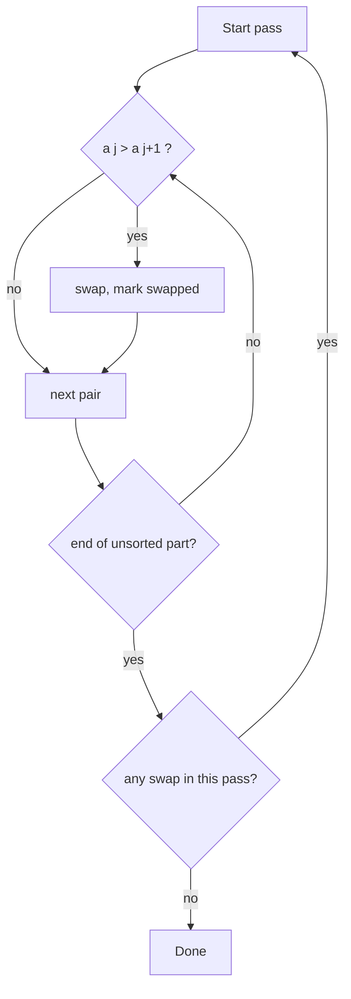

# 11 - Bubble Sort

Learn the simplest comparison sort: repeatedly compare neighbours and swap them until the biggest values "bubble" to the end. Ten programs take you from the plain algorithm to early exit, stability, operation counting and inversions.

## Table of Contents
- [A. Topic Introduction](#a-topic-introduction)
- [B. Core Concepts](#b-core-concepts)
- [C. How It Works](#c-how-it-works)
- [D. Time and Space Complexity](#d-time-and-space-complexity)
- [E. Problems for Practice](#e-problems-for-practice)
- [F. Installation Requirements](#f-installation-requirements)
- [G. How to Run the Files](#g-how-to-run-the-files)
- [H. Revision Notes](#h-revision-notes)

---

## A. Topic Introduction

**What it is.** Bubble Sort walks through a list again and again. In each pass it compares two neighbouring items and swaps them if they are in the wrong order. After pass 1 the largest value is at the end, after pass 2 the second largest is next to it, and so on.

**Why it matters in DSA.** It is rarely used in production, but it is the easiest sort to explain. It teaches passes, swaps, early exit, stability and the link between swaps and inversions, and these ideas return in every other sorting topic.

**Where it is used.** Teaching and interviews, tiny lists, and checking whether a list is already sorted (the optimized version finishes in one pass).

**Everyday analogy.** Students standing in a line, arranged by height. A teacher walks along the line and, whenever a taller student stands before a shorter one, asks them to swap. After one walk the tallest student is at the end of the line.

If you know Laravel: it is like running `orderBy('marks')` by hand. The database does this in one query; Bubble Sort is the slow manual loop that shows what such a sort does underneath.

---

## B. Core Concepts

| Term | Meaning |
|------|---------|
| Pass | One full walk over the unsorted part of the list. |
| Comparison | Checking if `a[j] > a[j + 1]`. |
| Swap | Exchanging two neighbouring items. |
| Sorted suffix | The tail of the list that already holds its final values. |
| Early exit | Stopping when a pass makes no swap. |
| Inversion | A pair `i < j` with `a[i] > a[j]`. |
| Stable sort | Equal items keep their original relative order. |
| In-place | Sorts inside the same list using only a few extra variables. |

**Pass picture for `[5, 1, 4, 2, 8]`** (the part after `|` is final)

```text
start   : 5 1 4 2 8
pass 1  : 1 4 2 5 | 8
pass 2  : 1 2 4 | 5 8
pass 3  : 1 2 4 5 8      (no swaps -> stop)
```

**Control flow**



---

## C. How It Works

**Dry run on `[5, 1, 4, 2, 8]` (pass 1)**

| Compare | Action | List afterwards |
|---------|--------|-----------------|
| 5 and 1 | swap | 1 5 4 2 8 |
| 5 and 4 | swap | 1 4 5 2 8 |
| 5 and 2 | swap | 1 4 2 5 8 |
| 5 and 8 | keep | 1 4 2 5 8 |

Pass 1 made 3 swaps and 4 comparisons. Pass 2 sorts `1 4 2 5` into `1 2 4 5` with 1 swap. Pass 3 makes zero swaps, so an optimized version stops.

**Why the largest value settles.** Whenever the current largest item meets a neighbour, the comparison pushes it one step right. It cannot be stopped until it meets a bigger value or the end.

**Why strict `>` matters.** Swapping only when `a[j] > a[j + 1]` leaves equal items untouched, so equal items never jump over each other. That keeps the sort stable.

**Last-swap trick.** If the last swap in a pass happened at index `k`, everything after `k` is already in place, so the next pass can stop at `k`.

---

## D. Time and Space Complexity

| Case | Basic version | With early exit |
|------|---------------|-----------------|
| Best (already sorted) | O(n^2) | O(n) |
| Average | O(n^2) | O(n^2) |
| Worst (reversed) | O(n^2) | O(n^2) |
| Space | O(1) | O(1) |

| Fact | Value |
|------|-------|
| Comparisons (basic, size n) | `n(n-1)/2` |
| Swaps | Exactly the number of inversions, at most `n(n-1)/2` |
| Stable? | Yes (with strict `>`) |
| In-place? | Yes |

---

## E. Problems for Practice

| No | Title | Difficulty | Concept | Python File |
|----|-------|------------|---------|-------------|
| 1 | Basic Bubble Sort | Easy | Passes and swaps | `01_basic_bubble_sort.py` |
| 2 | Descending Bubble Sort | Easy | Selectable order | `02_descending_bubble_sort.py` |
| 3 | Optimized Bubble Sort | Easy | Early exit with a swapped flag | `03_optimized_bubble_sort.py` |
| 4 | Pass-by-Pass Trace | Easy | Recording the list after each pass | `04_pass_by_pass_trace.py` |
| 5 | Early Termination with Last Swap | Medium | Shrinking the pass range | `05_early_termination_last_swap.py` |
| 6 | Bubble Sort with Duplicates | Medium | Strict vs loose comparison | `06_bubble_sort_duplicates.py` |
| 7 | Stability Check | Medium | Verifying stable behaviour | `07_stability_check.py` |
| 8 | Operation Counting | Medium | Best, average, worst counts | `08_operation_counting.py` |
| 9 | Swaps Equal Inversions | Medium | Inversion count equals swap count | `09_swaps_equal_inversions.py` |
| 10 | Sort Students by Marks | Medium | Generic sort with key and reverse | `10_sort_students_by_marks.py` |

### Problem 1 - Basic Bubble Sort (`01_basic_bubble_sort.py`)
**Statement.** Sort a list of integers in ascending order using Bubble Sort. Do not use `sorted()` or `list.sort()`.

**Example.**
```text
Before: [64, 34, 25, 12, 22, 11, 90]
After:  [11, 12, 22, 25, 34, 64, 90]
Reversed: [1, 2, 3, 4]
```
**Constraints / edge cases.** Empty and one-element lists are already sorted; sorted input still costs `O(n^2)` here; negatives and duplicates work unchanged.

**Hints.**
- Use an outer loop for passes and an inner loop for neighbour pairs.
- After each pass the inner loop can stop one position earlier.
- Swap with a tuple assignment, no temporary variable needed.

### Problem 2 - Descending Bubble Sort (`02_descending_bubble_sort.py`)
**Statement.** Sort from largest to smallest. Make the order selectable so one function sorts both ways.

**Example.**
```text
numbers = [5, 1, 4, 2, 8]
Descending: [8, 5, 4, 2, 1]
Ascending:  [1, 2, 4, 5, 8]
```
**Constraints / edge cases.** Empty and single-element lists; duplicates (equal neighbours are not swapped); already descending input stays unchanged.

**Hints.**
- Only the comparison direction changes.
- A boolean parameter choosing between "greater than" and "less than" is enough.
- Keep the comparison strict so equal items are not swapped.

### Problem 3 - Optimized Bubble Sort (`03_optimized_bubble_sort.py`)
**Statement.** Stop as soon as a full pass makes no swaps. Show the number of passes for the plain and the optimized version.

**Example.**
```text
nearly sorted [1, 2, 3, 5, 4, 6]: plain passes=5 optimized passes=2
already sorted [1, 2, 3, 4, 5]:   plain passes=4 optimized passes=1
```
**Constraints / edge cases.** Sorted list needs exactly 1 pass; empty or one element needs 0; a reversed list is the worst case and still needs `n - 1` passes.

**Hints.**
- Reset a boolean flag at the start of every pass.
- Set it when a swap happens; break if it is still false after the pass.
- Count passes with a counter you update inside the outer loop.

### Problem 4 - Pass-by-Pass Trace (`04_pass_by_pass_trace.py`)
**Statement.** Record the state of the list after every pass so you can watch the largest values settle at the end.

**Example.**
```text
Start : [5, 1, 4, 2, 8]
Pass 1 : [1, 4, 2, 5, 8] (swaps: 3)
Pass 2 : [1, 2, 4, 5, 8] (swaps: 1)
Pass 3 : [1, 2, 4, 5, 8] (swaps: 0)
```
**Constraints / edge cases.** Sorted input gives one swap-free pass; empty input gives only the starting snapshot; snapshots must be copies, not references.

**Hints.**
- Store `list(items)` (a copy) after each pass.
- Keep a swap counter per pass and store it next to the snapshot.
- Stop recording after the first pass with zero swaps.

### Problem 5 - Early Termination with Last Swap (`05_early_termination_last_swap.py`)
**Statement.** Remember the index of the last swap in each pass. Everything after it is sorted, so the next pass can stop there. Compare comparison counts with the basic version.

**Example.**
```text
data = [3, 2, 1, 4, 5, 6, 7, 8]
Basic     : comparisons = 28
Last swap : comparisons = 8
Reversed [4, 3, 2, 1]: ([1, 2, 3, 4], 6)
```
**Constraints / edge cases.** Sorted input is one pass of `n - 1` comparisons; empty or single element is zero comparisons; a sorted suffix saves many comparisons.

**Hints.**
- Track a variable "last swap position" that starts at 0 each pass.
- The next pass only needs to examine pairs up to that position.
- When the position stays at 0, nothing was swapped and the sort is finished.

### Problem 6 - Bubble Sort with Duplicates (`06_bubble_sort_duplicates.py`)
**Statement.** Sort a list with repeated values and count the swaps really needed. Show why equal neighbours must not be swapped.

**Example.**
```text
numbers = [4, 2, 4, 1, 2, 4]
Strict (>)  : [1, 2, 2, 4, 4, 4] swaps = 6
Loose (>=)  : [1, 2, 2, 4, 4, 4] swaps = 11
All equal   : ([7, 7, 7, 7], 0)
```
**Constraints / edge cases.** All equal values need zero swaps; duplicates at both ends; negative duplicates.

**Hints.**
- The loose version differs only in one comparison operator.
- Extra swaps of equal items change no value but waste time and break stability.
- Count swaps with a counter and compare the two versions.

### Problem 7 - Stability Check (`07_stability_check.py`)
**Statement.** Sort `(name, score)` records by score and verify that records with equal scores keep their original order.

**Example.**
```text
records = [("Asha", 80), ("Ben", 90), ("Chitra", 80), ("Dev", 90), ("Esha", 70)]
Strict (>) : Esha, Asha, Chitra, Ben, Dev     Stable? True
Loose (>=) : Esha, Asha, Chitra, Dev, Ben     Stable? False
```
**Constraints / edge cases.** All scores equal must return the list unchanged; empty list and single record; `>=` makes the sort unstable.

**Hints.**
- Compare only the score field, never the whole tuple.
- To check stability, for every pair with equal scores confirm the original position order is kept.
- Run both comparison versions on the same data.

### Problem 8 - Operation Counting (`08_operation_counting.py`)
**Statement.** Return how many comparisons and swaps Bubble Sort performs, then compare best, average and worst case inputs of size 8.

**Example.**
```text
best    comparisons= 7 swaps= 0
average comparisons=22 swaps=13
worst   comparisons=28 swaps=28
n(n-1)/2 for n=8: 28
```
**Constraints / edge cases.** Empty or one element gives `(0, 0)`; a reversed list of `n` items has `n(n-1)/2` of each; a sorted list has 0 swaps.

**Hints.**
- Increase a comparison counter on every neighbour check and a swap counter on every swap.
- Return the sorted list together with both counters.
- Compare the worst-case counters with the formula `n(n-1)/2`.

### Problem 9 - Swaps Equal Inversions (`09_swaps_equal_inversions.py`)
**Statement.** An inversion is a pair of positions `i < j` with `values[i] > values[j]`. Show that Bubble Sort makes exactly that many swaps by computing both independently.

**Example.**
```text
[3, 1, 2, 5, 4] inversions=3 swaps=3 equal=True
[4, 3, 2, 1]    inversions=6 swaps=6 equal=True
[2, 2, 1, 1]    inversions=4 swaps=4 equal=True
```
**Constraints / edge cases.** Sorted list has 0 inversions; reversed list has `n(n-1)/2`; equal values are not inversions.

**Hints.**
- Count inversions by brute force with two nested loops.
- Each adjacent swap removes exactly one inversion.
- Do not reuse the sort's own counter to compute the inversions.

### Problem 10 - Sort Students by Marks (`10_sort_students_by_marks.py`)
**Statement.** Given student dictionaries with `name` and `marks`, sort them from highest to lowest with a generic Bubble Sort that accepts a key function and a reverse flag. Ties keep their original order.

**Example.**
```text
1. Aman 91
2. Riya 82
3. Zoya 82
4. Karan 67
By name: ['Aman', 'Karan', 'Riya', 'Zoya']
```
**Constraints / edge cases.** Empty list; ties (Riya and Zoya) keep order; sorting by name works with the same function.

**Hints.**
- Compute `key(item)` for both neighbours and compare those values.
- For reverse order, swap when the left key is smaller; keep the comparison strict.
- Work on a copy so the input list is not changed.

---

## F. Installation Requirements

| Item | Requirement |
|------|-------------|
| Python version | Python 3.8 or newer |
| Packages | None. Standard library only |
| Extra installation | Nothing to install beyond Python itself |

Check your installation with `python --version` (see section G).

---

## G. How to Run the Files

1. Open a terminal: **Windows** - press `Win + R`, type `cmd` (or open PowerShell / VS Code terminal). **Linux/macOS** - open Terminal.
2. Verify Python:
   ```bash
   python --version      # Windows (or: py --version)
   python3 --version     # Linux / macOS
   ```
3. Move into the topic folder and run a file.

**Windows**
```bash
cd Python-DSA-Practice\11-Bubble-Sort
python 01_basic_bubble_sort.py
```
If `python` is not recognised, use the Python launcher: `py 01_basic_bubble_sort.py`.

**Linux / macOS**
```bash
cd Python-DSA-Practice/11-Bubble-Sort
python3 01_basic_bubble_sort.py
```

Every file is a standalone program: it needs no other file and no internet.

---

## H. Revision Notes

**Key concepts**
- Each pass pushes the largest remaining value to the end of the unsorted part.
- Basic version: `n(n-1)/2` comparisons, always. Early exit makes the best case `O(n)`.
- Swaps equal the number of inversions.
- Stable and in-place: `O(1)` extra space.

**Common mistakes**
- Using `>=` instead of `>`, which swaps equal items and breaks stability.
- Forgetting to shrink the inner loop, or running it past the last index (`IndexError`).
- Not resetting the `swapped` flag at the start of each pass.
- Storing references to the list instead of copies when tracing passes.

**Interview tips**
- Say worst and average are `O(n^2)`, best is `O(n)` only with early exit.
- Mention that it is stable and in-place, but too slow for large inputs.
- Know the link between swaps and inversions; it leads straight to the merge-sort inversion-count problem.
- Name better options: insertion sort for small or nearly sorted data, merge sort or Timsort (what Python uses) for general data.
