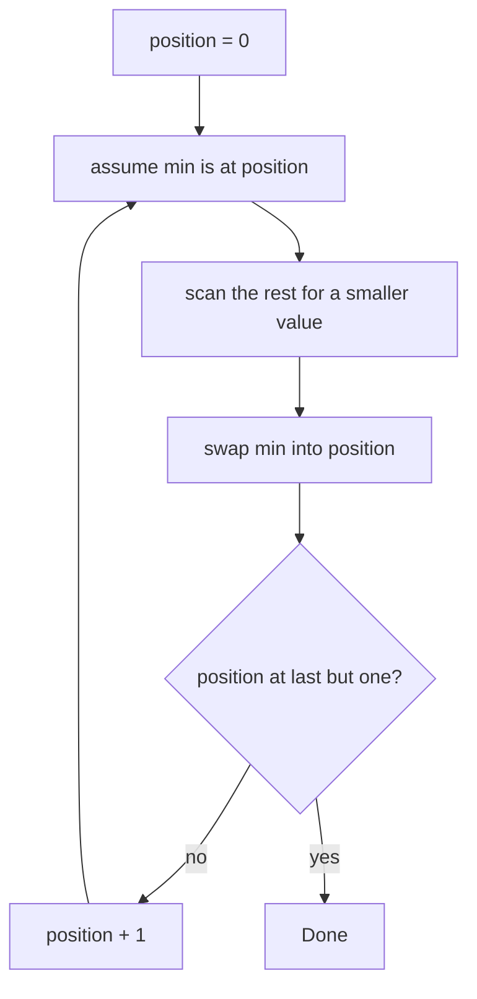

# 12 - Selection Sort

Learn the sort that repeatedly selects the smallest remaining value and places it at the front. It does very few swaps, which makes it a good lesson in "what exactly are we optimising?". Ten programs cover the basic algorithm, tracing, counting, stability, k-smallest and a comparison with other sorts.

## Table of Contents
- [A. Topic Introduction](#a-topic-introduction)
- [B. Core Concepts](#b-core-concepts)
- [C. How It Works](#c-how-it-works)
- [D. Time and Space Complexity](#d-time-and-space-complexity)
- [E. Problems for Practice](#e-problems-for-practice)
- [F. Installation Requirements](#f-installation-requirements)
- [G. How to Run the Files](#g-how-to-run-the-files)
- [H. Revision Notes](#h-revision-notes)

---

## A. Topic Introduction

**What it is.** Selection Sort splits the list into a sorted left part and an unsorted right part. In each pass it scans the unsorted part to find the smallest value and swaps it into the first unsorted position. The sorted part grows by one item per pass.

**Why it matters in DSA.** It shows the "find then place" pattern, the difference between comparisons and swaps (comparisons are always `n(n-1)/2`, swaps are at most `n - 1`), and the idea of an unstable sort.

**Where it is used.** Teaching, tiny lists, and situations where writing to memory is expensive (for example flash memory), because it performs the fewest swaps of the simple sorts.

**Everyday analogy.** Picking cards from a table: you look at all the remaining cards, pick the lowest, put it in your hand to the right of the previous one, and repeat.

If you know Laravel: it is like calling `$collection->min()` over the remaining items again and again and appending the result to a new list.

---

## B. Core Concepts

| Term | Meaning |
|------|---------|
| Sorted part | Left side, already in final position. |
| Unsorted part | Right side, still to be processed. |
| Selection | Finding the index of the minimum (or maximum) in the unsorted part. |
| Swap | Exchanging the selected item with the first unsorted item. |
| Stable sort | Equal items keep their original relative order. |
| Bidirectional (cocktail) selection | Selecting minimum and maximum in one scan. |

**Picture for `[29, 10, 14, 37, 13]`** (the part before `|` is final)

```text
start  : | 29 10 14 37 13
pass 1 : 10 | 29 14 37 13      min=10, swap index 0 <-> 1
pass 2 : 10 13 | 14 37 29      min=13, swap index 1 <-> 4
pass 3 : 10 13 14 | 37 29      min=14, already in place
pass 4 : 10 13 14 29 | 37      min=29, swap index 3 <-> 4
```

**Control flow**



---

## C. How It Works

**Dry run on `[29, 10, 14, 37, 13]`**

| Pass | Unsorted part | Minimum found | Swap | List afterwards |
|------|---------------|---------------|------|-----------------|
| 1 | 29 10 14 37 13 | 10 at index 1 | index 0 and 1 | 10 29 14 37 13 |
| 2 | 29 14 37 13 | 13 at index 4 | index 1 and 4 | 10 13 14 37 29 |
| 3 | 14 37 29 | 14 at index 2 | none | 10 13 14 37 29 |
| 4 | 37 29 | 29 at index 4 | index 3 and 4 | 10 13 14 29 37 |

**Why it is not stable.** A long-distance swap can jump an item over an equal one. With `[A70, R70, M40]` the first swap puts `M40` first and `A70` at the end, after `R70`. A stable version shifts items one place right instead of swapping.

**Why swaps stay small.** Each pass does at most one swap, so there are at most `n - 1` swaps, even for a reversed list (`n // 2`).

**Bidirectional idea.** Each pass picks the minimum and maximum together and places them at both ends, so only about `n / 2` passes are needed (the comparison count stays the same order).

---

## D. Time and Space Complexity

| Case | Time | Space |
|------|------|-------|
| Best (already sorted) | O(n^2) | O(1) |
| Average | O(n^2) | O(1) |
| Worst (reversed) | O(n^2) | O(1) |

| Fact | Value |
|------|-------|
| Comparisons | Always `n(n-1)/2` |
| Swaps | At most `n - 1` |
| Stable? | No (swap version); yes if you shift instead of swapping |
| In-place? | Yes |
| k smallest items | `O(n * k)` using only k passes |

---

## E. Problems for Practice

| No | Title | Difficulty | Concept | Python File |
|----|-------|------------|---------|-------------|
| 1 | Basic Selection Sort | Easy | Select minimum, swap into place | `01_basic_selection_sort.py` |
| 2 | Descending Selection Sort | Easy | Select the maximum instead | `02_descending_selection_sort.py` |
| 3 | Find Min and Max Manually | Easy | The selection step on its own | `03_find_min_and_max_manually.py` |
| 4 | Pass-by-Pass Trace | Easy | Showing the chosen index and the swap | `04_pass_by_pass_trace.py` |
| 5 | Swap Counting | Medium | Swaps versus comparisons | `05_swap_counting.py` |
| 6 | Sort and Group Duplicates | Medium | Sort, then count equal runs | `06_sort_and_group_duplicates.py` |
| 7 | Stability Check | Medium | Unstable swap versus stable shift | `07_stability_check.py` |
| 8 | K Smallest Elements | Medium | Running only k passes | `08_k_smallest_elements.py` |
| 9 | Bidirectional Selection Sort | Medium | Min and max in one pass | `09_bidirectional_selection_sort.py` |
| 10 | Compare with Other Sorts | Medium | Selection vs Bubble vs Insertion counts | `10_compare_with_other_sorts.py` |

### Problem 1 - Basic Selection Sort (`01_basic_selection_sort.py`)
**Statement.** Sort a list of integers in ascending order using Selection Sort. Do not use `sorted()`, `list.sort()` or `min()`.

**Example.**
```text
Before: [64, 25, 12, 22, 11]
After:  [11, 12, 22, 25, 64]
Negatives: [-5, -1, 0, 3]
```
**Constraints / edge cases.** Empty and single-element lists; sorted input still costs `O(n^2)` comparisons; duplicates and negatives work unchanged.

**Hints.**
- Outer loop picks the position to fill; inner loop starts one past it.
- Remember the index of the smallest value seen, not the value.
- Swap once at the end of each pass.

### Problem 2 - Descending Selection Sort (`02_descending_selection_sort.py`)
**Statement.** Sort from largest to smallest by selecting the maximum of the unsorted part in each pass.

**Example.**
```text
Before: [29, 10, 14, 37, 13]
After:  [37, 29, 14, 13, 10]
Duplicates: [5, 5, 2, 2, 1]
```
**Constraints / edge cases.** Empty and single-element lists; duplicates are all kept; already descending input needs zero swaps.

**Hints.**
- Change only the comparison direction of the scan.
- Skip the swap when the chosen index equals the current position.
- Think of "largest first" as "smallest of the negated values".

### Problem 3 - Find Min and Max Manually (`03_find_min_and_max_manually.py`)
**Statement.** Without `min()` or `max()`, find the value and index of both the smallest and the largest element in a single pass. This is the selection step Selection Sort repeats.

**Example.**
```text
List: [27, 8, 41, 8, 41, 3]
Smallest: 3 at index 5
Largest : 41 at index 2
```
**Constraints / edge cases.** An empty list raises `ValueError`; a single element has min and max at index 0; ties keep the first occurrence.

**Hints.**
- Start both candidates at index 0.
- Update the minimum only for a strictly smaller value, and the maximum only for a strictly larger one.
- Raise the error before touching the list when it is empty.

### Problem 4 - Pass-by-Pass Trace (`04_pass_by_pass_trace.py`)
**Statement.** Print, for every pass, which index was chosen as the minimum, what was swapped and how the list looks afterwards. Mark the sorted part with a bar `|`.

**Example.**
```text
Start : | 29 10 14 37 13
Pass 1: min=10 (swap index 0 <-> 1) -> 10 | 29 14 37 13
Pass 3: min=14 (no swap needed) -> 10 13 14 | 37 29
```
**Constraints / edge cases.** Sorted input reports "no swap needed" in every pass; empty or single element has no passes; with duplicates the first smallest occurrence is chosen.

**Hints.**
- Build each line as a string before printing (or return a list of lines).
- Insert the bar after the first `position + 1` items.
- Compare the chosen index with the current position to decide the "no swap" message.

### Problem 5 - Swap Counting (`05_swap_counting.py`)
**Statement.** Count swaps and comparisons on different inputs and show that swaps never exceed `n - 1` while comparisons are always `n(n-1)/2`.

**Example.**
```text
sorted    comparisons=15 swaps=0
reversed  comparisons=15 swaps=3
shuffled  comparisons=15 swaps=3
```
**Constraints / edge cases.** Sorted input has 0 swaps but full comparisons; empty or single element gives `(0, 0)`; a reversed list needs `n // 2` swaps because each swap fixes two positions.

**Hints.**
- Count a comparison in the inner loop and a swap only when the indices differ.
- Return both counters with the sorted list.
- Compare the comparison count with the formula for several sizes.

### Problem 6 - Sort and Group Duplicates (`06_sort_and_group_duplicates.py`)
**Statement.** Sort a list with many repeated values, then walk through it once and report every distinct value with how many times it occurs.

**Example.**
```text
Original: [4, 2, 4, 1, 2, 4, 3, 1]
Sorted:   [1, 1, 2, 2, 3, 4, 4, 4]
Value 4 appears 3 time(s)
```
**Constraints / edge cases.** Empty list gives no groups; all equal gives one group; all distinct gives `n` groups of size 1.

**Hints.**
- After sorting, equal values are neighbours.
- Keep the current value and a running count; when the value changes, store the group and restart.
- Do not forget to store the last group after the loop ends.

### Problem 7 - Stability Check (`07_stability_check.py`)
**Statement.** Sort `(name, marks)` records by marks. Show that the swap-based Selection Sort can reorder students with equal marks, then write a stable version that keeps their original order.

**Example.**
```text
records = [("Asha", 70), ("Ravi", 70), ("Meena", 40), ("Karan", 90)]
Standard: ['Meena', 'Ravi', 'Asha', 'Karan'] stable? False
Shifting: ['Meena', 'Asha', 'Ravi', 'Karan'] stable? True
```
**Constraints / edge cases.** Empty list and single record; all marks equal must leave the order unchanged; already sorted records.

**Hints.**
- The stable version removes the minimum by shifting the items between the two positions one step right.
- Insert the chosen record at the front of the unsorted part.
- Keep the scan strict (`<`) so the earliest of equal minima wins.

### Problem 8 - K Smallest Elements (`08_k_smallest_elements.py`)
**Statement.** Return the `k` smallest values in ascending order by running only the first `k` passes of Selection Sort. The rest of the list need not be sorted.

**Example.**
```text
Numbers: [64, 25, 12, 22, 11, 90, 3]
3 smallest: [3, 11, 12]
k = 0: []
k > length: [2, 5, 8]
```
**Constraints / edge cases.** `k = 0` returns an empty list; `k` larger than the length returns the fully sorted list; negative `k` raises `ValueError`; duplicates count separately.

**Hints.**
- Limit the outer loop to `k` passes (and to the list length).
- Work on a copy and return the first `k` items.
- Validate `k` before sorting anything.

### Problem 9 - Bidirectional Selection Sort (`09_bidirectional_selection_sort.py`)
**Statement.** In each pass select both the minimum and the maximum of the unsorted middle part and place them at the left and right ends. This halves the number of passes.

**Example.**
```text
Before: [29, 10, 14, 37, 13, 5, 21]
After:  [5, 10, 13, 14, 21, 29, 37]
Max at left: [1, 2, 3, 9]
```
**Constraints / edge cases.** Empty and single-element lists; the maximum sitting at the left boundary (its index changes after the first swap); all values equal; odd and even lengths.

**Hints.**
- Keep a `left` and a `right` boundary and shrink both after each pass.
- After swapping the minimum to `left`, check whether the maximum was at `left`; if so it has moved to the old minimum index.
- Stop when `left` meets `right`.

### Problem 10 - Compare with Other Sorts (`10_compare_with_other_sorts.py`)
**Statement.** Implement Selection, Bubble (with early exit) and Insertion Sort with counters and compare their comparisons and writes on sorted, reversed and shuffled lists of the same size.

**Example.**
```text
Reversed: [8, 7, 6, 5, 4, 3, 2, 1]
  Selection  comparisons=28 writes= 8
  Bubble     comparisons=28 writes=56
  Insertion  comparisons=28 writes=35
```
**Constraints / edge cases.** Empty and single-element lists have zero comparisons; reversed input is the worst case for Bubble and Insertion; sorted input is the best case for those two, but not for Selection.

**Hints.**
- Define one "write" as one assignment into the list (a swap counts as two).
- Use the same fixed input lists for every algorithm.
- Verify each result against a reference sort only in a final check.

---

## F. Installation Requirements

| Item | Requirement |
|------|-------------|
| Python version | Python 3.8 or newer |
| Packages | None. Standard library only |
| Extra installation | Nothing to install beyond Python itself |

Check your installation with `python --version` (see section G).

---

## G. How to Run the Files

1. Open a terminal: **Windows** - press `Win + R`, type `cmd` (or open PowerShell / VS Code terminal). **Linux/macOS** - open Terminal.
2. Verify Python:
   ```bash
   python --version      # Windows (or: py --version)
   python3 --version     # Linux / macOS
   ```
3. Move into the topic folder and run a file.

**Windows**
```bash
cd Python-DSA-Practice\12-Selection-Sort
python 01_basic_selection_sort.py
```
If `python` is not recognised, use the Python launcher: `py 01_basic_selection_sort.py`.

**Linux / macOS**
```bash
cd Python-DSA-Practice/12-Selection-Sort
python3 01_basic_selection_sort.py
```

Every file is a standalone program: it needs no other file and no internet.

---

## H. Revision Notes

**Key concepts**
- Find the minimum of the unsorted part, swap it to the front, repeat.
- Always `n(n-1)/2` comparisons, no best case better than `O(n^2)`.
- At most `n - 1` swaps: the fewest writes among the simple sorts.
- Swap-based version is unstable; shifting makes it stable.

**Common mistakes**
- Storing the minimum value instead of its index.
- Starting the inner loop at `position` instead of `position + 1` (harmless but wasteful).
- In the bidirectional version, forgetting to fix the maximum's index after the first swap.
- Claiming that Selection Sort is faster on sorted input (it is not).

**Interview tips**
- State that it is `O(n^2)` in every case, `O(1)` space, in-place, not stable.
- Mention the low swap count as its one advantage.
- Be ready to explain why it is unstable with a three-element example.
- Know that running only `k` passes gives the `k` smallest items in `O(n * k)`.
