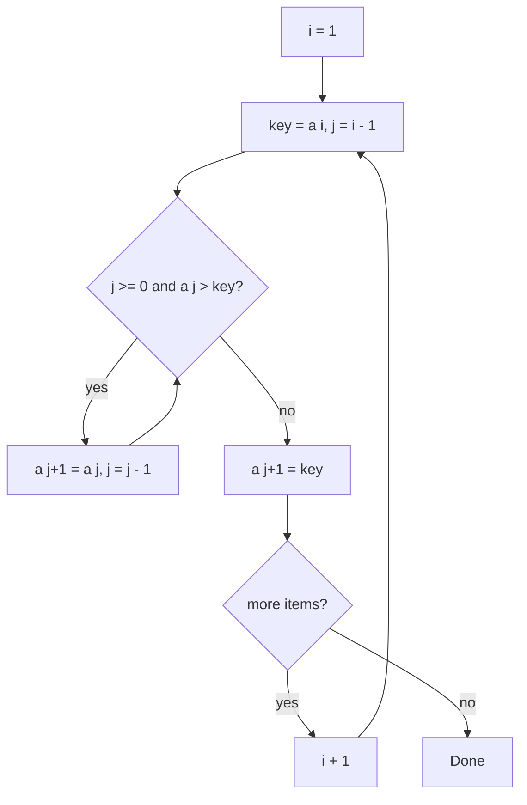

# 13 - Insertion Sort

Learn the sort you already use when arranging playing cards in your hand: take the next item and slide it into the right place among the items before it. Ten programs cover the basic algorithm, tracing, counting, nearly sorted data, stability, binary search, streaming input, linked lists and recursion.

## Table of Contents
- [A. Topic Introduction](#a-topic-introduction)
- [B. Core Concepts](#b-core-concepts)
- [C. How It Works](#c-how-it-works)
- [D. Time and Space Complexity](#d-time-and-space-complexity)
- [E. Problems for Practice](#e-problems-for-practice)
- [F. Installation Requirements](#f-installation-requirements)
- [G. How to Run the Files](#g-how-to-run-the-files)
- [H. Revision Notes](#h-revision-notes)

---

## A. Topic Introduction

**What it is.** Insertion Sort keeps a sorted part at the left of the list. In each pass it takes the next item (the key), shifts larger items of the sorted part one place to the right, and drops the key into the gap.

**Why it matters in DSA.** It is fast on small and nearly sorted data (`O(n)` in the best case), stable, in-place and online (it can sort items as they arrive). Real libraries use it inside hybrid sorts such as Timsort for small chunks.

**Where it is used.** Small arrays, nearly sorted data, keeping a list sorted while new values stream in, and as the finishing step of faster sorts.

**Everyday analogy.** Sorting playing cards in your hand: you pick up one card at a time and slide it left past larger cards until it fits.

If you know Laravel: it is like adding a new row to an already ordered result set and moving it to the correct position instead of re-sorting the whole set.

---

## B. Core Concepts

| Term | Meaning |
|------|---------|
| Key | The item currently being inserted. |
| Sorted part | Items to the left of the key, already ordered. |
| Shift | Moving a larger item one slot to the right to make room. |
| Comparison | Checking the key against an item in the sorted part. |
| Online algorithm | Works when the input arrives piece by piece. |
| Stable sort | Equal items keep their original order (stop shifting at an equal item). |
| Binary insertion | Uses binary search to find the insert position (fewer comparisons, same shifts). |

**Picture for `[6, 3, 8, 2, 5]`** (the brackets hold the sorted part)

```text
start  : [6] 3 8 2 5
pass 1 : [3 6] 8 2 5      key 3 shifts 6
pass 2 : [3 6 8] 2 5      key 8 stays
pass 3 : [2 3 6 8] 5      key 2 shifts 3 items
pass 4 : [2 3 5 6 8]      key 5 shifts 2 items
```

**Control flow**



---

## C. How It Works

**Dry run on `[6, 3, 8, 2, 5]`**

| Pass | Key | Sorted part before | Shifts | Sorted part after |
|------|-----|--------------------|--------|-------------------|
| 1 | 3 | 6 | 1 (6 moves right) | 3 6 |
| 2 | 8 | 3 6 | 0 | 3 6 8 |
| 3 | 2 | 3 6 8 | 3 | 2 3 6 8 |
| 4 | 5 | 2 3 6 8 | 2 (8 and 6 move) | 2 3 5 6 8 |

**Why it is fast on sorted data.** If every key is already larger than its left neighbour, the inner loop stops after one comparison, giving `n - 1` comparisons and no shifts.

**Why it is stable.** The shifting loop uses a strict `>` test, so an equal item is not moved past the key. Equal items keep their order.

**Shifts equal inversions.** Each shift removes exactly one inversion (a pair out of order). That is why a nearly sorted list needs few shifts and a reversed list needs `n(n-1)/2`.

---

## D. Time and Space Complexity

| Case | Time | Space |
|------|------|-------|
| Best (already sorted) | O(n) | O(1) |
| Average | O(n^2) | O(1) |
| Worst (reversed) | O(n^2) | O(1) |
| Nearly sorted (each item at most k places away) | O(n * k) | O(1) |

| Variant | Comparisons | Shifts |
|---------|-------------|--------|
| Basic | up to `n(n-1)/2` | equals inversions |
| Binary insertion | `O(n log n)` | still up to `O(n^2)` |
| Recursive | same as basic | same as basic, plus `O(n)` stack |
| Linked list | up to `O(n^2)` | no shifting, only relinking |

Stable: yes. In-place: yes (array version).

---

## E. Problems for Practice

| No | Title | Difficulty | Concept | Python File |
|----|-------|------------|---------|-------------|
| 1 | Basic Insertion Sort | Easy | Key, shift, insert | `01_basic_insertion_sort.py` |
| 2 | Descending Insertion Sort | Easy | Selectable order | `02_descending_insertion_sort.py` |
| 3 | Insertion Sort Trace | Easy | Printing the sorted part and key per pass | `03_insertion_sort_trace.py` |
| 4 | Count Operations | Easy | Comparisons and shifts for best, mixed, worst | `04_count_operations.py` |
| 5 | Nearly Sorted Array | Medium | Few shifts when items are close to place | `05_nearly_sorted_array.py` |
| 6 | Stable Insertion Sort | Medium | Stable versus unstable variant | `06_stable_insertion_sort.py` |
| 7 | Binary Insertion Sort | Medium | Binary search for the position | `07_binary_insertion_sort.py` |
| 8 | Online Sorted Insertion | Medium | Streaming values and running median | `08_online_sorted_insertion.py` |
| 9 | Insertion Sort on a Linked List | Medium | Relinking nodes | `09_insertion_sort_linked_list.py` |
| 10 | Recursive Insertion Sort | Medium | Sort first n-1, insert the last | `10_recursive_insertion_sort.py` |

### Problem 1 - Basic Insertion Sort (`01_basic_insertion_sort.py`)
**Statement.** Sort a list of integers in ascending order using Insertion Sort. Do not use `sorted()` or `list.sort()`.

**Example.**
```text
[5, 2, 4, 6, 1, 3] -> [1, 2, 3, 4, 5, 6]
[9, 7, 5, 3, 1]    -> [1, 3, 5, 7, 9]
[3, -1, 3, 0, -5, 2] -> [-5, -1, 0, 2, 3, 3]
```
**Constraints / edge cases.** Empty list, single element, already sorted, reverse sorted, duplicates, negative numbers.

**Hints.**
- Start the outer loop at index 1; index 0 is a sorted part of size one.
- Save the key before shifting, because shifting overwrites its slot.
- Write the key into the gap after the inner loop ends.

### Problem 2 - Descending Insertion Sort (`02_descending_insertion_sort.py`)
**Statement.** Sort from largest to smallest. Make the order selectable so one function handles both directions.

**Example.**
```text
Original: [4, 10, 3, 8, 1]
Descending: [10, 8, 4, 3, 1]
Ascending:  [1, 3, 4, 8, 10]
```
**Constraints / edge cases.** Empty list, one element, all equal values (no shifts), already descending.

**Hints.**
- Only the shifting condition changes: shift while the left item is smaller than the key.
- Keep the comparison strict so equal items are not moved.
- A boolean parameter can choose between the two conditions.

### Problem 3 - Insertion Sort Trace (`03_insertion_sort_trace.py`)
**Statement.** Print the list after every pass, marking the sorted part and the key that was inserted.

**Example.**
```text
Start  : [6] 3 8 2 5
Pass 1 : [3 6] 8 2 5   (inserted 3)
Pass 3 : [2 3 6 8] 5   (inserted 2)
Final  : [2, 3, 5, 6, 8]
```
**Constraints / edge cases.** Empty or single-element lists print no passes; already sorted lists show keys that do not move.

**Hints.**
- Build the display string from the first `i + 1` items and the rest separately.
- Print the key you saved before shifting.
- The "Start" line shows only the first item as sorted.

### Problem 4 - Count Operations (`04_count_operations.py`)
**Statement.** Return how many comparisons and how many shifts the sort performs. Compare best, average and worst case inputs.

**Example.**
```text
Best  [1, 2, 3, 4, 5, 6]  comparisons=5  shifts=0
Mixed [3, 1, 6, 2, 5, 4]  comparisons=10 shifts=6
Worst [6, 5, 4, 3, 2, 1]  comparisons=15 shifts=15
```
**Constraints / edge cases.** Empty list (0 operations), single element, duplicates (equal items are not shifted: one comparison, no shift).

**Hints.**
- Count a comparison every time you test the key against an item.
- Count a shift only when an item actually moves right.
- For a reversed list of `n` items both counts should equal `n(n-1)/2`.

### Problem 5 - Nearly Sorted Array (`05_nearly_sorted_array.py`)
**Statement.** Show that Insertion Sort is very fast when every element is close to its sorted place. Build a nearly sorted list, sort it, and compare the shifts with a reversed list of the same size.

**Example.**
```text
Nearly sorted input: [1, 2, 4, 3, 5, 7, 6, 8, 10, 9]
Shifts for nearly sorted list (n=10): 3
Shifts for reversed list (n=10): 45
Shifts for nearly sorted list (n=1000): 333
Shifts for reversed list (n=1000): 499500
```
**Constraints / edge cases.** `k = 0` (already sorted); `n` smaller than the swap interval; empty list.

**Hints.**
- Build the input by swapping neighbouring pairs at a fixed interval of a sorted list.
- Reuse the shift counter from the previous problem.
- Each swapped neighbouring pair adds exactly one inversion.

### Problem 6 - Stable Insertion Sort (`06_stable_insertion_sort.py`)
**Statement.** Sort `(name, marks)` records by marks ascending. Students with equal marks must keep their original order. Also show what an unstable variant does.

**Example.**
```text
Original : [('Asha', 80), ('Bob', 70), ('Chen', 80), ('Dina', 70), ('Eli', 60)]
Stable   : [('Eli', 60), ('Bob', 70), ('Dina', 70), ('Asha', 80), ('Chen', 80)]
Unstable : [('Eli', 60), ('Dina', 70), ('Bob', 70), ('Chen', 80), ('Asha', 80)]
```
**Constraints / edge cases.** All marks equal (output equals input), empty list, single record.

**Hints.**
- Compare only the marks field.
- Stable means shift only while the left marks are strictly greater than the key's marks.
- The unstable variant also shifts past equal marks.

### Problem 7 - Binary Insertion Sort (`07_binary_insertion_sort.py`)
**Statement.** Use binary search to find where each key must be inserted into the sorted part, then shift the elements to make room.

**Example.**
```text
Original: [37, 23, 0, 17, 12, 72, 31, 46, 100, 88, 54]
Sorted:   [0, 12, 17, 23, 31, 37, 46, 54, 72, 88, 100]
Duplicates: [1, 1, 3, 3, 5, 5]
```
**Constraints / edge cases.** Empty list, one element, duplicates, key smaller or larger than everything.

**Hints.**
- Search only the sorted part (indexes `0` to `i - 1`).
- When the middle value equals the key, continue to the right to stay stable.
- Binary search cuts comparisons, but the shifting loop still costs `O(n)` per insert.

### Problem 8 - Online Sorted Insertion (`08_online_sorted_insertion.py`)
**Statement.** Numbers arrive one at a time. After every arrival keep the list of values seen so far sorted, print it, and report the median.

**Example.**
```text
after 5: [5] median=5
after 2: [2, 5] median=3.5
after 9: [2, 5, 9] median=5
after 1: [1, 2, 5, 9] median=3.5
```
**Constraints / edge cases.** First value (size 1), duplicate values, even count (median is the average of the two middle values), empty stream.

**Hints.**
- Each new value is one insertion step of Insertion Sort.
- For an odd count take the middle index; for an even count average the two middle values.
- Use true division only when the count is even to avoid printing `5.0`.

### Problem 9 - Insertion Sort on a Linked List (`09_insertion_sort_linked_list.py`)
**Statement.** Sort a singly linked list in ascending order by relinking nodes, not by copying values into an array.

**Example.**
```text
Before: 4 -> 2 -> 1 -> 3
After : 1 -> 2 -> 3 -> 4
```
**Constraints / edge cases.** Empty list, single node, duplicates, already sorted, reverse sorted.

**Hints.**
- Build a new sorted list and insert each node from the old list into it.
- A dummy head node removes the special case of inserting at the front.
- Save the next pointer of a node before you relink it.

### Problem 10 - Recursive Insertion Sort (`10_recursive_insertion_sort.py`)
**Statement.** Implement Insertion Sort recursively: sort the first `n - 1` elements recursively, then insert the last element into its place.

**Example.**
```text
[9, 4, 7, 1, 8, 2] -> [1, 2, 4, 7, 8, 9]
[3, 3, 1]          -> [1, 3, 3]
[]                 -> []
```
**Constraints / edge cases.** Empty list, one element, duplicates. Lists longer than about 1000 items exceed Python's default recursion limit, which is why the loop version is preferred.

**Hints.**
- Base case: a list of size 0 or 1 is already sorted.
- After the recursive call the first `n - 1` items are sorted, so the insert step is the same shifting loop.
- The recursion depth equals `n`, so the extra stack space is `O(n)`.

---

## F. Installation Requirements

| Item | Requirement |
|------|-------------|
| Python version | Python 3.8 or newer |
| Packages | None. Standard library only |
| Extra installation | Nothing to install beyond Python itself |

Check your installation with `python --version` (see section G).

---

## G. How to Run the Files

1. Open a terminal: **Windows** - press `Win + R`, type `cmd` (or open PowerShell / VS Code terminal). **Linux/macOS** - open Terminal.
2. Verify Python:
   ```bash
   python --version      # Windows (or: py --version)
   python3 --version     # Linux / macOS
   ```
3. Move into the topic folder and run a file.

**Windows**
```bash
cd Python-DSA-Practice\13-Insertion-Sort
python 01_basic_insertion_sort.py
```
If `python` is not recognised, use the Python launcher: `py 01_basic_insertion_sort.py`.

**Linux / macOS**
```bash
cd Python-DSA-Practice/13-Insertion-Sort
python3 01_basic_insertion_sort.py
```

Every file is a standalone program: it needs no other file and no internet.

---

## H. Revision Notes

**Key concepts**
- Take the key, shift larger items right, drop the key into the gap.
- Best case `O(n)` on sorted data; worst and average `O(n^2)`; `O(1)` extra space.
- Stable, in-place and online.
- Number of shifts equals the number of inversions.

**Common mistakes**
- Overwriting the key by shifting before saving it.
- Checking `a[j]` before checking `j >= 0` (negative index wraps around in Python).
- Using `>=` while shifting, which makes the sort unstable.
- Believing binary insertion makes the whole sort `O(n log n)`; the shifts still cost `O(n^2)`.

**Interview tips**
- Say it is the best simple sort for small or nearly sorted input.
- Link its speed to the inversion count.
- Mention that Timsort and introsort use insertion sort for small chunks.
- For a linked list, no shifting is needed, but finding the position is still a linear walk.
