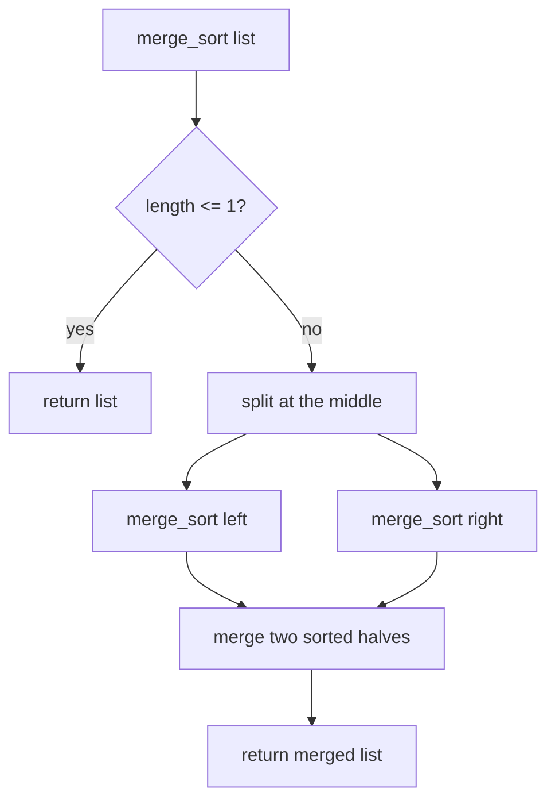

# 14 - Merge Sort

Learn the classic divide and conquer sort: split the list in halves, sort each half, and merge the two sorted halves. It guarantees `O(n log n)` time. Ten programs cover the merge step, recursion, tracing, descending order, a bottom-up version, inversion counting, linked lists, stability, merging k lists and complexity analysis.

## Table of Contents
- [A. Topic Introduction](#a-topic-introduction)
- [B. Core Concepts](#b-core-concepts)
- [C. How It Works](#c-how-it-works)
- [D. Time and Space Complexity](#d-time-and-space-complexity)
- [E. Problems for Practice](#e-problems-for-practice)
- [F. Installation Requirements](#f-installation-requirements)
- [G. How to Run the Files](#g-how-to-run-the-files)
- [H. Revision Notes](#h-revision-notes)

---

## A. Topic Introduction

**What it is.** Merge Sort cuts the list into two halves, sorts each half recursively, and merges the two sorted halves into one sorted list. A list of size 0 or 1 is already sorted, which stops the recursion.

**Why it matters in DSA.** It is the standard example of divide and conquer, it always runs in `O(n log n)`, it is stable, and its merge step is reused to count inversions, merge k lists and sort linked lists.

**Where it is used.** Sorting large data, external sorting of files that do not fit in memory, sorting linked lists, stable sorting of records (Python's built-in sort, Timsort, is built on merging), and merging results from several sorted sources.

**Everyday analogy.** Two teachers each have a sorted pile of exam papers by roll number. To combine them, look at the top paper of each pile, take the smaller roll number, and repeat. That is the merge step.

If you know Laravel: merging paginated, already ordered results from two database shards into one ordered list is exactly this merge.

---

## B. Core Concepts

| Term | Meaning |
|------|---------|
| Divide | Split the list into a left and a right half. |
| Conquer | Sort each half recursively. |
| Combine (merge) | Join two sorted lists into one sorted list using two pointers. |
| Base case | A list of length 0 or 1. |
| Recursion depth | About `log2(n)` levels. |
| Bottom-up merge sort | Iterative version: merge runs of size 1, 2, 4, ... |
| Stable sort | When two front items are equal, take the left one first. |
| Inversion | A pair `i < j` with `a[i] > a[j]`; counted during the merge. |

**Divide and conquer tree for `[6, 5, 3, 1, 8, 7, 2, 4]`**

```text
                 [6 5 3 1 8 7 2 4]
                /                 \
          [6 5 3 1]             [8 7 2 4]
          /      \               /      \
      [6 5]     [3 1]        [8 7]     [2 4]
      /  \      /  \         /  \      /  \
    [6] [5]   [3] [1]      [8] [7]   [2] [4]
      \  /      \  /         \  /      \  /
     [5 6]     [1 3]        [7 8]     [2 4]
          \      /               \      /
          [1 3 5 6]              [2 4 7 8]
                \                 /
                 [1 2 3 4 5 6 7 8]
```

**Control flow**



---

## C. How It Works

**Dry run of the merge step: `[1, 4, 7]` and `[2, 3, 9]`**

| Front of left | Front of right | Take | Result so far |
|---------------|----------------|------|---------------|
| 1 | 2 | 1 | 1 |
| 4 | 2 | 2 | 1 2 |
| 4 | 3 | 3 | 1 2 3 |
| 4 | 9 | 4 | 1 2 3 4 |
| 7 | 9 | 7 | 1 2 3 4 7 |
| (left empty) | 9 | 9 | 1 2 3 4 7 9 |

When one list runs out, the rest of the other is copied as it is.

**Why it is `O(n log n)`.** There are about `log2(n)` levels of splitting, and each level merges a total of `n` items. So the work is `n` per level times `log n` levels.

**Why it is stable.** When two front items are equal, the one from the left half is taken first, so equal items keep their original order.

**Counting inversions while merging.** If the right front is smaller than the left front, then it is smaller than every remaining item of the left half. Add the number of remaining left items to the inversion count.

---

## D. Time and Space Complexity

| Case | Time | Space |
|------|------|-------|
| Best | O(n log n) | O(n) |
| Average | O(n log n) | O(n) |
| Worst | O(n log n) | O(n) |

| Variant | Extra space |
|---------|-------------|
| Array merge sort | `O(n)` for merged copies, plus `O(log n)` recursion stack |
| Bottom-up merge sort | `O(n)`, no recursion stack |
| Linked-list merge sort | `O(log n)` stack, relinking nodes (no copies) |
| Merge k sorted lists (pairwise rounds) | `O(N log k)` time for `N` total items |

Stable: yes. Not in-place for arrays. Comparisons are at most `n * log2(n)` for powers of two (see Problem 10).

---

## E. Problems for Practice

| No | Title | Difficulty | Concept | Python File |
|----|-------|------------|---------|-------------|
| 1 | Merge Two Sorted Lists | Easy | The two-pointer merge step | `01_merge_two_sorted_lists.py` |
| 2 | Recursive Merge Sort | Easy | Divide, conquer, merge | `02_recursive_merge_sort.py` |
| 3 | Merge Sort Trace | Easy | Printing splits and merges by depth | `03_merge_sort_trace.py` |
| 4 | Descending Merge Sort | Easy | Selectable order | `04_descending_merge_sort.py` |
| 5 | Iterative Bottom-Up Merge Sort | Medium | Doubling run size, no recursion | `05_iterative_bottom_up_merge_sort.py` |
| 6 | Count Inversions | Medium | Counting during the merge | `06_count_inversions.py` |
| 7 | Merge Sort on a Linked List | Medium | Find middle, split, merge nodes | `07_merge_sort_linked_list.py` |
| 8 | Stable Merge Sort of Records | Medium | Key function and stability | `08_stable_merge_sort_records.py` |
| 9 | Merge K Sorted Lists | Medium | Pairwise merge rounds | `09_merge_k_sorted_lists.py` |
| 10 | Merge Sort Complexity Analysis | Medium | Comparison counts versus n log n | `10_merge_sort_complexity_analysis.py` |

### Problem 1 - Merge Two Sorted Lists (`01_merge_two_sorted_lists.py`)
**Statement.** Given two lists that are each sorted ascending, produce one new sorted list with all elements of both. Do not use `sorted()` or `list.sort()`; write the merge step yourself.

**Example.**
```text
merge([1, 4, 7], [2, 3, 9]) = [1, 2, 3, 4, 7, 9]
merge([2, 2, 5], [2, 3, 5]) = [2, 2, 2, 3, 5, 5]
merge([], [5, 6]) = [5, 6]
```
**Constraints / edge cases.** One or both lists empty; all of one list smaller than the other; duplicates across lists; negative numbers.

**Hints.**
- Keep one index per list and compare the two front items.
- Take from the left when the values are equal (this keeps the merge stable).
- After the loop, append whatever is left of the non-empty list.

### Problem 2 - Recursive Merge Sort (`02_recursive_merge_sort.py`)
**Statement.** Sort a list of integers ascending with Merge Sort. Write both the recursive splitting and the merge step yourself.

**Example.**
```text
[38, 27, 43, 3, 9, 82, 10] -> [3, 9, 10, 27, 38, 43, 82]
[4, -2, 4, 0, -2, 7]       -> [-2, -2, 0, 4, 4, 7]
```
**Constraints / edge cases.** Empty, single element, duplicates, already sorted, reverse sorted, odd and even lengths, negatives.

**Hints.**
- Base case: length 0 or 1 returns the list.
- Split at `len // 2`, sort each half, then merge them.
- Return a new list; the merge helper from Problem 1 can be reused (copy it in, files are standalone).

### Problem 3 - Merge Sort Trace (`03_merge_sort_trace.py`)
**Statement.** Print every split and every merge, indented by recursion depth, so the divide-and-conquer tree becomes visible.

**Example.**
```text
Input: [6, 5, 3, 1, 8, 7, 2, 4]
split [6, 5, 3, 1, 8, 7, 2, 4] -> [6, 5, 3, 1] | [8, 7, 2, 4]
  split [6, 5, 3, 1] -> [6, 5] | [3, 1]
    split [6, 5] -> [6] | [5]
    merge [6] + [5] -> [5, 6]
```
**Constraints / edge cases.** Single element (no split or merge lines), empty list, odd length (halves differ by one), duplicates.

**Hints.**
- Pass a `depth` argument and increase it on each recursive call.
- Indent with a fixed number of spaces times the depth.
- Print the split before recursing and the merge after both halves return.

### Problem 4 - Descending Merge Sort (`04_descending_merge_sort.py`)
**Statement.** Sort from largest to smallest. Make the order configurable so one function sorts both ways.

**Example.**
```text
Original: [12, 11, 13, 5, 6, 7]
Descending: [13, 12, 11, 7, 6, 5]
Ascending:  [5, 6, 7, 11, 12, 13]
```
**Constraints / edge cases.** Empty, single element, all equal, already descending, negatives.

**Hints.**
- Only the choice made inside the merge step changes.
- When the front items are equal, still take from the left to stay stable.
- Pass a boolean down through the recursive calls.

### Problem 5 - Iterative Bottom-Up Merge Sort (`05_iterative_bottom_up_merge_sort.py`)
**Statement.** Sort a list with Merge Sort without recursion. Start with runs of size 1 and repeatedly merge neighbouring runs, doubling the run size every pass.

**Example.**
```text
[5, 2, 9, 1, 5, 6, 3] -> [1, 2, 3, 5, 5, 6, 9]
[10, -3, 7, 7, 0, -3, 2, 8, 1] -> [-3, -3, 0, 1, 2, 7, 7, 8, 10]
```
**Constraints / edge cases.** Empty, single element; a length that is not a power of two (the last block of a pass may be short or have no partner); duplicates.

**Hints.**
- Outer loop: `width = 1, 2, 4, ...` while `width < n`.
- Inner loop: step through the list in jumps of `2 * width` and merge the block pairs.
- Clamp the middle and end indexes to `n` so the last block does not overrun.

### Problem 6 - Count Inversions (`06_count_inversions.py`)
**Statement.** An inversion is a pair of positions `i < j` with `arr[i] > arr[j]`. Count the inversions of a list in `O(n log n)` time. A brute-force `O(n^2)` version is included to verify the answer.

**Example.**
```text
[2, 4, 1, 3, 5]: inversions=3 (brute force=3) OK
[5, 4, 3, 2, 1]: inversions=10 (brute force=10) OK
[3, 1, 2, 3, 1]: inversions=5 (brute force=5) OK
```
**Constraints / edge cases.** Empty or one element (0); sorted list (0); reverse sorted list (`n(n-1)/2`); equal elements are not inversions.

**Hints.**
- Return the pair (sorted list, inversion count) from every recursive call.
- During the merge, when you take from the right half, add the number of items still waiting in the left half.
- Take from the left on ties so that equal items are not counted.

### Problem 7 - Merge Sort on a Linked List (`07_merge_sort_linked_list.py`)
**Statement.** Sort a singly linked list in ascending order by relinking nodes. Do not copy the values into a Python list.

**Example.**
```text
Before: 4 -> 2 -> 1 -> 3
After : 1 -> 2 -> 3 -> 4
```
**Constraints / edge cases.** Empty list, single node, two nodes, duplicates, already sorted, reversed.

**Hints.**
- Find the middle with a slow and a fast pointer.
- Cut the list by setting the `next` of the middle node to `None`.
- Merge two sorted lists by moving a tail pointer; a dummy head node simplifies it.

### Problem 8 - Stable Merge Sort of Records (`08_stable_merge_sort_records.py`)
**Statement.** Sort `(name, marks)` records by marks ascending so records with equal marks keep their original order. Then sort by name with the same function to show that a key function makes it reusable.

**Example.**
```text
Original : [('Asha', 80), ('Bob', 70), ('Chen', 80), ('Dina', 70), ('Eli', 60)]
By marks : [('Eli', 60), ('Bob', 70), ('Dina', 70), ('Asha', 80), ('Chen', 80)]
By name  : [('Asha', 80), ('Bob', 70), ('Chen', 80), ('Dina', 70), ('Eli', 60)]
```
**Constraints / edge cases.** Empty list, all keys equal (output equals input), single record, string keys.

**Hints.**
- Accept a function that returns the key of a record and compare keys, not records.
- In the merge take the left item when `key(left) <= key(right)`.
- The same code sorts by any field because only the key function changes.

### Problem 9 - Merge K Sorted Lists (`09_merge_k_sorted_lists.py`)
**Statement.** Given `k` ascending lists, merge them into one sorted list. Use divide and conquer: merge the lists in pairs, round after round, until one list remains.

**Example.**
```text
Input: [[1, 4, 7], [2, 5, 8], [0, 3, 6, 9]]
round 1: 3 lists -> 2 lists
round 2: 2 lists -> 1 lists
Merged: [0, 1, 2, 3, 4, 5, 6, 7, 8, 9]
Same as one-by-one merge: True
```
**Constraints / edge cases.** No lists; one list; empty lists inside the input; duplicates across lists; lists of very different lengths.

**Hints.**
- In each round merge list 0 with list 1, list 2 with list 3, and so on; an odd last list is carried over.
- Each round roughly halves the number of lists, so there are about `log k` rounds.
- Merging one by one into a growing result is slower (`O(N * k)`); keep it only as a check.

### Problem 10 - Merge Sort Complexity Analysis (`10_merge_sort_complexity_analysis.py`)
**Statement.** Count the element comparisons Merge Sort makes on inputs of growing size and different orders (sorted, reversed, shuffled). Compare with `n * log2(n)` and with the `n^2` growth of a quadratic sort.

**Example.**
```text
    n  sorted  reversed  shuffled  n*log2(n)    n*n
    8      12        12        17         24     64
  256    1024      1024      1715       2048  65536
Every column stays at or below n*log2(n); n*n grows much faster.
```
**Constraints / edge cases.** `n = 1` gives zero comparisons; sizes are powers of two so `n * log2(n)` is exact; data with duplicates.

**Hints.**
- Add a counter incremented every time two front items are compared in the merge.
- Use a fixed shuffled list (or a seeded generator) so the output is repeatable.
- Print the formulas next to the measured counts to see the match.

---

## F. Installation Requirements

| Item | Requirement |
|------|-------------|
| Python version | Python 3.8 or newer |
| Packages | None. Standard library only |
| Extra installation | Nothing to install beyond Python itself |

Check your installation with `python --version` (see section G).

---

## G. How to Run the Files

1. Open a terminal: **Windows** - press `Win + R`, type `cmd` (or open PowerShell / VS Code terminal). **Linux/macOS** - open Terminal.
2. Verify Python:
   ```bash
   python --version      # Windows (or: py --version)
   python3 --version     # Linux / macOS
   ```
3. Move into the topic folder and run a file.

**Windows**
```bash
cd Python-DSA-Practice\14-Merge-Sort
python 01_merge_two_sorted_lists.py
```
If `python` is not recognised, use the Python launcher: `py 01_merge_two_sorted_lists.py`.

**Linux / macOS**
```bash
cd Python-DSA-Practice/14-Merge-Sort
python3 01_merge_two_sorted_lists.py
```

Every file is a standalone program: it needs no other file and no internet.

---

## H. Revision Notes

**Key concepts**
- Split in half, sort both halves, merge with two pointers.
- `O(n log n)` in best, average and worst case; `O(n)` extra space for arrays.
- Stable when ties are taken from the left half.
- The merge step also counts inversions and merges k lists.

**Common mistakes**
- Forgetting the base case (infinite recursion).
- Taking from the right on ties, which breaks stability.
- Not appending the leftover items after one list runs out.
- Slicing in every call and forgetting that slices copy (extra cost and memory).
- Running past the end in the bottom-up version for non-power-of-two sizes.

**Interview tips**
- State `O(n log n)` time and `O(n)` space, and say why: `log n` levels, `n` work per level.
- Prefer merge sort over quicksort for linked lists and when stability or guaranteed worst case matters.
- For inversions, explain the "remaining left items" trick in one sentence.
- Be ready to write the merge step on its own; it is asked as a separate question.
