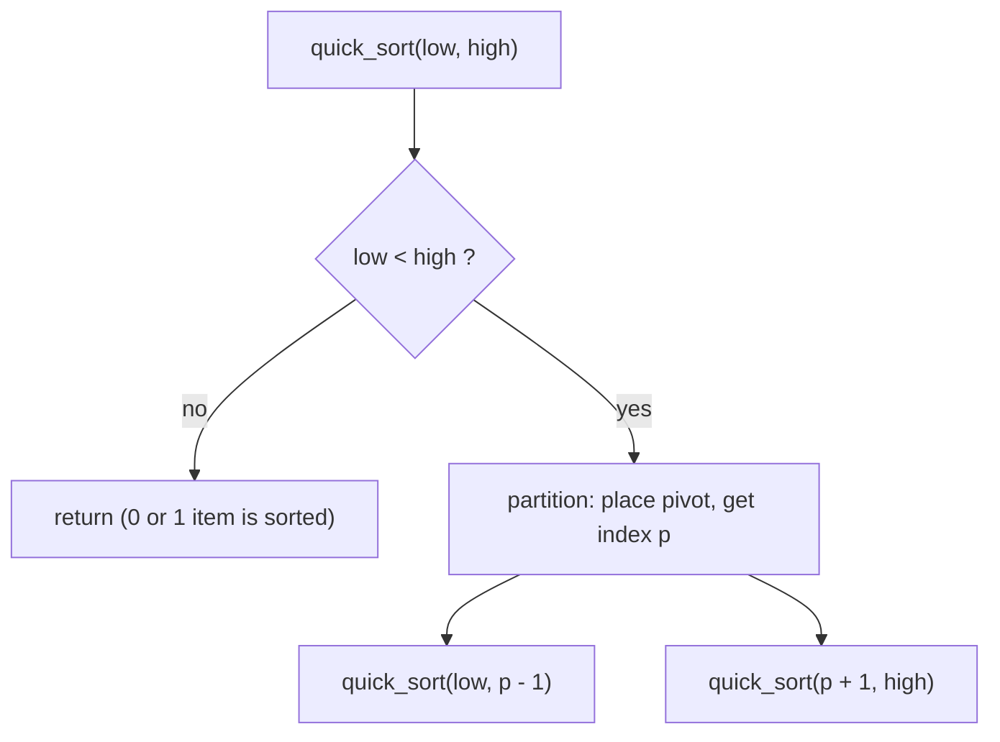

# 15 - Quick Sort

Learn quick sort, the partition-based divide and conquer sort. You will write both classic partition schemes, try different pivot rules, handle duplicates, and reuse the partition idea to find the k-th smallest element.

## Table of Contents
- [A. Topic Introduction](#a-topic-introduction)
- [B. Core Concepts](#b-core-concepts)
- [C. How It Works](#c-how-it-works)
- [D. Time and Space Complexity](#d-time-and-space-complexity)
- [E. Problems for Practice](#e-problems-for-practice)
- [F. Installation Requirements](#f-installation-requirements)
- [G. How to Run the Files](#g-how-to-run-the-files)
- [H. Revision Notes](#h-revision-notes)

---

## A. Topic Introduction

**What it is.** Quick sort is a divide and conquer sorting algorithm. It picks one element called the **pivot**, rearranges the list so smaller items sit on the left of the pivot and larger items on the right (this step is called **partitioning**), and then repeats the same idea on the left and right parts. It sorts in place, so it needs almost no extra memory.

**Why it matters in DSA.** Quick sort is the practical default behind many library sorts: it is very fast on average (`O(n log n)`), cache friendly, and the partition step is reused by other algorithms such as Quick Select (k-th smallest element). Interviewers love it because it tests recursion, pointer handling and worst-case reasoning together.

**Where it is used.** Sorting large in-memory arrays, finding medians and percentiles, top-k queries, and the introsort used inside C++ `std::sort`.

**Everyday analogy.** Sorting a pile of exam papers by marks: pick one paper, put everyone with lower marks on its left and higher marks on its right. That paper is now in its final place. Repeat for each pile.

If you know Laravel: it is like splitting a collection with `partition()` around one value, then calling the same function on each half instead of calling `sortBy()`. Unlike merge sort, the hard work is done on the way down (partitioning), and nothing is merged on the way up.

---

## B. Core Concepts

| Term | Meaning |
|------|---------|
| Pivot | The element used to split the range into small and large parts. |
| Partition | Rearranging a range so that small items are left of the pivot and large items are right of it. |
| Lomuto scheme | One left-to-right scan with a boundary index; pivot is usually the last element. Simple to write. |
| Hoare scheme | Two pointers move toward each other and swap out-of-place pairs. Fewer swaps. |
| Three-way partition | Splits into smaller / equal / greater, so repeated values are not sorted again. |
| Quick Select | Partition and recurse into only ONE side to find the k-th smallest item. |
| In-place | Sorting inside the same list with only a few extra variables. |
| Unstable | Equal items may change their relative order. |

**Key idea.** After one partition the pivot is already in its final sorted position. Only the two sides remain.

**Shape of the recursion**

```text
                [ whole range ]
                 /    pivot    \
        [ smaller ]  p  [ larger ]
          /   \              /   \
       [..] p [..]       [..] p [..]
```

**Good pivot versus bad pivot**

```text
Balanced split  -> depth about log n  -> O(n log n)
  n -> n/2 + n/2 -> n/4 ...

Lopsided split  -> depth about n      -> O(n^2)
  n -> (n-1) + 0 -> (n-2) + 0 ...   (last element pivot on sorted input)
```

**Flow of the algorithm**



---

## C. How It Works

**Dry run 1: Lomuto partition of `[9, 4, 7, 3, 10, 5]`** (pivot = last = 5, `i` = end of the "small" zone, starts at -1)

| j | arr[j] | arr[j] <= 5 ? | action | list after |
|---|--------|---------------|--------|-----------|
| 0 | 9 | no | nothing | `[9, 4, 7, 3, 10, 5]` |
| 1 | 4 | yes | i = 0, swap positions 0 and 1 | `[4, 9, 7, 3, 10, 5]` |
| 2 | 7 | no | nothing | `[4, 9, 7, 3, 10, 5]` |
| 3 | 3 | yes | i = 1, swap positions 1 and 3 | `[4, 3, 7, 9, 10, 5]` |
| 4 | 10 | no | nothing | `[4, 3, 7, 9, 10, 5]` |
| end | - | - | swap pivot into position i + 1 = 2 | `[4, 3, 5, 9, 10, 7]` |

The pivot 5 is now at index 2. Everything left is `<= 5`, everything right is `> 5`. Return 2.

**Dry run 2: Hoare partition of `[5, 3, 8, 4, 2, 7, 1, 10]`** (pivot = first = 5)

```text
left pointer stops at 5 (>= pivot), right pointer stops at 1 (<= pivot) -> swap
[1, 3, 8, 4, 2, 7, 5, 10]
left stops at 8, right stops at 2 -> swap
[1, 3, 2, 4, 8, 7, 5, 10]
left stops at 8 (index 4), right stops at 4 (index 3): pointers crossed -> return 3
```
Left part `[1, 3, 2, 4]` is all `<= 5`, right part `[8, 7, 5, 10]` is all `>= 5`. Note that with Hoare the pivot is not necessarily at the split position; the two parts are simply sorted separately.

**Dry run 3: full quick sort of `[10, 7, 8, 9, 1, 5]`** (Lomuto, last pivot)

```text
[10, 7, 8, 9, 1, 5]   pivot 5 -> [1, 5, 8, 9, 10, 7]   5 is final (index 1)
   left  [1]                     sorted
   right [8, 9, 10, 7] pivot 7 -> [7, 9, 10, 8]         7 is final
        right [9, 10, 8] pivot 8 -> [8, 10, 9]          8 is final
             right [10, 9] pivot 9 -> [9, 10]           done
result: [1, 5, 7, 8, 9, 10]
```

**Dry run 4: why a sorted list hurts a last-element pivot**

`[1, 2, 3, 4, 5]` with pivot 5: every other value is smaller, so the pivot stays at the end and the split is `4 + 0`. Next round the split is `3 + 0`, and so on. That makes `n + (n-1) + ... + 1` comparisons, which is `O(n^2)`. Random or median-of-three pivots break this pattern.

---

## D. Time and Space Complexity

| Variant | Best | Average | Worst | Extra space | Stable? |
|---------|------|---------|-------|-------------|---------|
| Quick sort (Lomuto or Hoare) | O(n log n) | O(n log n) | O(n^2) | O(log n) average stack, O(n) worst | No |
| Randomized pivot | O(n log n) | O(n log n) expected | O(n^2), extremely unlikely | O(log n) expected | No |
| Three-way partition | O(n) with few distinct values | O(n log n) | O(n^2) | O(log n) | No |
| Iterative with explicit stack (smaller side first) | O(n log n) | O(n log n) | O(n^2) | O(log n) | No |
| Quick Select | O(n) | O(n) | O(n^2) | O(1) iterative | - |
| One partition pass | O(n) | O(n) | O(n) | O(1) | - |

**Why the average is `O(n log n)`.** A balanced split halves the range, so there are about `log n` levels and each level partitions about `n` items in total.

**Why the worst case is `O(n^2)`.** If each pivot is the smallest or largest value, one level only removes a single item, giving `n` levels of up to `n` work.

**Compared with Selection Sort** (file 10): selection sort always makes `n(n-1)/2` comparisons, so doubling `n` makes it about 4 times slower. Quick sort grows by only a little over 2 times when `n` doubles.

---

## E. Problems for Practice

| No | Title | Difficulty | Concept | Python File |
|----|-------|------------|---------|-------------|
| 1 | Lomuto Partition | Easy | Partition step with a boundary index | `01_lomuto_partition.py` |
| 2 | Quick Sort with Lomuto Partition | Easy | Recursive quick sort, in place | `02_quick_sort_lomuto.py` |
| 3 | Hoare Partition | Easy | Two pointers moving toward each other | `03_hoare_partition.py` |
| 4 | Quick Sort with Hoare Partition | Easy | Quick sort using Hoare, swap counting | `04_quick_sort_hoare.py` |
| 5 | Pivot Selection Strategies | Medium | First, last and median-of-three pivots | `05_pivot_selection_strategies.py` |
| 6 | Randomized Quick Sort | Medium | Random pivot beats sorted input | `06_randomized_quick_sort.py` |
| 7 | Three-Way Quick Sort | Medium | Smaller / equal / greater partition for duplicates | `07_three_way_quick_sort.py` |
| 8 | Quick Select (k-th Smallest) | Medium | Partition and recurse on one side only | `08_quick_select.py` |
| 9 | Iterative Quick Sort | Medium | Explicit stack instead of recursion | `09_iterative_quick_sort.py` |
| 10 | Quick Sort vs Selection Sort | Medium | Measuring growth of comparisons | `10_quick_sort_vs_selection_sort.py` |

### Problem 1 - Lomuto Partition (`01_lomuto_partition.py`)
**Statement.** Choose the last element as the pivot and rearrange the list in place so everything smaller than or equal to the pivot is on its left and everything larger is on its right. Return the final index of the pivot.

**Example.**
```text
[9, 4, 7, 3, 10, 5] -> [4, 3, 5, 9, 10, 7], pivot index = 2
[5, 4, 3, 2, 1]    -> [1, 4, 3, 2, 5], pivot index = 0
[4, 4, 4, 4]       -> [4, 4, 4, 4], pivot index = 3
```
**Constraints / edge cases.** Single element; pivot is the largest (stays last); pivot is the smallest (moves to the front); many duplicates of the pivot.

**Hints.**
- Keep one index that marks where the small zone ends; start it just before the range.
- Scan once; whenever an item is `<=` pivot, grow the small zone and swap the item into it.
- At the end, swap the pivot into the slot right after the small zone and return that slot.

### Problem 2 - Quick Sort with Lomuto Partition (`02_quick_sort_lomuto.py`)
**Statement.** Sort a list of integers in ascending order, in place, using quick sort with the Lomuto partition. Do not use `sorted()` or `list.sort()`.

**Example.**
```text
[10, 7, 8, 9, 1, 5] -> [1, 5, 7, 8, 9, 10]
[4, -1, 4, 0, -1, 9, 2] -> [-1, -1, 0, 2, 4, 4, 9]
[] -> []
```
**Constraints / edge cases.** Empty list; single element; already sorted (quadratic with a last-element pivot); reverse sorted; all equal; negative numbers.

**Hints.**
- Recursive function takes `low` and `high`; stop when `low >= high`.
- Partition first, then sort the part before the pivot and the part after it.
- Never include the pivot index in either recursive call.

### Problem 3 - Hoare Partition (`03_hoare_partition.py`)
**Statement.** Implement Hoare's partition: use the first element as pivot and move two pointers toward each other, swapping out-of-place pairs, until they cross. Return the split index `j` so that every item up to `j` is `<=` pivot and every item after `j` is `>=` pivot.

**Example.**
```text
[5, 3, 8, 4, 2, 7, 1, 10] -> [1, 3, 2, 4, 8, 7, 5, 10], split after index 3
[2, 1] -> [1, 2], split after index 0
[3, 3, 3, 3] -> [3, 3, 3, 3], split after index 1
```
**Constraints / edge cases.** Two elements; all elements equal (both pointers stop at every item and meet in the middle); already sorted; pivot is the largest value.

**Hints.**
- Left pointer moves right while the item is smaller than the pivot; right pointer moves left while the item is larger.
- Both pointers stop on equal values; this keeps the split balanced for duplicates.
- When the pointers meet or cross, return the right pointer; otherwise swap and continue.

### Problem 4 - Quick Sort with Hoare Partition (`04_quick_sort_hoare.py`)
**Statement.** Sort a list in place using quick sort built on Hoare's partition. Compare the number of swaps with the Lomuto version on the same data.

**Example.**
```text
[29, 10, 14, 37, 13, 5, 21, 8] -> [5, 8, 10, 13, 14, 21, 29, 37]  hoare swaps=8, lomuto swaps=9
[9, 8, 7, 6, 5, 4, 3, 2, 1] -> sorted  hoare swaps=4, lomuto swaps=24
```
**Constraints / edge cases.** Empty list; single element; two elements; all equal elements; duplicates.

**Hints.**
- With Hoare the recursion is on `low..j` and `j+1..high` (the pivot is not excluded).
- Count a swap each time two items are exchanged, in both versions.
- Hoare usually swaps fewer items than Lomuto, especially on reversed data.

### Problem 5 - Pivot Selection Strategies (`05_pivot_selection_strategies.py`)
**Statement.** Implement quick sort with three pivot rules (first element, last element, median of three) and compare their comparison counts on random, ascending and descending data of the same size.

**Example.**
```text
n = 200 comparisons
input       first   last  median3
random       1661   1518    1380
ascending   19900  19900    1153
descending  19900  19900    1786
```
**Constraints / edge cases.** Ranges with 1 or 2 elements; all equal elements; pivot already at the end. Keep input small so the lopsided case stays within Python's recursion limit.

**Hints.**
- Median of three means the middle value among first, middle and last items.
- Move the chosen pivot to the position your partition expects (for Lomuto, the end) before partitioning.
- Count one comparison for every item compared with the pivot.

### Problem 6 - Randomized Quick Sort (`06_randomized_quick_sort.py`)
**Statement.** Sort a list in place with quick sort that chooses its pivot at random. Show it handles sorted and reverse-sorted data without the `O(n^2)` slowdown of a fixed last-element pivot by comparing the deepest recursion level.

**Example.**
```text
Deepest recursion level
input        fixed pivot  random pivot
ascending            399            17
descending           399            17
[9, 3, 7, 3, 1, 8, 2] -> [1, 2, 3, 3, 7, 8, 9]
```
**Constraints / edge cases.** Empty list; one element; all equal elements (still quadratic with plain Lomuto, see problem 7); already sorted; reversed. Use a seeded generator so output is repeatable.

**Hints.**
- Pick a random index in the range, swap that item to the pivot position, then run the usual partition.
- Track recursion depth with an extra argument to see the balance.
- Seed the random generator so each run prints the same result.

### Problem 7 - Three-Way Quick Sort (`07_three_way_quick_sort.py`)
**Statement.** Sort a list with many repeated values in place using three-way partitioning (smaller than, equal to, greater than the pivot). Compare its comparison count with the plain Lomuto version.

**Example.**
```text
[4, 9, 4, 4, 1, 9, 4, 4, 1, 4] -> [1, 1, 4, 4, 4, 4, 4, 4, 9, 9]
few distinct: three-way=297, lomuto=3923
all equal   : three-way=149, lomuto=11175
```
**Constraints / edge cases.** Empty list; single element; all equal (one pass, no deeper recursion); only two distinct values; already sorted.

**Hints.**
- Keep three pointers: end of the smaller zone, current item, start of the greater zone.
- Equal items are simply skipped over; they never move again.
- Recurse only on the smaller and greater zones, never on the equal zone.

### Problem 8 - Quick Select (k-th Smallest) (`08_quick_select.py`)
**Statement.** Find the k-th smallest element of an unsorted list (`k = 1` is the minimum) without sorting the whole list, by reusing the partition step and continuing into only one side.

**Example.**
```text
[7, 10, 4, 3, 20, 15]
k=1 -> 3
k=3 -> 7
k=6 -> 20
```
**Constraints / edge cases.** `k < 1` or `k > n` raises `ValueError`; empty list raises `ValueError`; duplicates count separately; single element.

**Hints.**
- After partitioning, compare the pivot's final index with `k - 1`.
- If equal, you are done; if `k - 1` is smaller go left, otherwise go right.
- Work on a copy so the caller's list is not rearranged.

### Problem 9 - Iterative Quick Sort (`09_iterative_quick_sort.py`)
**Statement.** Sort a list in place with quick sort without recursion: keep pending `(low, high)` ranges on a stack you manage yourself. Process the smaller side first so the stack never holds more than `O(log n)` ranges.

**Example.**
```text
[10, 7, 8, 9, 1, 5, 3, 6] -> [1, 3, 5, 6, 7, 8, 9, 10] (max stack size 3)
```
**Constraints / edge cases.** Empty list; single element; sorted and reverse-sorted data; duplicates; ranges of size 0 or 1 are skipped.

**Hints.**
- Push the whole range, then loop while the stack is not empty.
- After partitioning, push the larger side first and the smaller side last so the smaller side is popped next.
- Skip ranges with fewer than two items instead of pushing them.

### Problem 10 - Quick Sort vs Selection Sort (`10_quick_sort_vs_selection_sort.py`)
**Statement.** Count the comparisons made by Selection Sort (always `n(n-1)/2`) and by quick sort with a median-of-three pivot for growing input sizes, and show how the gap widens when `n` doubles. Use a hand-written deterministic data generator.

**Example.**
```text
   n  selection  quick  ratio
  50       1225    212    5.8
 100       4950    550    9.0
 200      19900   1329   15.0
growth when n doubles: selection about x4, quick about x2.5
```
**Constraints / edge cases.** Empty list (zero comparisons); single element; all equal values (quick sort degrades toward `O(n^2)` here).

**Hints.**
- Selection sort finds the smallest of the remaining items each round; count every comparison.
- Use a simple formula-based generator (for example a linear congruential one) so the data is identical on every run.
- Divide the two counts to print the ratio and compare the count at `n` with the count at `n / 2`.

---

## F. Installation Requirements

| Item | Requirement |
|------|-------------|
| Python version | Python 3.8 or newer |
| Packages | None. Standard library only |
| Extra installation | Nothing to install beyond Python itself |

Check your installation with `python --version` (see section G).

---

## G. How to Run the Files

1. Open a terminal: **Windows** - press `Win + R`, type `cmd` (or open PowerShell / VS Code terminal). **Linux/macOS** - open Terminal.
2. Verify Python:
   ```bash
   python --version      # Windows (or: py --version)
   python3 --version     # Linux / macOS
   ```
3. Move into the topic folder and run a file.

**Windows**
```bash
cd Python-DSA-Practice\15-Quick-Sort
python 01_lomuto_partition.py
```
If `python` is not recognised, use the Python launcher: `py 01_lomuto_partition.py`.

**Linux / macOS**
```bash
cd Python-DSA-Practice/15-Quick-Sort
python3 01_lomuto_partition.py
```

Every file is a standalone program: it needs no other file and no internet.

---

## H. Revision Notes

**Key concepts**
- Partition places the pivot in its final position; recursion handles both sides.
- Lomuto: one scan, simple, more swaps. Hoare: two pointers, fewer swaps, careful with the returned index.
- Pivot choice decides the speed: balanced splits give `O(n log n)`, lopsided ones give `O(n^2)`.
- Randomized, median-of-three and three-way versions fix the common bad inputs.
- Quick Select reuses partition to find the k-th item in average `O(n)`.
- Quick sort is in place but not stable.

**Common mistakes**
- Including the pivot again in a recursive call (infinite recursion or wrong result).
- Mixing up the Lomuto and Hoare return values and recursion ranges.
- Using a plain last-element pivot on sorted data and hitting `O(n^2)` and the recursion limit.
- Forgetting that all-equal data is bad for two-way partitioning.
- Off-by-one on the boundary index (`i` starts at `low - 1`, pivot goes to `i + 1`).
- Using `sorted()` inside the algorithm instead of writing the partition.

**Interview tips**
- State the pivot rule first, then give average and worst case with the reason.
- Mention space: in place, but recursion stack is `O(log n)` average and `O(n)` worst; recurse on the smaller side to cap it.
- Know when to prefer merge sort: need stability or guaranteed `O(n log n)`.
- For "k-th largest" questions say Quick Select first (average `O(n)`), then mention a heap as the safe alternative.
- Be ready to write the Lomuto partition from memory in under two minutes.
