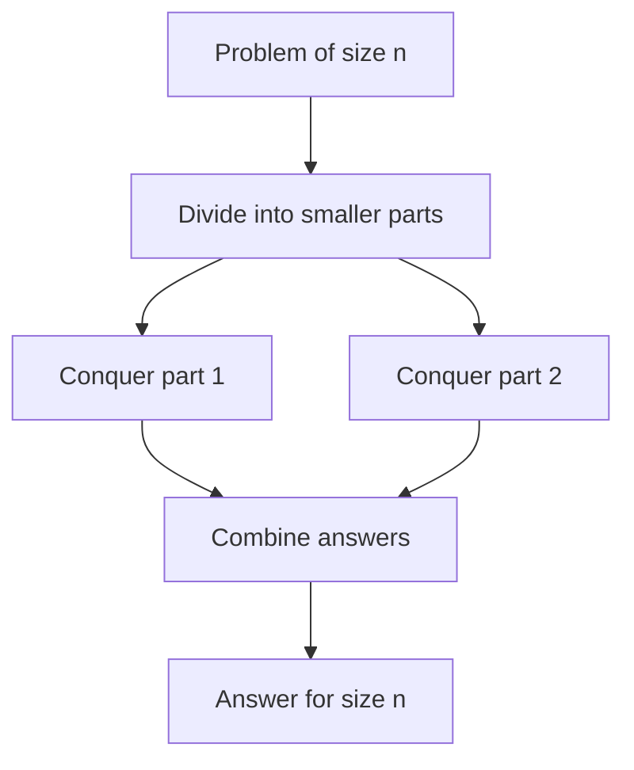

# 16 - Divide and Conquer

Learn the divide, conquer and combine pattern through ten classic problems, from binary search to Strassen matrix multiplication. Each program is a standalone file with a worked explanation in its docstring.

## Table of Contents
- [A. Topic Introduction](#a-topic-introduction)
- [B. Core Concepts](#b-core-concepts)
- [C. How It Works](#c-how-it-works)
- [D. Time and Space Complexity](#d-time-and-space-complexity)
- [E. Problems for Practice](#e-problems-for-practice)
- [F. Installation Requirements](#f-installation-requirements)
- [G. How to Run the Files](#g-how-to-run-the-files)
- [H. Revision Notes](#h-revision-notes)

---

## A. Topic Introduction

**What it is.** Divide and conquer solves a big problem in three moves: **divide** it into smaller copies of the same problem, **conquer** each copy (usually by recursion), and **combine** the small answers into the final answer. When a piece becomes tiny (a base case) it is solved directly.

**Why it matters in DSA.** Many of the fastest known algorithms use this pattern: binary search, merge sort, quick sort, fast exponentiation, Karatsuba multiplication and Strassen matrix multiplication. It turns a hard problem into a recurrence that you can analyse with simple rules.

**Where it is used.** Searching sorted data, large number arithmetic in cryptography, matrix and graphics computations, geometry (closest points), and parallel processing, because the halves are independent.

**Everyday analogy.** Counting votes in a big election: each booth counts its own ballots (conquer), districts add up booths, states add up districts (combine). No single person counts everything.

If you know Laravel: it is like using `$collection->chunk()` to split a huge list, processing each chunk with the same function, and then merging the results with `reduce()`.

---

## B. Core Concepts

| Term | Meaning |
|------|---------|
| Divide | Split the input into smaller subproblems of the same kind. |
| Conquer | Solve each subproblem, usually recursively. |
| Combine | Merge subproblem answers into the answer for the whole input. |
| Base case | A subproblem so small that the answer is immediate (empty list, one element). |
| Recurrence | A formula such as `T(n) = 2T(n/2) + n` that counts the work. |
| Master theorem | Shortcut to read the Big O from a recurrence `T(n) = aT(n/b) + f(n)`. |
| Recursion depth | How many nested calls are open at once; it decides stack space. |

**The pattern**

```text
solve(problem)
    if problem is small:        return direct answer      # base case
    left,  right = split(problem)                         # divide
    a = solve(left)                                       # conquer
    b = solve(right)                                      # conquer
    return combine(a, b)                                  # combine
```

**Recursion tree for `n = 8` halving twice per level**

```text
level 0:                 [ 8 ]                  1 problem  of size 8
level 1:         [ 4 ]           [ 4 ]          2 problems of size 4
level 2:      [2]    [2]      [2]    [2]        4 problems of size 2
level 3:     [1][1] [1][1]   [1][1] [1][1]      8 problems of size 1
```

**Flow**



**Three shapes of divide and conquer in this folder**
- Throw one half away: binary search, peak finding, quickselect, fast power (only one half is solved).
- Solve both halves and combine: max/min, majority element, maximum subarray, closest pair.
- Fewer sub-multiplications than the obvious method: Karatsuba (3 instead of 4), Strassen (7 instead of 8).

---

## C. How It Works

**Dry run 1: binary search for 23 in `[2, 5, 8, 12, 16, 23, 38, 56, 72, 91]`**

| low | high | mid | data[mid] | decision |
|-----|------|-----|-----------|----------|
| 0 | 9 | 4 | 16 | 16 < 23, search right half |
| 5 | 9 | 7 | 56 | 56 > 23, search left half |
| 5 | 6 | 5 | 23 | found, return 5 |

Three calls for ten items: the range shrinks 10, 5, 2.

**Dry run 2: fast power `3 ** 13`**

```text
power(3, 13): 13 is odd  -> 3 * power(3, 12)
power(3, 12): 12 is even -> half = power(3, 6); half * half
power(3, 6) : half = power(3, 3); half * half
power(3, 3) : odd  -> 3 * power(3, 2)
power(3, 2) : half = power(3, 1) = 3 -> 9
power(3, 3) = 27, power(3, 6) = 729, power(3, 12) = 531441, power(3, 13) = 1594323
```
About 6 multiplications instead of 12.

**Dry run 3: maximum subarray, the crossing case**

Split `[1, -2, 3, 4 | -1, 2, -5, 1]` in the middle. The best subarray is either entirely left, entirely right, or crosses the middle.
- Best sum ending at the middle going left: `4, 7, 5, 6` so the best is 7.
- Best sum starting just after the middle going right: `-1, 1, -4, -3` so the best is 1.
- Crossing sum = 7 + 1 = 8 (the subarray `[3, 4, -1, 2]`). Compare with the left and right answers and keep the biggest.

**Dry run 4: Karatsuba for `12 * 34`**

Split each number: `12 = 1*10 + 2`, `34 = 3*10 + 4`.
```text
ac = 1 * 3 = 3
bd = 2 * 4 = 8
(a + b)(c + d) = 3 * 7 = 21
middle = 21 - ac - bd = 10
result = ac * 100 + middle * 10 + bd = 300 + 100 + 8 = 408
```
Only 3 multiplications instead of 4.

**Dry run 5: Strassen on 2x2 matrices** (`A = [[1,2],[3,4]]`, `B = [[5,6],[7,8]]`)

Seven products: `M1 = (1+4)(5+8) = 65`, `M2 = (3+4)*5 = 35`, `M3 = 1*(6-8) = -2`, `M4 = 4*(7-5) = 8`, `M5 = (1+2)*8 = 24`, `M6 = (3-1)(5+6) = 22`, `M7 = (2-4)(7+8) = -30`.
Combine: top-left `M1+M4-M5+M7 = 19`, top-right `M3+M5 = 22`, bottom-left `M2+M4 = 43`, bottom-right `M1-M2+M3+M6 = 50`, matching `[[19, 22], [43, 50]]`.

**Dry run 6: peak element in `[1, 3, 20, 4, 1, 0]`**

Look at the middle item and its right neighbour. If the right neighbour is bigger, a peak must exist on the right; otherwise one must exist at the middle or on the left. Middle `20` is bigger than its right neighbour `4`, so the answer is at or left of it; the search narrows to index 2 and returns 20.

---

## D. Time and Space Complexity

| Problem | Recurrence | Time | Extra space |
|---------|------------|------|-------------|
| Binary search | T(n) = T(n/2) + 1 | O(log n) | O(log n) recursive, O(1) loop |
| Max and min | T(n) = 2T(n/2) + 2 | O(n) (about 3n/2 comparisons) | O(log n) |
| Fast power | T(e) = T(e/2) + 1 | O(log e) | O(log e) recursive, O(1) loop |
| Peak element | T(n) = T(n/2) + 1 | O(log n) | O(1) iterative |
| Majority element | T(n) = 2T(n/2) + n | O(n log n) | O(log n) |
| Maximum subarray | T(n) = 2T(n/2) + n | O(n log n) | O(log n) |
| Quickselect | T(n) = T(n/2) + n (average) | O(n) average, O(n^2) worst | O(n) copy plus O(log n) |
| Karatsuba | T(n) = 3T(n/2) + n | O(n^1.585) | O(n) |
| Closest pair | T(n) = 2T(n/2) + n | O(n log n) textbook; this teaching version can reach O(n^2) | O(n) |
| Strassen | T(n) = 7T(n/2) + n^2 | O(n^2.807) | O(n^2) |

**Reading a recurrence quickly**
- One half kept, constant work: `log n` (binary search).
- Both halves, linear combine: `n log n` (merge-sort style).
- Both halves, constant combine: `n` (max and min).
- Fewer than 4 (or 8) subcalls than the obvious method gives a lower exponent (Karatsuba, Strassen).

**Space.** Recursion uses one stack frame per level, so a halving recursion costs `O(log n)` stack. Python's default limit (about 1000 frames) is never a problem for halving, but would be for linear recursion.

---

## E. Problems for Practice

| No | Title | Difficulty | Concept | Python File |
|----|-------|------------|---------|-------------|
| 1 | Binary Search as Divide and Conquer | Easy | Halve the range, solve one half | `01_binary_search.py` |
| 2 | Max and Min by Divide and Conquer | Easy | Both halves, combine two pairs | `02_max_min_divide_conquer.py` |
| 3 | Fast Power | Easy | Exponentiation by squaring | `03_fast_power.py` |
| 4 | Find a Peak Element | Easy | Compare neighbours to choose a half | `04_find_peak_element.py` |
| 5 | Majority Element | Medium | Candidate from halves, verify by counting | `05_majority_element.py` |
| 6 | Maximum Subarray Sum | Medium | Left, right and crossing sums | `06_maximum_subarray.py` |
| 7 | k-th Smallest with Quickselect | Medium | Partition and keep one side | `07_quickselect_kth_smallest.py` |
| 8 | Karatsuba Multiplication | Medium | Three sub-multiplications instead of four | `08_karatsuba_multiplication.py` |
| 9 | Closest Pair of Points | Medium | Split by x, check the middle strip | `09_closest_pair_of_points.py` |
| 10 | Strassen Matrix Multiplication | Medium | Seven block products instead of eight | `10_strassen_matrix_multiplication.py` |

### Problem 1 - Binary Search as Divide and Conquer (`01_binary_search.py`)
**Statement.** Given a sorted list and a target, return the target's index or -1. Solve it by recursively halving the search range, then compare with a loop-based version.

**Example.**
```text
data = [2, 5, 8, 12, 16, 23, 38, 56, 72, 91]
search 23 -> 5
search 7 -> -1
empty list -> -1
```
**Constraints / edge cases.** Empty list; single element; target smaller than all; target larger than all; target at the first or last position.

**Hints.**
- Define a range `[low, high]`; if `low > high` the range is empty so return -1.
- Compute the middle with integer division and compare it with the target.
- Recurse into only one half; there is nothing to combine.

### Problem 2 - Max and Min by Divide and Conquer (`02_max_min_divide_conquer.py`)
**Statement.** Find both the largest and smallest element of a list by splitting it in two halves, solving each half recursively and combining. Do not use the built-in `max()` or `min()`. Also count comparisons and compare with a simple scan.

**Example.**
```text
[34, 7, 23, 32, 5, 62, 32, 8, -4, 19]
divide and conquer: min=-4, max=62, comparisons=14
simple scan       : min=-4, max=62, comparisons=18
```
**Constraints / edge cases.** Empty list (raise `ValueError`); one element; two elements; all equal; negative numbers; odd length.

**Hints.**
- Base cases are one element (min = max = that element) and two elements (one comparison).
- Combine by comparing the two halves' minimums and the two halves' maximums.
- Return the pair `(min, max)` from every call.

### Problem 3 - Fast Power (`03_fast_power.py`)
**Statement.** Compute `base ** exp` using `O(log exp)` multiplications. Also support a modulus (compute `base ** exp % mod` without huge numbers) and negative exponents for float results.

**Example.**
```text
2 ** 10 = 1024
3 ** 13 = 1594323
2 ** -3 = 0.125
7 ** 128 % 13 = 3
```
**Constraints / edge cases.** `exp = 0` gives 1 (even for base 0); base 0 or 1; negative exponent (use the reciprocal); `mod = 1` gives 0.

**Hints.**
- Compute the power of half the exponent once, then square it.
- If the exponent is odd, multiply by the base one extra time.
- Apply the modulus after every multiplication so numbers stay small.

### Problem 4 - Find a Peak Element (`04_find_peak_element.py`)
**Statement.** A peak is an element strictly greater than its neighbours (outside the list counts as negative infinity). Given a list where adjacent elements differ, return the index of ANY peak in `O(log n)` time.

**Example.**
```text
[1, 3, 20, 4, 1, 0] -> peak at index 2 (value 20)
[1, 2, 3, 4, 5] -> peak at index 4
[9, 5, 2, 1] -> peak at index 0
```
**Constraints / edge cases.** Single element; strictly increasing (peak at last); strictly decreasing (peak at first); several peaks (any is fine); empty list.

**Hints.**
- Look at the middle item and its right neighbour.
- If the right neighbour is bigger, a peak exists on the right side; otherwise on the middle or left side.
- Keep shrinking until the range is a single index.

### Problem 5 - Majority Element (`05_majority_element.py`)
**Statement.** Given a list, return the element that appears MORE than `n/2` times, or `None` if there is none. Use divide and conquer.

**Example.**
```text
[2, 2, 1, 1, 1, 2, 2] -> 2
[3, 3, 4, 2, 4, 4, 2, 4, 4] -> 4
[1, 2, 3, 4] -> None
[1, 1, 2, 2] -> None
```
**Constraints / edge cases.** Empty list; single element; no majority; exactly `n/2` occurrences is NOT a majority; all equal.

**Hints.**
- A majority of the whole list must be a majority in at least one half.
- Find each half's candidate, then count both candidates over the whole range.
- Return the candidate whose count is more than half of the range length.

### Problem 6 - Maximum Subarray Sum (`06_maximum_subarray.py`)
**Statement.** Given a list of integers (positive and negative), find the largest sum of any non-empty contiguous subarray using divide and conquer.

**Example.**
```text
[-2, 1, -3, 4, -1, 2, 1, -5, 4] -> 6
[5, 4, -1, 7, 8] -> 23
[-8, -3, -6, -2, -5] -> -2
```
**Constraints / edge cases.** All negative (answer is the largest single element); single element; all positive; zeros; empty list (error).

**Hints.**
- The best subarray lies entirely in the left half, entirely in the right half, or crosses the middle.
- For the crossing case grow outward from the middle in each direction and remember the best running sum.
- Return the largest of the three values.

### Problem 7 - k-th Smallest with Quickselect (`07_quickselect_kth_smallest.py`)
**Statement.** Find the k-th smallest element (1-based) of an unsorted list without sorting the whole list.

**Example.**
```text
[7, 10, 4, 3, 20, 15]
k=1 -> 3
k=3 -> 7
k=6 -> 20
```
**Constraints / edge cases.** `k` out of range (raise `ValueError`); duplicates; single element; already sorted input; `k = 1` and `k = n`.

**Hints.**
- Partition around a pivot and look at where the pivot lands.
- If its position is the wanted rank you are done; otherwise recurse into the side that contains the rank.
- Rank numbers shift when you go to the right side; keep track of them carefully.

### Problem 8 - Karatsuba Multiplication (`08_karatsuba_multiplication.py`)
**Statement.** Multiply two non-negative integers using Karatsuba's method, which needs only three recursive multiplications of half-sized numbers instead of four.

**Example.**
```text
1234 * 5678 = 7006652
12 * 34 = 408
99999 * 99999 = 9999800001
0 * 777 = 0
```
**Constraints / edge cases.** Zero operands; single-digit operands (use direct multiplication as base case); different lengths; powers of ten; very large numbers.

**Hints.**
- Split both numbers at the same digit position into a high and a low part (x = a, b and y = c, d).
- Compute `a*c` (high parts), `b*d` (low parts) and `(a+b)*(c+d)` (sum of the parts of each number) recursively.
- The middle term is the third product minus the first two; recombine with powers of ten.

### Problem 9 - Closest Pair of Points (`09_closest_pair_of_points.py`)
**Statement.** Given points in the plane, find the pair with the smallest Euclidean distance using divide and conquer rather than checking every pair.

**Example.**
```text
[(2, 3), (12, 30), (40, 50), (5, 1), (12, 10), (3, 4)]
closest pair: (2, 3) and (3, 4), distance = 1.4142
duplicates (1, 1) and (1, 1): distance = 0.0
```
**Constraints / edge cases.** Fewer than two points (error); duplicate points (distance 0); points with the same x; collinear points.

**Hints.**
- Sort by x, split in the middle, find the best distance `d` in each half.
- Only points within `d` of the dividing line can form a closer crossing pair.
- Inside that strip order points by y; each point only needs comparing with a few following ones.

### Problem 10 - Strassen Matrix Multiplication (`10_strassen_matrix_multiplication.py`)
**Statement.** Multiply two `n x n` matrices (`n` a power of two) with Strassen's algorithm, which uses 7 recursive block multiplications instead of 8.

**Example.**
```text
A = [[1, 2], [3, 4]], B = [[5, 6], [7, 8]]
result = [[19, 22], [43, 50]]
Strassen matches classic multiplication on a 4 x 4 case
```
**Constraints / edge cases.** 1 x 1 matrices (base case); sizes that are not a power of two (rejected; padding with zeros is the usual fix); identity and zero matrices; negative entries.

**Hints.**
- Split each matrix into four equal blocks.
- Form seven products from sums and differences of blocks, then combine them with additions and subtractions.
- Check your result against the ordinary triple-loop multiplication.

---

## F. Installation Requirements

| Item | Requirement |
|------|-------------|
| Python version | Python 3.8 or newer |
| Packages | None. Standard library only |
| Extra installation | Nothing to install beyond Python itself |

Check your installation with `python --version` (see section G).

---

## G. How to Run the Files

1. Open a terminal: **Windows** - press `Win + R`, type `cmd` (or open PowerShell / VS Code terminal). **Linux/macOS** - open Terminal.
2. Verify Python:
   ```bash
   python --version      # Windows (or: py --version)
   python3 --version     # Linux / macOS
   ```
3. Move into the topic folder and run a file.

**Windows**
```bash
cd Python-DSA-Practice\16-Divide-and-Conquer
python 01_binary_search.py
```
If `python` is not recognised, use the Python launcher: `py 01_binary_search.py`.

**Linux / macOS**
```bash
cd Python-DSA-Practice/16-Divide-and-Conquer
python3 01_binary_search.py
```

Every file is a standalone program: it needs no other file and no internet.

---

## H. Revision Notes

**Key concepts**
- Divide, conquer, combine; always define the base case first.
- Count the work with a recurrence; halving with constant work is `log n`, halving with linear work is `n log n`.
- Some problems discard a half (binary search, peak, quickselect); others need a real combine step.
- Reducing the number of sub-calls (Karatsuba 3, Strassen 7) lowers the exponent.
- Recursion costs stack space equal to the depth.

**Common mistakes**
- Missing or wrong base case (infinite recursion, or empty list crashes).
- Overlapping halves or dropping the middle element when splitting.
- Computing the midpoint wrongly or using `/` instead of integer division `//`.
- Forgetting the crossing case in maximum subarray and closest pair.
- Treating exactly `n/2` occurrences as a majority.
- Using the built-in `max()`/`min()` in place of the algorithm being taught.

**Interview tips**
- Write the recurrence aloud, then read off the complexity.
- Say whether it is "throw half away" or "solve both halves" up front.
- Mention that binary search is divide and conquer with no combine step.
- For majority element, mention the `O(n)` Boyer-Moore alternative; for maximum subarray, mention Kadane's `O(n)` algorithm.
- Always state recursion stack space as part of space complexity.
