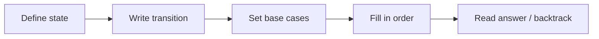

# 17 - Dynamic Programming

Learn dynamic programming: remember answers to subproblems instead of recomputing them. Ten classic problems take you from Fibonacci to knapsack, subsequences and grid paths, using both memoization and tabulation.

## Table of Contents
- [A. Topic Introduction](#a-topic-introduction)
- [B. Core Concepts](#b-core-concepts)
- [C. How It Works](#c-how-it-works)
- [D. Time and Space Complexity](#d-time-and-space-complexity)
- [E. Problems for Practice](#e-problems-for-practice)
- [F. Installation Requirements](#f-installation-requirements)
- [G. How to Run the Files](#g-how-to-run-the-files)
- [H. Revision Notes](#h-revision-notes)

---

## A. Topic Introduction

**What it is.** Dynamic programming (DP) solves a problem by breaking it into overlapping subproblems, solving each subproblem only once, and storing the answer so it is never recomputed. Two styles exist: **top-down** (recursion plus a cache, called memoization) and **bottom-up** (fill a table from the smallest case upward, called tabulation).

**Why it matters in DSA.** DP turns exponential brute force into polynomial time. It is one of the most tested interview topics: stairs, coins, knapsack, subsequences and grid paths all follow the same recipe.

**Where it is used.** Route and cost optimisation, text diff tools (longest common subsequence), spell-checkers, resource allocation and budgeting, scheduling, and bioinformatics sequence alignment.

**Everyday analogy.** Writing the answer to a hard sum on the margin of your notebook so you can copy it next time instead of working it out again.

If you know Laravel: memoization is just `Cache::remember($key, fn () => compute())`, and tabulation is filling an array by looping from the base case. Same idea, but the cache lives inside one function call.

**Recipe for a DP problem**
1. Define the state: what does `dp[i]` (or `dp[i][j]`) mean in plain words?
2. Write the transition: how does a state come from smaller states?
3. Set the base cases.
4. Choose the order that fills smaller states first.
5. Read the answer from the right cell; optionally backtrack to rebuild the choice.

---

## B. Core Concepts

| Term | Meaning |
|------|---------|
| Overlapping subproblems | The same smaller question is asked many times (for example `fib(3)` inside `fib(5)` and `fib(4)`). |
| Optimal substructure | The best answer to the whole is built from the best answers to its parts. |
| State | The few numbers that describe a subproblem (index, remaining amount, ...). |
| Transition | The formula linking a state to smaller states. |
| Memoization | Top-down: recursion plus a dictionary or list cache. |
| Tabulation | Bottom-up: fill a table in order, no recursion. |
| Space optimisation | Keep only the rows or variables still needed. |
| Backtracking the table | Walking back through the table to find which choices gave the best value. |
| Pseudo-polynomial | Time depends on a numeric value (such as the capacity `W`) rather than on the input length. |

**Plain recursion versus DP (Fibonacci)**

```text
fib(5)
 |-- fib(4)
 |    |-- fib(3)  <- computed
 |    `-- fib(2)
 `-- fib(3)       <- computed AGAIN
```
With a cache each `fib(k)` is computed once, so the tree collapses into a straight line of `n` steps.

**Typical DP shapes in this folder**

```text
1-D line      : dp[i]              Fibonacci, stairs, house robber, coins, LIS
2-D table     : dp[i][j]           knapsack (items x capacity), LCS (a x b), grid paths
boolean table : dp[i][s] = True?   subset sum
```

**Flow**



---

## C. How It Works

**Dry run 1: House Robber, money `[2, 7, 9, 3, 1]`** (`dp[i]` = best total using the first `i` houses; `dp[i] = best(dp[i-1], dp[i-2] + money[i-1])`)

| i | house value | skip it: dp[i-1] | take it: dp[i-2] + value | dp[i] |
|---|-------------|------------------|--------------------------|-------|
| 0 | - | - | - | 0 |
| 1 | 2 | 0 | 0 + 2 | 2 |
| 2 | 7 | 2 | 0 + 7 | 7 |
| 3 | 9 | 7 | 2 + 9 | 11 |
| 4 | 3 | 11 | 7 + 3 | 11 |
| 5 | 1 | 11 | 11 + 1 | 12 |

Table `[0, 2, 7, 11, 11, 12]`, answer 12 (houses 0, 2 and 4).

**Dry run 2: fewest coins, coins `[1, 5, 6, 9]`, amount 11** (`dp[a]` = fewest coins to make `a`)

```text
a:   0 1 2 3 4 5 6 7 8 9 10 11
dp:  0 1 2 3 4 1 1 2 3 1  2  2
```
`dp[11] = min(dp[10]+1, dp[6]+1, dp[5]+1, dp[2]+1) = 2` (coins 5 and 6). A greedy choice would take 9 first and end with 3 coins (9, 1, 1), so greedy fails here and DP is needed.

**Dry run 3: 0/1 Knapsack, weights `[1, 3, 4, 5]`, values `[1, 4, 5, 7]`, capacity 7**

```text
capacity:       0  1  2  3  4  5  6  7
no items        0  0  0  0  0  0  0  0
item 1 (1,1)    0  1  1  1  1  1  1  1
item 2 (3,4)    0  1  1  4  5  5  5  5
item 3 (4,5)    0  1  1  4  5  6  6  9
item 4 (5,7)    0  1  1  4  5  7  8  9
```
Each cell: `max(cell above, value + cell above at capacity - weight)`. Best value 9, taking the items of weight 3 and 4.

**Dry run 4: Longest Common Subsequence of `"ABCBDAB"` and `"BDCABA"`**

If the letters match: `dp[i][j] = dp[i-1][j-1] + 1`. If not: `dp[i][j] = best(dp[i-1][j], dp[i][j-1])`. The bottom-right cell is 4. Walk back from it: on a match record the letter and move diagonally; otherwise move toward the larger neighbour. One answer is `"BCBA"`.

**Dry run 5: Coin change ways, coins `[1, 2, 5]`, amount 5**

Process one coin at a time (outer loop over coins gives combinations, not orderings).
```text
amount:        0 1 2 3 4 5
start:         1 0 0 0 0 0
after coin 1:  1 1 1 1 1 1
after coin 2:  1 1 2 2 3 3
after coin 5:  1 1 2 2 3 4
```
Answer 4: `1+1+1+1+1`, `1+1+1+2`, `1+2+2`, `5`.

**Dry run 6: Grid paths with an obstacle, 3 x 3, centre blocked**

```text
1  1  1
1  X  1        each cell = cell above + cell to the left
1  1  2        blocked cell = 0, answer in the bottom-right = 2
```

---

## D. Time and Space Complexity

| Problem | State | Time | Space (table) | Better space |
|---------|-------|------|---------------|--------------|
| Fibonacci | `dp[i]` | O(n) | O(n) | O(1) two variables |
| Climbing stairs | `dp[i]` | O(n * k) for k step sizes | O(n) | O(1) for the classic version |
| House robber | `dp[i]` | O(n) | O(n) | O(1) two variables (value only) |
| Minimum coins | `dp[amount]` | O(amount * coins) | O(amount) | - |
| Coin change ways | `dp[amount]` | O(amount * coins) | O(amount) | - |
| 0/1 knapsack | `dp[item][capacity]` | O(n * W) | O(n * W) | O(W) one row |
| LCS | `dp[i][j]` | O(m * n) | O(m * n) | O(min(m, n)) for length only |
| LIS | `dp[i]` | O(n^2) | O(n) | O(n log n) time with the tails method |
| Grid unique paths | `dp[r][c]` | O(m * n) | O(m * n) | O(n) one row |
| Subset sum | `dp[i][sum]` | O(n * target) | O(n * target) | O(target) |

**Naive versus DP.** Plain Fibonacci recursion is `O(2^n)` (about 2.7 million calls for `n = 30`); memoization makes it `O(n)`. Brute-force knapsack tries all `2^n` subsets; DP needs `n * W` cells.

**Pseudo-polynomial.** Knapsack, subset sum and coin problems depend on the numeric size of the capacity, target or amount. They are fast for small numbers but grow quickly if the target is huge.

---

## E. Problems for Practice

| No | Title | Difficulty | Concept | Python File |
|----|-------|------------|---------|-------------|
| 1 | Fibonacci with Memoization and Tabulation | Easy | Memo, table and space-optimised DP | `01_fibonacci_memo_tabulation.py` |
| 2 | Climbing Stairs | Easy | Counting ways with a 1-D table | `02_climbing_stairs.py` |
| 3 | House Robber | Easy | Take or skip, maximum non-adjacent sum | `03_house_robber.py` |
| 4 | Minimum Number of Coins | Medium | Fewest coins, unbounded choices | `04_minimum_coins.py` |
| 5 | Coin Change - Number of Ways | Medium | Combinations versus ordered sequences | `05_coin_change_ways.py` |
| 6 | 0/1 Knapsack | Medium | 2-D table, take or leave each item | `06_zero_one_knapsack.py` |
| 7 | Longest Common Subsequence | Medium | 2-D table over two strings | `07_longest_common_subsequence.py` |
| 8 | Longest Increasing Subsequence | Medium | O(n^2) DP and O(n log n) tails | `08_longest_increasing_subsequence.py` |
| 9 | Unique Paths in a Grid | Medium | 2-D grid DP with obstacles and costs | `09_grid_unique_paths.py` |
| 10 | Subset Sum and Equal-Sum Partition | Medium | Boolean DP, reachable sums | `10_subset_sum.py` |

### Problem 1 - Fibonacci with Memoization and Tabulation (`01_fibonacci_memo_tabulation.py`)
**Statement.** Compute the n-th Fibonacci number (`F(0)=0`, `F(1)=1`, `F(n)=F(n-1)+F(n-2)`). Show slow plain recursion, then fix it with memoization (top-down), tabulation (bottom-up) and a space-optimised loop.

**Example.**
```text
n=10: naive=55 (177 calls), memo=55, table=55, optimised=55
n=30: 832040, naive needs 2692537 calls
n=90: 2880067194370816120
```
**Constraints / edge cases.** `n = 0` and `n = 1` (base cases); negative `n` rejected; large `n` is exact because Python integers do not overflow.

**Hints.**
- Naive: call yourself for `n-1` and `n-2`; count calls to see the blow-up.
- Memo: check the cache first, store the answer before returning.
- Table and loop: start from the base cases and move upward, keeping only the last two values for the loop.

### Problem 2 - Climbing Stairs (`02_climbing_stairs.py`)
**Statement.** You can climb 1 or 2 steps at a time. In how many distinct ways can you reach step `n`? Then generalise to any step sizes from a given list.

**Example.**
```text
classic: n=2 -> 2, n=3 -> 3, n=5 -> 8, n=10 -> 89
n=6 with steps {1, 3, 4} is also computed
```
**Constraints / edge cases.** `n = 0` has 1 way (do nothing); `n = 1`; step sizes larger than `n`; empty step list gives 0 ways for `n > 0`.

**Hints.**
- The last move was a 1-step or a 2-step, so ways(n) adds two earlier answers.
- For general steps add ways(n - s) for each allowed size `s` that does not go below zero.
- Notice the classic answer is the Fibonacci sequence shifted by one.

### Problem 3 - House Robber (`03_house_robber.py`)
**Statement.** Houses on a street hold some money, and you cannot take from two neighbouring houses. Return the maximum money you can take and which houses give it.

**Example.**
```text
money = [2, 7, 9, 3, 1]
dp table: [0, 2, 7, 11, 11, 12]
maximum 12 from houses [0, 2, 4]
```
**Constraints / edge cases.** Empty street (0); one house; two houses (take the larger); all zeros; equal neighbours.

**Hints.**
- For each house choose the better of skipping it or taking it plus the best from two houses back.
- Keep the full table if you want to rebuild which houses were chosen.
- Walk back from the end: if the value changed at this step, this house was taken.

### Problem 4 - Minimum Number of Coins (`04_minimum_coins.py`)
**Statement.** Given coin denominations (unlimited supply) and a target amount, return the fewest coins that add up to the amount, or -1 if impossible. Also report which coins are used.

**Example.**
```text
coins=[1, 5, 6, 9], amount=11 -> 2 coins [5, 6]
greedy on the same input gives [9, 1, 1]
coins=[2], amount=3 -> -1
```
**Constraints / edge cases.** Amount 0 (0 coins); impossible amount; a coin larger than the amount; a single coin type; coin sets where greedy fails.

**Hints.**
- `dp[a]` is the fewest coins for amount `a`; start with `dp[0] = 0` and everything else as unreachable.
- For each amount try every coin that fits and keep the smallest `dp[a - coin] + 1`.
- Store which coin gave the best value so you can rebuild the list afterwards.

### Problem 5 - Coin Change - Number of Ways (`05_coin_change_ways.py`)
**Statement.** Count how many different COMBINATIONS of coins sum to the amount (`1+2` and `2+1` are the same). Also count ORDERED sequences to see the difference.

**Example.**
```text
coins=[1, 2, 5], amount=5
combinations: 4  ([1,1,1,1,1], [1,1,1,2], [1,2,2], [5])
ordered sequences: 9
```
**Constraints / edge cases.** Amount 0 has exactly 1 way; no coins; coin bigger than the amount; duplicates in the coin list.

**Hints.**
- For combinations loop over coins on the OUTSIDE and amounts on the inside.
- For ordered sequences swap the loops: amounts on the outside, coins inside.
- Base case: one way to make amount 0 (use nothing).

### Problem 6 - 0/1 Knapsack (`06_zero_one_knapsack.py`)
**Statement.** Given items with weights and values and a bag of capacity `W`, choose a subset (each item whole or not at all) with total weight at most `W` and maximum total value. Report the value and the chosen items.

**Example.**
```text
weights [1, 3, 4, 5], values [1, 4, 5, 7], capacity 7
best value: 9
items taken (0-based): [1, 2]
```
**Constraints / edge cases.** Capacity 0; no items; an item heavier than the capacity; all items fit; equal value-to-weight ratios; zero-value items.

**Hints.**
- `dp[i][w]` is the best value using the first `i` items with capacity `w`.
- Either skip item `i` or, if it fits, take it and add its value to the best of the remaining capacity.
- For the 1-D version loop the capacity from high to low so an item is not used twice.

### Problem 7 - Longest Common Subsequence (`07_longest_common_subsequence.py`)
**Statement.** Given two strings, find the length of their longest common subsequence (characters in both, in the same order, not necessarily adjacent) and return one such subsequence.

**Example.**
```text
a = "ABCBDAB", b = "BDCABA"
LCS length: 4
one LCS: BCBA
```
**Constraints / edge cases.** Empty strings; identical strings; no common characters; one string inside the other; repeated characters.

**Hints.**
- `dp[i][j]` is the LCS length of the first `i` letters of `a` and the first `j` letters of `b`.
- Matching letters extend the diagonal cell by one; otherwise take the larger of the cell above and the cell to the left.
- Walk back from the bottom-right cell to rebuild one answer.

### Problem 8 - Longest Increasing Subsequence (`08_longest_increasing_subsequence.py`)
**Statement.** Given a list of integers, find the length of the longest strictly increasing subsequence and one such subsequence.

**Example.**
```text
[10, 9, 2, 5, 3, 7, 101, 18]
LIS length: 4, sequence: [2, 5, 7, 101]
fast O(n log n) length: 4
```
**Constraints / edge cases.** Empty list (0); single element; strictly decreasing (answer 1); all equal (answer 1, increase must be strict); already sorted.

**Hints.**
- `dp[i]` is the length of the best subsequence that ENDS at position `i`.
- Look at every earlier smaller value and extend its best length by one.
- Remember the previous index for each position so you can rebuild the sequence.

### Problem 9 - Unique Paths in a Grid (`09_grid_unique_paths.py`)
**Statement.** A robot starts at the top-left of an `m x n` grid and moves only right or down. Count the paths to the bottom-right. Cells marked 1 are obstacles. Also find the minimum-cost path when each cell has a cost.

**Example.**
```text
3x3 empty grid: 6
7x3 empty grid: 28
3x3 with centre obstacle: 2
blocked start: 0
```
**Constraints / edge cases.** 1 x 1 grid; single row or column; blocked start or end; a wall that cuts the grid.

**Hints.**
- A cell's count is the count above plus the count to its left; an obstacle cell is 0.
- The first row and first column need care because they have only one neighbour.
- For minimum cost add the cell's cost to the cheaper of the two neighbours.

### Problem 10 - Subset Sum and Equal-Sum Partition (`10_subset_sum.py`)
**Statement.** Given non-negative integers and a target, decide whether some subset adds up exactly to the target and return one such subset. Then test whether the list can be split into two parts with equal sums.

**Example.**
```text
numbers [3, 34, 4, 12, 5, 2], target 9 -> subset [4, 5]
target 30 -> None
partition [1, 5, 11, 5] -> True
```
**Constraints / edge cases.** Target 0 is always possible (empty subset); empty list; target larger than the total; a zero in the list; odd total for partition.

**Hints.**
- `dp[i][s]` says whether the first `i` numbers can make sum `s`.
- A sum is reachable if it was reachable without this number, or reachable at `s - number` before it.
- For partition the total must be even; then ask for a subset with half the total.

---

## F. Installation Requirements

| Item | Requirement |
|------|-------------|
| Python version | Python 3.8 or newer |
| Packages | None. Standard library only |
| Extra installation | Nothing to install beyond Python itself |

Check your installation with `python --version` (see section G).

---

## G. How to Run the Files

1. Open a terminal: **Windows** - press `Win + R`, type `cmd` (or open PowerShell / VS Code terminal). **Linux/macOS** - open Terminal.
2. Verify Python:
   ```bash
   python --version      # Windows (or: py --version)
   python3 --version     # Linux / macOS
   ```
3. Move into the topic folder and run a file.

**Windows**
```bash
cd Python-DSA-Practice\17-Dynamic-Programming
python 01_fibonacci_memo_tabulation.py
```
If `python` is not recognised, use the Python launcher: `py 01_fibonacci_memo_tabulation.py`.

**Linux / macOS**
```bash
cd Python-DSA-Practice/17-Dynamic-Programming
python3 01_fibonacci_memo_tabulation.py
```

Every file is a standalone program: it needs no other file and no internet.

---

## H. Revision Notes

**Key concepts**
- DP = overlapping subproblems + optimal substructure + a cache or table.
- Top-down (memoization) is easier to write; bottom-up (tabulation) avoids recursion limits and allows space saving.
- Always say in words what `dp[i]` or `dp[i][j]` means before writing code.
- Greedy can fail where DP works (coins `[1, 5, 6, 9]`).
- Loop order matters: combinations versus ordered sequences, and 0/1 knapsack versus unbounded coins.

**Common mistakes**
- Wrong or missing base case (`dp[0]`).
- Treating an unreachable state as 0 instead of "infinite" in minimum problems.
- Iterating the 1-D knapsack capacity upward (item reused several times).
- Swapping the coin and amount loops and counting the wrong thing.
- Off-by-one between 0-based items and 1-based table rows.
- Returning the table value but forgetting to backtrack when the actual items are asked for.

**Interview tips**
- Start with the brute-force recursion, point out repeated work, then add the cache.
- Give the state, transition and base case out loud before coding.
- Mention the space-optimised version (two variables or one row) as a follow-up.
- Know the standard pair: LIS in `O(n^2)` and in `O(n log n)`.
- Say "pseudo-polynomial" when discussing knapsack and subset sum.
